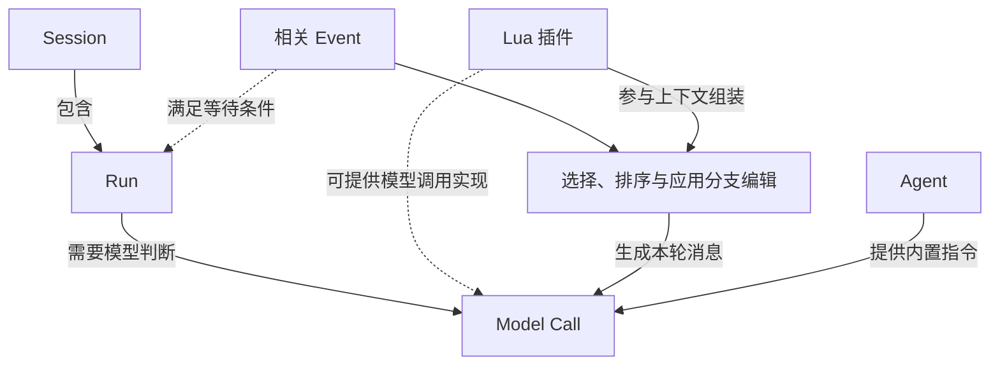
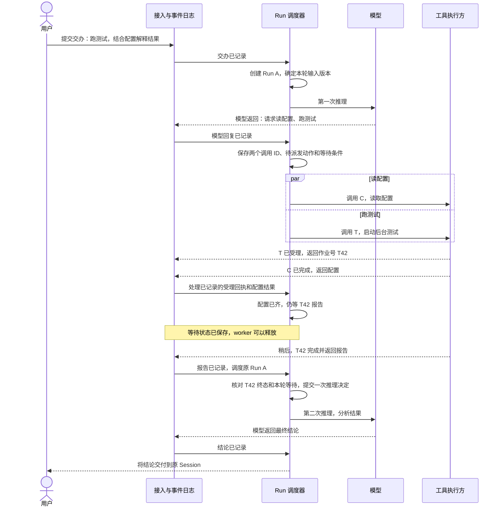
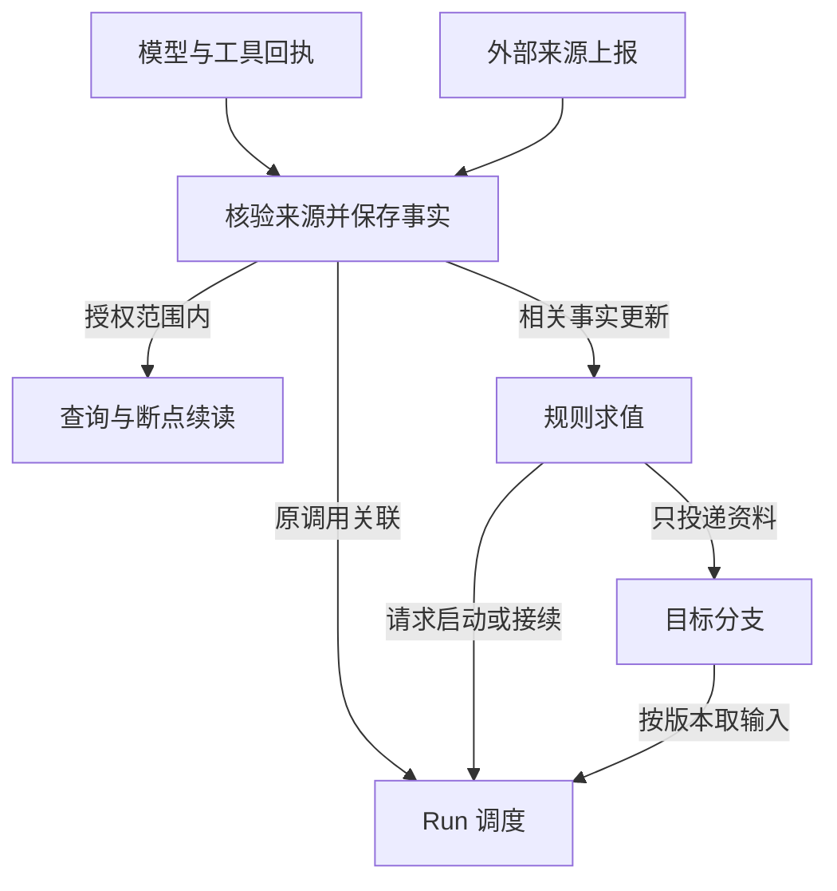
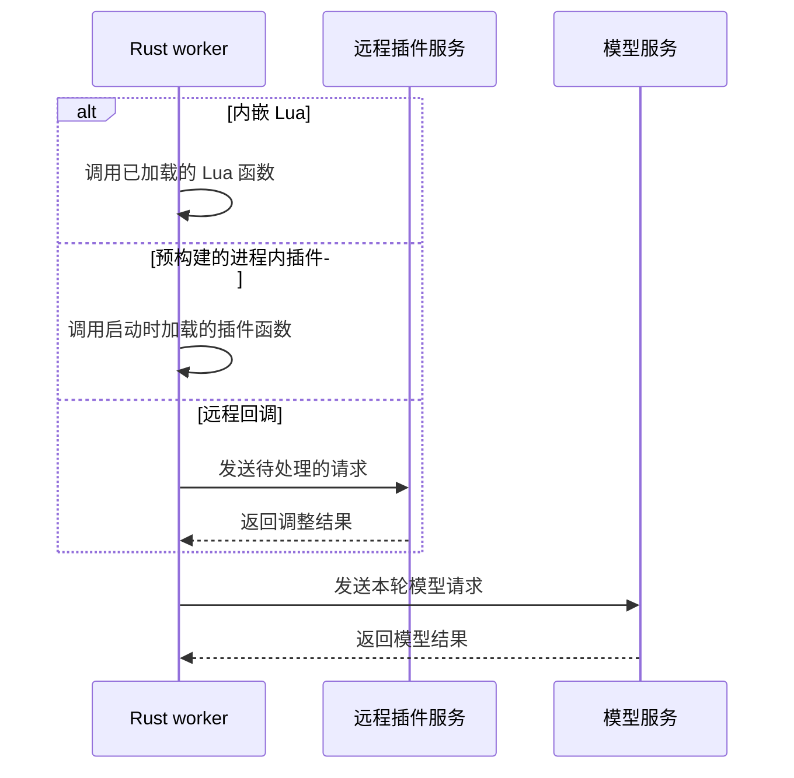
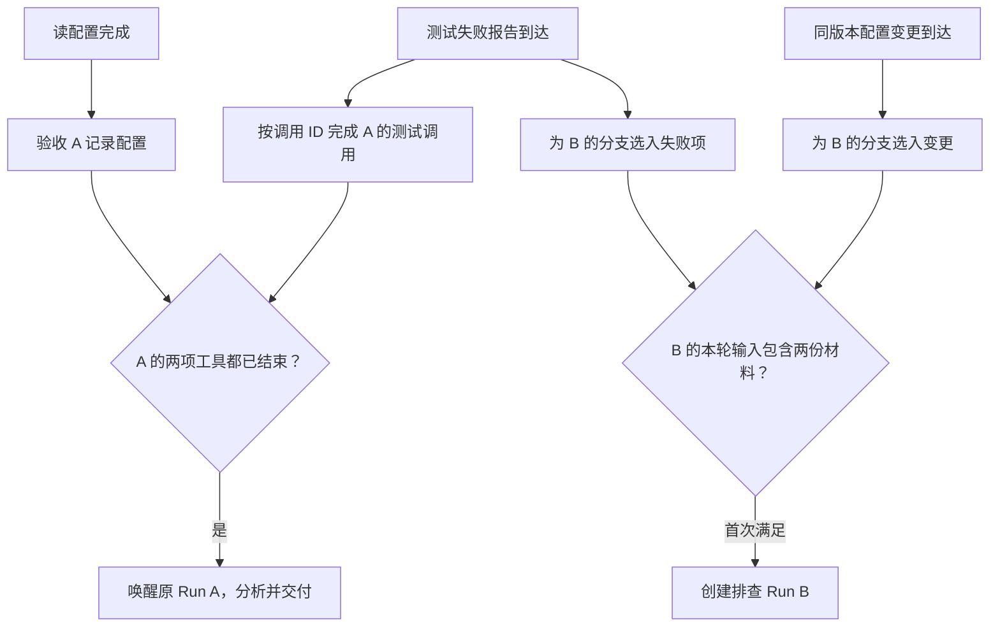
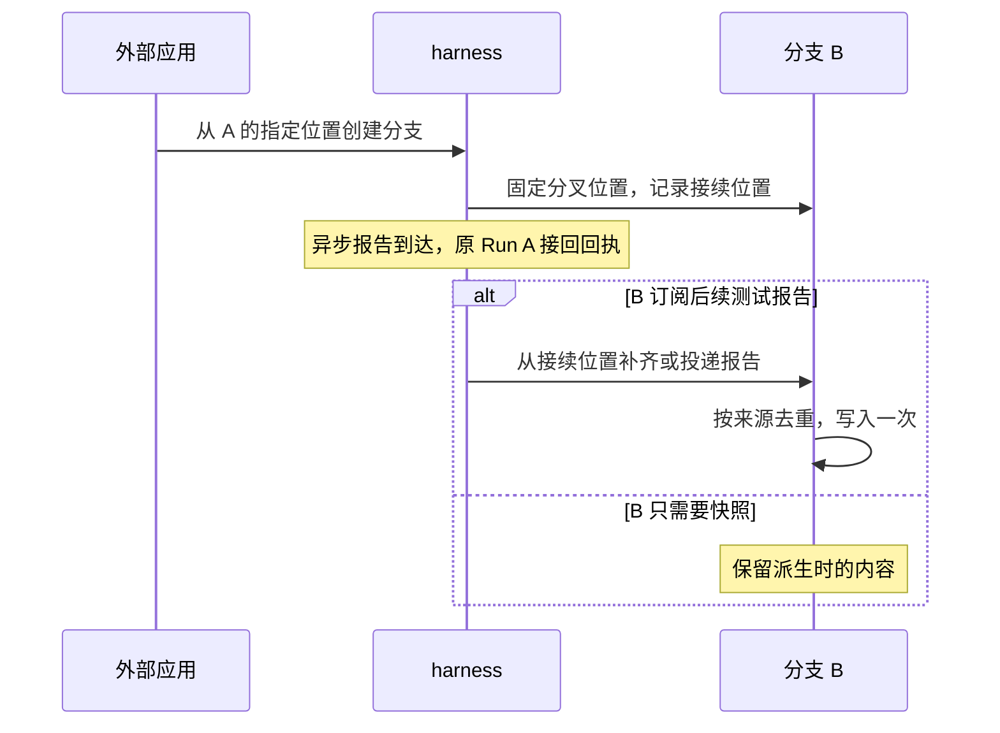
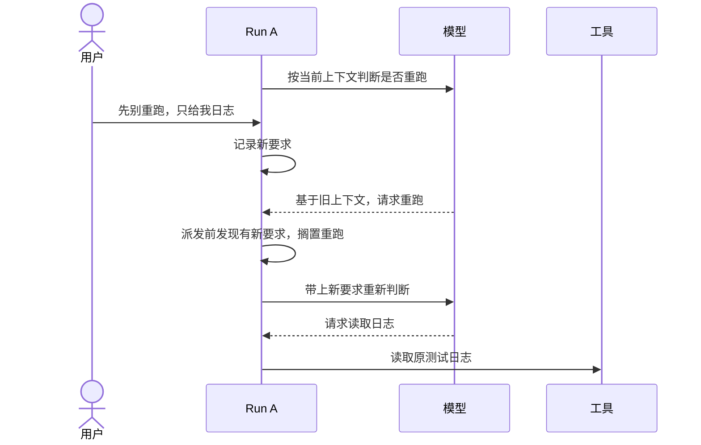
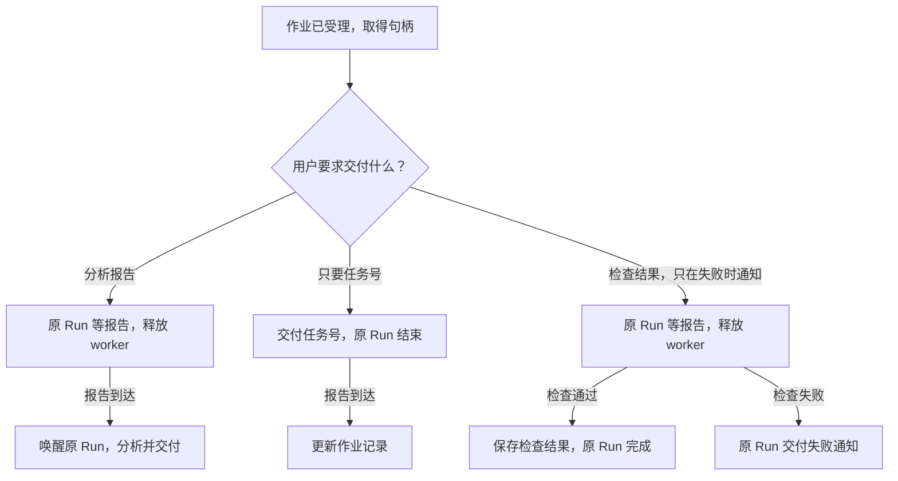
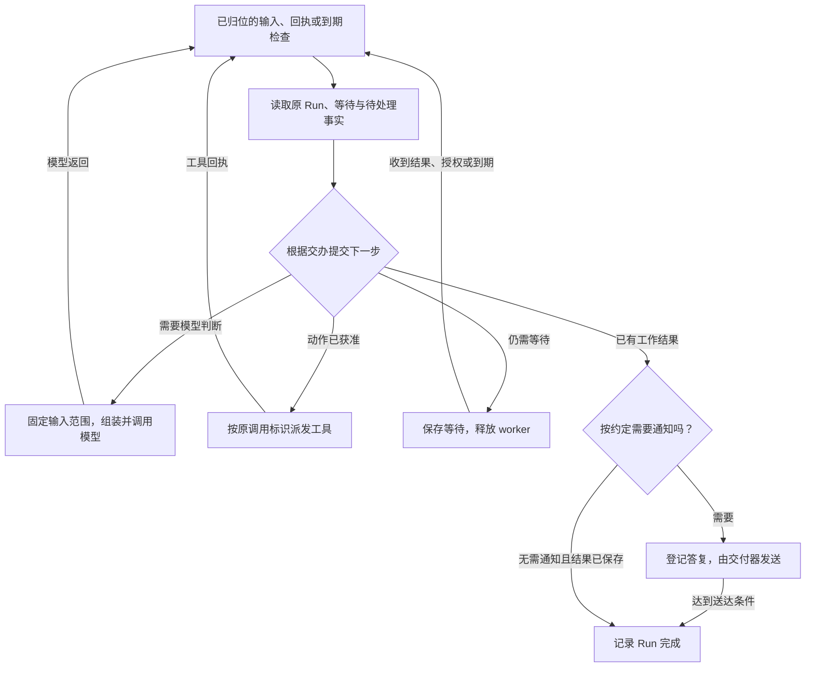
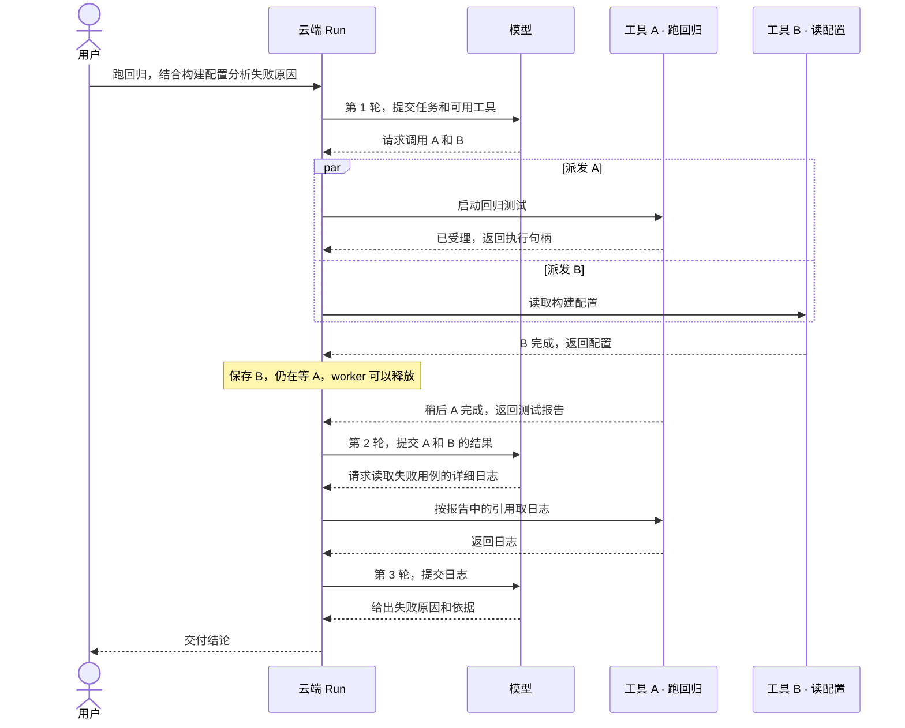

# loom-harness 设计草稿

[当前领域模型、REST API、官方插件和扩展点总览](overview.md)

## 产品方向

目标是让大模型更好地控制受控端，未来定位为云端 Agent 管理器。harness 中的工作主体称为 Agent，本轮独立讨论它的运行和上下文能力。

Agent 和受控机器可以分开部署。loom-harness 自身调用模型，负责推进 Agent 的工作。

## 领域模型总览（候选）

| 概念 | 职责 | 例子 |
| --- | --- | --- |
| Agent | 定义谁来承担工作。包含内置指令 system prompt 和对外简介 description。 | 验收 Agent 根据测试报告给出结论。 |
| Session | 给连续交办提供稳定的会话身份，在这里可以找到历次 Run。 | 同一个验收会话可以先验收一个版本，再交办下一个版本。 |
| Run | 在一个 Session 内由指定 Agent 承接一次交办，记录完成条件、交付对象、当前等待和已决定的动作。 | 同一次版本验收可跨过多轮推理、异步测试和人工批准。 |
| Event | 记录某个对象上已经发生的事实，可由多个接收方使用。 | 作业 T42 测试失败。 |

扩展侧有两个面向开发者的概念。Plugin 是可启用的插件，本期用 Lua 编写。Extension Point 是 Rust 核心开放的一项运行契约，规定何时调用插件以及接受什么结果。一个插件可以接入多个点。核心内部通过 `PluginProvider` 加载和调用插件，本期实现为 `LuaPluginProvider`。插件作用于整个 harness、某个 Agent 或某次 Run 的选择规则仍待确定。

当 Run 需要调用模型时，harness 从相关 Event 和本次选定的材料出发，按该分支的取舍、顺序和编辑生成本轮 message list。模型请求还使用 Agent 的内置指令。message list 是 Model Call 的输入值，可以按需生成。外部可以在组装时配置或提供这些变换。



如果分支要在下次调用时继续使用，就要能取回分叉位置和编辑，或直接取回编辑后的材料。由 Session、外部应用或可重建的引用承载这些信息均可，具体分工待定。若需核查某次调用，可以在 Model Call 上留存实际请求或足以还原它的不可变引用。

工具调用有自己的标识，以便并行回执各自归位。工具若立即返回后台作业句柄，Run 可以按句柄等待稍后到达的终态。跨会话订阅可以把资料提供给指定分支，或在目标 Session 发起新 Run。LLM loop 是调度器推进 Run 的行为。Tool 是可调用的能力，Skill 是可供 Agent 加载的方法说明。Agent 的能力配置见下文候选设计，通用订阅的管理边界仍待确定。

## Agent 的基础能力候选

先从 Agent 能接到任务、采取行动并交付结果来判断能力是否齐全，后续再讨论各项由谁提供、怎样实现。用户首先提出了 LLM loop、Tool 和 Skill。以下清单待共同确认。

| 能力 | 解决的问题 |
| --- | --- |
| System prompt（Agent 的常驻提示词） | 传给模型的角色配置。例如验收 Agent 的提示词可以是“你负责版本验收。根据实际测试报告给出结论，并列出失败用例。” |
| 输入与交付 | 当次任务来自具体消息，例如会话中的“帮我验收 v0.1.8，只跑 Windows 回归”。Agent 可在该会话提问或交付报告。 |
| 上下文管理 | 每次调用模型时，应当让它看到哪些指令、消息、已有进展和工具结果？ |
| LLM loop | 如何根据实际反馈决定继续行动、询问、完成或报告阻塞？ |
| Tool | 可以执行哪些动作、观察哪些外部状态，执行结果如何返回？ |
| Skill | 遇到某类工作时，可以复用哪些方法、步骤和判断标准？ |
| 会话与运行状态 | 同一件事已推进到哪里、有哪些动作未完成、在等什么、什么时候继续？ |

涉及文件和跨角色交付时，还要考虑工作空间与产物的保存、定位和交接。需要在不同任务之间积累经验时，再考虑长期记忆。操作受控端时，身份与权限约束可见范围和可执行范围。

## Agent 定义

Agent 包含必要的内置指令 system prompt，也需要简介供人或其他 Agent 了解其职责。具体元数据格式仍是候选。一种做法是让 `description` 使用 Markdown，允许通过 YAML frontmatter 提供摘要，正文按需展开。摘要字段、纯文本回退和是否必填尚待确定。头像可以保留为可选项；负责人、标签等业务元数据仍待取舍。

创建 Agent 时，允许定义者填写一段角色提示词。例如验收 Agent 可以写“你负责版本验收。根据测试报告给出通过、失败或无法判断的结论，并附上依据。”字段名暂用 `system_prompt` 举例。

<a id="agent-templates"></a>

### 从模板创建普通 Agent 与创造者 Agent

2026-11-24 补充确认，首版交付 `standard`（普通）和 `creator`（创造者）两份 AgentTemplate。包作者在不可变版本的 `plugin.yaml` 中用 `agent_templates` 列出 `templates/agents/*.yaml`。调用方可查可用模板的 ID、简介、来源和包版本，再选定模板版本并指定新 Agent ID。模板的 `spec` 沿用 `agent.yaml` 的配置字段，宿主校验后保存一份独立定义到 `agents/<id>/agent.yaml`。模板或包以后升级时，已有 Agent 保留自己的修订。[模板与资源格式](../../../../spec/reference/home.md#agent-templates)

第三方包可以提供模板，也可独立声明 `agent_config_schema` 来消费每个 Agent 的配置。模板可以在 `spec.extensions.<instance-id>` 中给目标插件实例传值。宿主按目标实例所属包版本的 schema 校验，将有效值保存到生成的 Agent 定义的 `extensions` 中。执行时只将当前 Agent 修订内属于该实例的值注入 `ctx.agent_config`。同一插件包的两个实例各读自己的配置，两个 Agent 共用同一实例时也可有不同值。实例通用设置仍通过 `ctx.settings` 取得。模板中的工具引用仍受部署授权和调用时权限检查。

| 模板 | 默认用途及可验证的行为 |
| --- | --- |
| `standard` | 通过日常工具集（示例名 `loom.daily`）读取自身 Agent 定义、查看当前 Session 历史、查询直接投给当前 Agent 的 Inbox 事件，并在当前 Session 检索、读写 Note。`sessions.history()` 与 `events.search(scope: current_agent_inbox)` 分别回答“这次会话说过什么”和“直接投给我的是什么”。另投给 Session 或其他 Agent 的事件不会因使用此模板进入该 Inbox 查询。 |
| `creator` | 具备普通模板的日常能力，并可绑定 `plugins.authoring`、`loom.self_management`。在委托范围内查实例与匹配版本的文档、读包、安装并启停插件、修改自身 Agent 配置与获准设置、只读预览上下文。安装与启用后，在下一次模型调用的实际目录里找到并调用新工具，以调用记录核验实现与版本。 |

两类能力和第三方接入进入首版范围，示例工具集名及物理分包可在实现时细化。[模板与自管理验收](../../../../spec/goals/v1.md#agent-template-acceptance)

一个候选做法是由 harness 提供简短的通用运行约定，和角色提示词一起放入模型的系统上下文。例如“调用工具后，根据返回结果判断操作进展”。这样，创建不同角色时只需写各自的职责。是否由 harness 默认加入这段约定尚待讨论。

### Agent 的 Tool 与 Skill

Agent 使用统一的 Tool 接口。工具可以由 harness 内置，也可以由 Lua 插件提供。一个 Lua 插件可以直接实现工具，或把外部来源的多个工具接入 harness。例如 MCP 插件按自身的服务地址和连接身份配置接入 MCP Server，对外提供相应的 Tool。其他工具接入方式可由新的插件实现。承载这些插件的运行时均可复用本期的 `LuaPluginProvider`。

此前讨论的候选方案是由 harness 维护 Agent 可用的 Tool 和 Skill 引用。另一种方案把渐进式披露开放给插件和工具，让同一机制承载 Skill，详见下文。Agent 配置的具体字段仍待确定。

建议 Agent 定义引用它可用的技能，技能包维护方法和配套材料。渐进式披露体现在模型看到内容的时机。组装模型输入时先提供技能名和适用场景，用户点名或模型选中后再读取该技能的 `SKILL.md` 正文，遇到具体步骤再取所需模板、参考资料或脚本。例如验收 Agent 平时只看到“版本验收”的目录项，收到验收任务才读取验收步骤，编写报告时再取模板。这三个时机分别对应发现、激活和按需使用配套资源。[Agent Skills 集成指南](https://agentskills.io/client-implementation/adding-skills-support)

建议在每次请求的系统指令中加入本轮可用的技能目录。Agent 定义持久保存角色指令和技能引用。组装模型请求时，Skill 插件通过上下文构建扩展点贡献各技能的名称和适用场景，由 harness 把这些条目与角色指令组合成实际发给模型的 system prompt。若接入插件还注册了读取正文的工具，目录可标明其实际调用方式。技能包仍可采用 `SKILL.md` 与配套资源。

以模型自行选用“版本验收”为例，第一轮的系统指令列出“release-review：发布前，根据回归报告判断版本能否交付”，用户消息提供当次交办。假设验收插件已注册正文读取工具，模型可在 Code Mode 中调用该工具，将验收步骤作为这次程序的输出。Run 记录两层调用，下一轮的 message list 带上模型发起的调用及其输出。若外部已明确选中技能，上下文构建也可以在第一轮直接带上正文作为任务材料。模型适配层负责将系统指令编码到目标模型要求的位置。

#### 通过工具和插件提供渐进式披露（候选）

从插件作者看，注册工具时可选附上一条按需阅读的说明，也可以为一组工具共用一条说明。最小声明包含稳定标识、适用场景和正文读取入口。组装请求时，宿主从本轮可用且已获准展示的声明中按标识去重，把简介与读取方式写入实际 system prompt。Agent 保存的角色指令独立维护。模型使用普通的只读 Tool 获取正文或其中引用的资源，结果通过已有工具调用链进入下一轮 message list。工具参数与返回值继续由工具 schema 说明。

例如，发布插件的查询构建、读取报告与发起回归三个工具共用一份“版本验收”指南。另一份“评审结论写作”指南只有正文与模板，也可以使用通用读取入口。Skill 插件可以把现有技能包的名称、简介、正文和附件适配成上述声明，沿用 `SKILL.md` 的作者体验。在这个方案中，Rust 核心只需理解渐进式披露的契约。是否在 Agent 的管理 API 上提供独立的 Skill 绑定，可单独决定。

#### 工具集怎样贡献系统指令片段（候选）

Agent 定义保存作者写的角色指令。system prompt 插件提供 section 注册、刷新和撤出接口。插件可以主动维护自己的片段，在登记 Tool 或工具集时一并注册。建议按来源实例和片段标识识别同一段，刷新替换原内容，工具集的共同说明只登记一次。Session 发起时，该插件将基础指令和此 Session 可见的片段组装成初始 system prompt。

Session 发起时完成初始组装，后续在每次模型调用前检查片段变更，每个请求取得一份完整版本。建议工具或插件卸载时一并撤出其拥有的片段。Session 内手动切换工具集留待以后。

可以用事件驱动这次更新。注册、刷新和撤出产生带来源、片段标识和版本的变更事件。Run 准备一次模型请求时，system prompt 插件取本次准备开始时已提交的事件位置，从 Session 上次组装的位置补齐相关变更。同一片段在这段范围内按版本取最终状态。无变化时复用现有结果；已上报内容的直接采用；只通知了刷新的，才向提供方读取指定版本；撤出的直接移除。Session 初次组装使用同一规则，从当前可见片段初始化。

模型发送步骤等待组装完成，并保存本次实际使用的 prompt 版本。截点后的变更留给下一次调用。若提供方暂时取不到指定版本，本次准备可报错或重试，成功前保留待处理进度。这样即使提供方已卸载，也能处理撤出；一个已经撤出的片段也不会因旧的同步结果迟到而重新出现。

例如，Skill 工具在能够访问技能包的环境中读取本地 `SKILL.md`，上报可解析的技能标识、名称和 `description`。system prompt 插件用这些材料组成可见目录。模型选中技能后，通过同一工具按标识读取正文，结果进入下一轮 message list。简介变化时，工具实现端刷新对应 section；移除技能时撤出对应条目。若工具按工具集注册整份目录，移除单项可以通过刷新整份目录表达。

待验证的产品差异是片段的用途。例如“验收版本时可读取验收指南”属于渐进式披露的目录项。“先查最近一次报告，再决定是否重跑”则可以作为工具集启用期间持续生效的使用约定。前者只需要目录和读取入口，后者还需要约定哪些插件有权把使用指令放入系统提示词，以及与 Agent 角色指令冲突时如何处理。

#### 工具实现与运行

工具体系还可以整体用 Lua 实现。这个候选方案把“内置”理解为随 harness 发布。官方 Lua 工具模块接收插件注册的工具，按 Agent 配置列出本轮工具及参数说明，并将每次调用分派给对应实现。随包工具和后装插件使用同一接口。一个插件可以提供多个工具，例如 MCP 插件可从一个服务发现多个工具，并分别暴露给 Agent。

以读取文件和后台测试为例，随包的 Lua 工具通过宿主读取当前工作区的文件，另一个插件可以通过外部服务提交测试。Rust 宿主提供受权限约束的文件和网络接口。Run 登记每次调用的标识，并持久记录等待与完成状态。测试结果稍后返回时，即使原来的 Lua 实例已退出，也能按原调用标识接回 Run。

Run 启动时解析 Agent 的配置，结合本次身份能访问的工具和技能，形成执行时可用的能力。模型按需获得技能说明和允许使用的工具；派发工具时由 harness 按当前授权检查。加载某项 Skill 不会自动授予它提及的工具权限。例如验收 Agent 与发布 Agent 可以共用一份构建服务配置，两者都能查报告，只有发布 Agent 获准触发发布。

#### 默认通过 Code Mode 调用工具

本轮可用业务工具默认只进入 Code Mode。显式标记为直接调用的工具只进入模型原生工具列表。模型通过顶层执行入口提交短程序，既能调用一个工具并马上返回，也能取得构建 ID 后并行查多份报告、筛选结果。需要模型解释原文时，程序可以直接输出原文或材料引用。

建议官方随包提供默认执行入口。模型程序通过同一工具分派接口发起子调用，宿主记录父子关系，插件作者管理工具、路由、settings 的接口由独立环境持有。具体定义、交互示例、异步接续、失败处理和验收场景见[工具层方案](tools.md)。模型脚本语言和插件打包细节仍待评审。

短程序可以等待一批调用。需要跨服务重启接收结果的作业，由 Run 持久记录子调用标识和外部作业句柄，稍后的结果以事件接回。Codex 的执行协议区分观察时限与执行时限，允许按执行单元 ID 继续等待，会话租约断开则终止活跃执行单元。[执行与等待协议](https://github.com/openai/codex/blob/main/codex-rs/code-mode-protocol/src/grpc/codex.code_mode.v1.proto)

## 先前提出的 harness 职责候选

| 职责 | 一次工作中具体承担什么 |
| --- | --- |
| 运行配置 | 将 Agent 的职责说明、模型、技能和可用工具关联起来。 |
| 上下文管理 | 从用户交办、会话消息、本次进度和工具结果中，选择下一轮判断需要的材料。 |
| 模型与工具执行 | 调用模型，派发工具请求，关联真实返回，必要时再次调用模型。 |
| 工作状态与接续 | 保存执行进展、等待原因和待完成的操作。新信息到达时继续工作，按交办要求交付结果。受控操作结束与产物已交付分别判断。 |

四项是云端管理器的候选职责。Agent 的定义可关联工具与技能，也可以允许指定模型。哪些配置对创建者可见仍待确定。模型负责需要结合现场作出的判断。

以跨角色的夜间构建为例：构建角色代表谁、一次工作进展到哪里、某台 host 上的进程是否在运行，各有各的生命周期。等待构建时可以不调用模型；取得终态后再让模型分析结果并把结果交给验收角色。这是用于检验“黑灯工厂”目标的候选情境。

## 候选方案：一次交办内的模型循环

以一次交办为起点，记录对应的上下文和交付目标。harness 保存本次任务、相关上下文、本次可用的工具，以及已发生的模型调用和工具结果。模型每轮可以请求工具或给出答复；一次交办可以包含多轮模型调用。

模型提出工具调用后，harness 检查工具与参数，记录调用标识，交给工具执行，并把真实结果对应到原调用。输出中既有文字又有工具调用时，先处理尚待执行的调用。模型需要用户提供信息时，把具体问题送回原讨论并等待；任务有结论时，交付结果或说明阻塞。取消和耗尽预算应有明确状态，以便用户知道工作停在哪里。

终端命令的执行句柄和模型工具调用的标识分别记录。对于已知无需输入的长命令，harness 可以按原句柄等待，把有意义的输出、终态或异常交给模型。交互式程序可能要求立即处理提示。工具调用结果未知时保留不确定性，避免自动重做可能已有副作用的动作。

## 待讨论

可以用同一个模型、同一个 host 和同一组工具来描述“更好”的含义。例如，用户要求在指定测试机跑回归并报出失败用例。一个候选判断标准是，模型能利用已有执行句柄跟进长任务，读取终态和测试报告，再把有依据的结果带回原讨论。这个例子用于辨认价值，尚未选为首版任务或验收标准。

有待讨论的是，创建一个 Agent 时，定义者最少需要提供哪些信息，其他哪些运行职责应由 harness 承担。

## 云端事件驱动 Run（暂定方向）

### Session、Run 与 Event（候选）

Session 是可持续多次交办的会话，每个 Run 归属一个 Session，Event 记录已经发生的事实。交办时确定要完成的工作、在什么条件下应向谁交付什么。普通问答默认答复发问处，也可以明确约定“保存检查结果，只在失败时通知我”。这些约定随 Run 保留，获准修改原交办时一同更新。一个 Session 可以有零到多个 Run，独立交办各有自己的完成条件。

建议固定一条归属关系：每个 Run 都有自己的 Session。Event 描述哪个对象发生了什么。例如 `job.finished` 描述作业，`run.completed` 描述 Run，`session.created` 描述 Session。事件可以先于任何关心它的会话存在。将来由谁接收、用来做什么，由调用时登记的等待或订阅动作决定。

例如验收会话中的 Run A 发起测试并登记等待作业 T42。T42 结束时，事件 E 记录作业结果。调度器据此满足 A 的这项等待，其他条件也齐备时继续 A；从 A 的归属就能找到验收会话。排查会话 B 若只订阅失败报告，命中后直接在指定分支记下 E 的引用。若交办的是“失败就排查”，则以 E 为输入在 B 启动新的 Run。事后可通过等待或动作记录查到谁用过 E。

<a id="event-run-sequence"></a>

### 从用户交办到结论交付的时序（候选）

以“跑回归测试，结合当前配置解释结果”为例。用户输入、模型回复和工具回执由接入端记录；调度器按同一 Run 的当前状态依次提交下一步决定。图中的泳道表示职责，模型与工具回执可由适配器代为上报。



本例需要配置和最终报告两份材料。先到的结果更新原调用，两份齐备后，下一轮输入包含配置和报告。若此时 T42 的复查提醒也到达，等待协调器核对原调用已有终态，复用同一次等待处理结果。模型若还需要读日志，可沿相同路径继续。结论准备好时，Run 登记应发往原讨论的答复，交付器确认达到约定的送达条件后，Run 结束。

其他 Session 可以独立使用这份报告。只需留档时，为目标分支记下引用即可。另有失败排查交办时，按相应条件创建排查 Run。原 Run 通过调用或作业标识接回结果，可以先于其他订阅者完成交付。

### 事件接入、管理与开放（候选）

建议公开 Event 和 EventDelivery 两项资源。Event 保存事实，EventDelivery 跟踪一次向 Agent 或 Session 的投递，并关联后续处理结果。目标持久收件即可确认送达。消费者决定记录材料、创建 Run 或满足既有等待；Run 需要推理时才执行模型调用。上报、查询、显式投递、追踪和重试各有入口。见[事件管理与投递](overview.md#event-delivery)和[消费与推理时机](overview.md#event-consumer)。

EventDelivery 之前设投递安排层，用户通过 REST、获准的 Agent 通过该层提供的 Code Mode 工具管理同一份配置。候选方案把已配置的数据源与投递安排分开。安排选择提交时、到时或来源事件到达时触发，由固定配置或用户自定义脚本决定是否投递以及每项的内容、目标和消费意图。宿主按已保存的决定入箱。Webhook 可作为来源插件加入。见[投递安排及跨入口管理](overview.md#message-ingress)。

云端 harness 可以同时承接运行所需的内部回执和外部来源上报的事实。一个刚到达的事件可以暂时与任何 Session 都无关。Run 依据交办目标决定下一步，订阅者可以独立读取同一事实，也可以按已登记的规则用它发起新的交办。普通问答和原调用接回结果都可直接运行，调用方无需为它们编写规则。



| 能力 | 建议由 harness 承担的契约 |
| --- | --- |
| 接入 | 登记事件来源及其可上报的类型。工具回执对应实际派发的调用，外部可上报自定义业务事实，按来源与事件 ID 识别重送。启动交办等影响运行的外部动作优先使用事件。对已有交办补充输入、请求取消均使用统一事件投递入口，关联原 Run。宿主校验后记录受理与实际结果。 |
| 管理 | 保留公开事件的类型、版本、关联对象和内容或产物引用。允许按作业、调用或 Run 查到经过。原始事实与各接收方的投递进度分别保存，因此创建分支、编辑分支或重读历史都能独立进行。 |
| 开放 | 外部可在授权范围内上报、筛选历史、从游标继续读取，也可单独请求给指定分支补入材料或启动 Run。接口说明可补读的保留期限和游标过期的结果。公开事件使用稳定契约，worker 重试日志、模型流式片段可以使用单独的调试或实时接口。 |
| 规则 | 调用方可登记规则，选择事实来源和关联对象、写出条件、指定从何处开始和触发几次，并声明目标及动作。harness 负责保存等待和执行进度，按该交办的权限提交动作。动作可以只是给分支补入材料，也可以要求基于包含指定材料的输入启动或接续 Run。 |

例如作业 T-42 的失败报告只保存一次。发起测试的 Run A 收回工具结果。独立应用从游标读到报告并刷新界面。规则还可以把报告送给 B，并且仅当同一构建的配置快照也已就绪时才启动一次排查。报告和配置按构建 ID 配对，两者谁先到都能工作。历史补读只向读者返回事实。worker 恢复时继续已登记但未完成的动作。

规则匹配时，将本次触发标识与待完成的动作一起持久保存。这样，服务在写入报告和创建 Run 之间重启，仍能补完这次排查。底层存储和传输可以替换。第三方业务之间无关 Agent 的消息中转可以由外部事件服务承担。

建议分三步检验演进。首先，云端 Run 在重启后仍能接回迟到的工具结果并完成原交办。其次，外部应用能够独立上报与续读，并能把选中的结果用于自己的界面或分支上下文。最后，应用只登记一条规则便可以离线，harness 继续等候、执行并提供处理记录。达到第三步才需要托管规则实例。已知作业取现状、长订阅从游标开始，二者可以共用求值和提交动作的实现。跨对象关联和时间窗口可按具体用例扩展。

既有组件可分别评估。CloudEvents 为事件提供来源与标识的约定，CEL 可以嵌入产品求值声明式表达式。等待状态、来源能力、触发次数和动作恢复仍需由 harness 定义。 [CloudEvents 规范](https://github.com/cloudevents/spec/blob/main/cloudevents/spec.md) · [CEL 概览](https://cel.dev/overview/cel-overview)

#### Cordis 如何组合 harness 能力（候选）

Cordis 让插件通过 `ctx` 使用具名服务，并跟踪该插件在运行期间添加的注册。插件声明依赖，服务就绪才激活；所依赖的服务撤下时，插件的注册随之释放。DeepSeek 的教程里，一个插件向 `ctx.tools` 注册工具，另一个插件监听 `tools/result`。卸载记录插件只撤销它自己的监听，工具可以继续执行。[服务依赖](https://github.com/deepseek-ai/deepseek-harness/blob/2e39e70496aa02986ca6a820c5d497e816b69d7e/docs/cordis-tutorial/03-services.zh.md) · [工具与监听示例](https://github.com/deepseek-ai/deepseek-harness/blob/2e39e70496aa02986ca6a820c5d497e816b69d7e/docs/cordis-tutorial/07-into-the-harness.zh.md)

对 loom-harness，当前建议用普通接口在 worker 启动时装配工具与模型。各 Agent 即使选择不同的工具子集，也可以从已注册的工具中选择。若今后多个团队需要独立发布能力、按作用域装卸，并要求依赖变化后自动释放监听器和工具注册，再评估 Cordis 带来的收益。工具回执一经云端确认接收，就应有可恢复的处理记录；日志观察器可以独立装卸。

#### 历史方案对照：DeepSeek Harness 云端执行器

这条早期路线设想在 DeepSeek Harness 的 worker 内沿用 Cordis。当前方案采用 Rust 核心与 Lua 插件，以下保留当时用于比较执行器的场景与资料。云端 worker 可通过 SDK 启动无界面运行时，复用模型循环和工具执行。loom-harness 管理 Agent 定义、Run 的交付目标，以及跨 worker 等待和接续的状态。用户通过 GUI 或 API 操作同一份云端工作。DeepSeek 的 Web 界面可作为客户端候选；Electron 默认随应用启动私有 Host。复用界面需要把操作接到实际持有该 Session 的云端实例。[启动组合与桌面结构](https://github.com/deepseek-ai/deepseek-harness/blob/2e39e70496aa02986ca6a820c5d497e816b69d7e/docs/architecture.md) · [SDK 进程协议](https://github.com/deepseek-ai/deepseek-harness/blob/2e39e70496aa02986ca6a820c5d497e816b69d7e/packages/sdk/README.md)

选型可用一条流程判断。用户启动后台测试后关掉界面，替换执行 worker。另一客户端从原上下文派生出排查分支。测试结束时，云端按已登记的交办收回同一作业的结果，为约定的目标生成一次结论，并能指出该次模型请求实际提交的输入。默认作业后端随进程退出，跨进程作业要有自己的执行与结果存储，按 `ctx.jobs` 契约接入。若持久工作和上下文操作可通过插件及公开接口完成，继续跟随上游。若必须接管默认循环与 Session 日志的关键语义，再决定复用哪些组件或维护针对性的分支。[作业后端契约](https://github.com/deepseek-ai/deepseek-harness/blob/2e39e70496aa02986ca6a820c5d497e816b69d7e/packages/jobs/jobs-local/README.md) · [Session 与模型输入](https://github.com/deepseek-ai/deepseek-harness/blob/2e39e70496aa02986ca6a820c5d497e816b69d7e/packages/core/session/README.md)

<details>
<summary>此前调研的 DeepSeek 上层功能对照</summary>

对照官方仓库提交 `2e39e70` 的默认 Agent 循环、Session、后台作业和实验性 Webhook 实现。以下是源码与文档对照所得的候选取舍。

| DeepSeek Harness 的做法 | 对 loom-harness 的启发 |
| --- | --- |
| 默认循环直接推进 turn 和 step。追加到 Session 的事实可读回，运行中的 `agent/*` 钩子允许插件在模型请求前等具体时机介入。客户端可按 Session 读取历史或跟随更新，断线后可补读缺口。[架构](https://github.com/deepseek-ai/deepseek-harness/blob/2e39e70496aa02986ca6a820c5d497e816b69d7e/docs/architecture.md) · [客户端接口](https://github.com/deepseek-ai/deepseek-harness/blob/2e39e70496aa02986ca6a820c5d497e816b69d7e/packages/api/session-controller/README.md) | 原 Run 能独立走完模型与工具循环。把允许外部订阅的事实以及允许插件参与的运行步骤分别写清，避免对外部消费者承诺能够重放一个正在执行的钩子。 |
| `inject`、`steer` 和 `followup` 共用一个输入接口，分别表达静默补材料、在最近的下一步处理，以及排入独立的一轮。[输入实现](https://github.com/deepseek-ai/deepseek-harness/blob/2e39e70496aa02986ca6a820c5d497e816b69d7e/packages/core/agent-loop/src/agent.ts#L171-L190) | 规则可指定材料写入哪里、哪次工作使用，以及要不要唤醒。静默投递不能靠模型推理来完成。 |
| 模型历史从 Session 日志派生。fork 指定历史截点，给子会话尚未闭合的调用记录补上结束标记。跨会话引用可在发送时捕获快照，来源之后的编辑不会改写本次引用。[分支实现](https://github.com/deepseek-ai/deepseek-harness/blob/2e39e70496aa02986ca6a820c5d497e816b69d7e/packages/core/session/src/fork.ts) · [跨会话引用](https://github.com/deepseek-ai/deepseek-harness/blob/2e39e70496aa02986ca6a820c5d497e816b69d7e/packages/context/session-reference/README.md) | 外部能编辑后来要用的上下文。已发出的模型请求应可定位到实际输入的版本。继承上下文、接收将来的事件、接手在途工具分别约定。 |
| 可并行的工具重叠执行，独占调用形成屏障，批次结果按模型原调用顺序返回。后台 Bash 可先返回作业 ID。后台作业通知遇到忙碌 Agent 默认补到下一步，遇到空闲 Agent 默认唤醒。维护者记录了一处竞态，若通知落在最后一次检查收件箱到转为空闲的间隙，材料可能滞留。[批内并行](https://github.com/deepseek-ai/deepseek-harness/blob/2e39e70496aa02986ca6a820c5d497e816b69d7e/packages/core/tool-executor-native/README.md) · [后台通知](https://github.com/deepseek-ai/deepseek-harness/blob/2e39e70496aa02986ca6a820c5d497e816b69d7e/packages/jobs/tool-jobs/README.md) | 工具结果在现实中的到达顺序和模型收到的顺序可以分别处理。对承诺自动接续的作业，记录完成事实和待处理动作，让新的 worker 能在原 worker 退出后继续。 |
| Webhook 适配器校验来源，可信代码规则决定是否请求创建 Session。实验性实现使用进程内分发，重复投递可以创建多个 Session，进程退出后不能重放分发。[Webhook 契约](https://github.com/deepseek-ai/deepseek-harness/blob/2e39e70496aa02986ca6a820c5d497e816b69d7e/docs/subsystems/webhook.md) · [分发源码](https://github.com/deepseek-ai/deepseek-harness/blob/2e39e70496aa02986ca6a820c5d497e816b69d7e/packages/experimental/webhook/src/index.ts) | 接入和规则判断可以分别扩展。云端托管条件交办时，按规则和关联对象保存触发及执行记录，允许恢复“已收报告、待启动排查”等中间状态。 |

一个区分两套承诺的验收场景是：测试报告到达后，接收它的 worker 恰好退出。看板重新连接能读到报告。原 Run 若还欠验收结论便恢复推进。若 B 的规则还在等同一构建的配置快照，等材料齐备后才创建一次排查 Run。三方可以使用同一份报告。

</details>

<a id="worker-pool"></a>

### 一个逻辑 API 与执行 worker

一个 Loom 实例向客户端提供一个逻辑 API。默认启动一个 `loom-harness` 进程，在其中运行 API、事务发件箱发布循环和一个执行 worker。部署者可调整进程内的 worker 数量，也可用同一程序把 API 与执行角色分开启动，由 N 个执行进程承接同一实例的工作。跨机器运行时，各进程访问同一权威状态库和消息总线，并能读取同一包和配置修订、工具产物及共享持久目录中的 Note。[部署与执行约定](../../../../spec/architecture/runtime.md#worker-pool)

Worker 领取 Run 当前就绪的步骤。等待 CI 作业 T42 时会持久保存原 ToolCall、作业号和等待条件，释放 worker 处理其他工作。报告到达后，另一 worker 可从原 Run 接续。运行时与审计属于不同的逻辑订阅，可分别处理这份报告。同一订阅消费组内的 worker 分担条目并可接管未确认项，按已提交的决定防止一次等待重复推进。[默认启动与换 worker 验收](../../../../spec/goals/v1.md#worker-pool-acceptance)

### Rust 核心与插件机制

Rust 核心负责 Run 调度、定义扩展点和使用扩展点的结果。`PluginProvider` 是核心加载和调用插件的接口。本期仅实现 `LuaPluginProvider`，由它加载 Lua 脚本、取得登记的处理函数、在 worker 进程内执行函数，并在宿主数据与 Lua 值之间转换。调用上下文、输入、结果和错误使用宿主定义的类型。注册方式和具体扩展点的契约仍为候选。

第三方通过 Lua 脚本扩展 harness。建议将开发者编写、用户启用的 Lua 模块称为“插件”（Plugin），将 harness 开放的位置称为“扩展点”（Extension Point）。一个插件可以为多个扩展点登记处理函数。建议沿用同一种登记形式，以扩展点名映射到函数。每个点的契约说明输入、返回值以及多个实现如何参与。以下名称和调用契约是候选设计。

| 扩展位置 | 第三方可以做什么 | 调用约定 |
| --- | --- | --- |
| 上下文组装 `context.build` | 选择、整理或补入本轮材料 | 将配置的变换按序应用到上下文。 |
| 模型请求准备 `model.before_invoke` | 调整准备发送的请求参数 | 各处理函数依约定顺序参与。 |
| 模型调用 `model.invoke` | 实现到模型服务的调用与协议转换 | 每次调用选一个实现。未配置替代实现时选择内置实现。 |
| 模型调用结束 `model.after_invoke` | 观察结果或错误，例如统计用量 | harness 在选定实现返回或报错后通知观察者。 |
| 工具派发前 `tool.before_dispatch` | 按交办约束决定是否允许本次派发 | 已启用的检查按契约执行。 |
| 注册 settings | 声明插件的配置项、类型、约束和可选默认值 | 宿主根据声明提供统一 REST 配置服务，并把生效值放入插件的调用上下文。 |

例如，某个团队可以仅用 Lua 实现公司推理网关的请求编码、调用及响应解析。harness 向它提供本次模型请求，收回约定格式的文本、工具请求或错误，并据此推进 Run。内置实现与第三方实现遵守同一调用契约。调用前后的扩展点由 harness 触发，因此选用公司的实现后，原有的请求参数调整和用量统计仍会生效。模型中间件和自定义提供方的分工可参照 [Vercel AI SDK 的模型中间件](https://ai-sdk.dev/docs/ai-sdk-core/middleware)与[自定义模型提供方](https://ai-sdk.dev/providers/community-providers/custom-providers)。

例如一份用于发布评审的脚本可以在 `context.build` 为本轮上下文补入评审清单引用，在 `tool.before_dispatch` 遇到部署工具时返回拒绝和原因。前者支持在默认上下文上增量修改，后者在派发前参与决定。工具已经执行完的 Event 仍记录实际结果。未启用第三方插件时，harness 走内置流程。

Run 保存交办受理时选用的 Agent 定义与绑定。宿主在实际调用时固定所选脚本版本和执行顺序。后续模型调用可刷新已生效的工具目录和 section。材料变换按固定顺序合成，工具派发前收到拒绝即停止派发。脚本可读数据与可返回动作由宿主接口限定。超时或异常按扩展点的契约处理，例如承担派发检查的脚本出错时暂停这次派发。

<a id="plugin-events"></a>

#### 插件统一订阅与消费事件（接口草案）

按事件查生产者和消费者、按插件或 Rust 逻辑组件反查订阅的方法，见[总览中的事件与订阅目录](overview.md#official-events)。该目录将已满足的工具等待归一为 Run 级通知，再交给推理触发插件评估。

插件启用时可以通过同一个入口声明消费哪个范围内的哪些事件。Rust 宿主登记订阅、检查权限、路由投递并保存消费进度，Lua 插件实现处理函数。Agent 或 Session 是业务收件地址，插件订阅是程序接收通知的方式。同一次业务投递可供多个已获准的插件分别消费。插件仅订阅感兴趣的类型，无需轮询整条总线。

```lua
plugin:subscribe({
  id = "model-usage",
  types = { "model.completed" },
}, function(ctx, event)
  return record_usage(ctx, event)
end)
```

这里的订阅 ID 在插件实例内稳定。宿主依据插件可见范围裁剪事件，提供只读调用上下文、事件及投递标识。同一次业务投递在不同目标或订阅上的进度分别记录。停用插件即停止接收新投递，已接收的处理进度可查询。订阅起点与主动补读历史可另行设置。

<a id="event-distribution"></a>

**2026-11-24 补充的事件分发约定。** 首版采用 Redis Streams 作为默认事件分发后端。Rust 宿主通过可替换的消息总线适配器发布、接收和确认事件，Lua 插件沿用上面的统一订阅入口。宿主根据插件的作用域投递获准的事实，流、消费组、传输凭据和 ACK 均由适配器管理。[事件分发规范](../../../../spec/architecture/runtime.md#event-distribution)

| 时点 | 持久记录与恢复 |
| --- | --- |
| 登记事实 | 在同一领域存储事务中提交业务状态、带稳定 `event_id` 的 Event 和事务发件箱记录。事务回滚时，分发器没有可发布的记录。 |
| 发布到 Redis Streams | 发布器读取已提交的发件箱记录，使用原 `event_id` 发布，再记录已发布。Redis 暂时不可用时保留记录续发。若消息已写入流但发布器来不及标记，恢复后重发可能产生另一条传输记录，两条均指向同一 Event。 |
| 匹配与处理 | 每个逻辑订阅分别记录自己的消费进度。同一订阅的多个 worker 可接手未确认的消费。在同一事务中记下该订阅对 `event_id` 的处理结果，以及它引起的 Run 决定、待执行动作和相应的新事件与发件箱记录。事务提交后宿主才向 Redis 确认。已提交的消费再次送达时复用处理结果，补作 ACK。一次订阅的确认不影响另一订阅。 |

例如，Run 正在等待 CI 作业 T42 的最终报告。先在领域状态、报告 Event 和发件箱同事务提交后、首次写入 Redis Stream（`XADD`）前停止服务。重启后发布器应补发原 Event，运行时和审计订阅分别处理。在另一次测试中，让运行时订阅满足等待并提交下一步后、ACK 前停机。重启后可先处理审计订阅，再恢复运行时订阅。即使再次收到原事件，运行时订阅也只补确认，原 Run 仍只有一个下一步。外部工具调用遵循原 ToolCall 的查询和幂等恢复约定。[故障恢复验收](../../../../spec/goals/v1.md#event-distribution-acceptance)

**两个默认插件如何依次触发。** 触发插件订阅 `run.started`、`run.input_received` 和 `run.wait_satisfied`。工具回执先按调用 ID 交还直接调用方。属于 Run 的顶层结果由等待协调器检查，相关等待首次就绪才发布 `run.wait_satisfied`。触发插件依据 Run 状态和已就绪的事实提出建议。宿主决定推理时，以唯一决策 ID 登记本轮推理并发布 `model.inference_requested`，携带 Run、分支版本、输入截止位置和所需材料引用。上下文插件据此构建输入，宿主保存结果并发布 `model.input_prepared`。执行器核对决定仍有效，同步 section，再调用选定的 `model.invoke`。同一决策对应一个逻辑 ModelCall，失败和重试都可追溯到该决策。

| 已讨论的能力 | 适合用订阅驱动的部分 | 仍由原契约负责的部分 |
| --- | --- | --- |
| System Prompt、Skill、Toolset | Session 创建时初始化，技能目录或 section 内容变更后定向刷新、撤出 | 发送模型请求前确认所需版本已生效；读取 Skill 正文仍是工具调用 |
| Code Mode、异步工具与 Run 等待 | 子工具回执按调用 ID 交还直接调用方；作业终态与顶层完成可更新等待、触发 Run 评估 | 工具有唯一执行者，子调用结果仍需交还程序；派发前的授权和拒绝必须先取得结论 |
| Settings、MCP 和工具目录 | 配置提交后通知受影响插件重载指定版本；MCP 工具清单改变后更新可见目录 | 配置写入时校验；调用绑定当前工具与获准的配置；变更事件只给版本或引用，敏感值仍由受限 ctx 提供 |
| 上下文压缩、分支、copy、编辑 | 新分支或新版本就绪后准备摘要、更新派生资料或索引 | 创建分支须返回明确的分支及版本；本轮必需的摘要和编辑必须对应这一次选中的版本 |
| 用量统计、运行通知、状态视图 | 模型或工具完成、Run 结束后分别记账、通知、更新视图，消费者可独立追赶进度 | 同一消费的重试复用原操作标识；观察失败不阻塞推理 |
| 插件生命周期与动态 REST | 启停后的事实可更新管理界面或通知依赖方 | 路由注册与冲突检查在启用成功前完成；REST 请求须有确定处理者和响应 |

阶段事件与普通观察共用订阅声明和分发机制。谁有权提交该阶段的结果由扩展点绑定决定。需要有序修改的 `model.before_invoke` 和需要给出许可的 `tool.before_dispatch` 保留顺序、等待和错误契约；完成后的纯观察可以复用事件订阅。只读查询、工具实际执行和模型提供方的响应仍有直接的请求与结果关系。此方案支持已安装插件订阅，向外部客户托管跨会话订阅及通用规则另行讨论。

#### 官方插件与扩展位置

官方插件的交付范围可以按下表核对。扩展点的名称仍为草案，一个插件可以使用多个扩展点。

| 能力 | 已明确的方向 | 对应的扩展位置 |
| --- | --- | --- |
| System Prompt | 由插件负责组装会话的系统指令 | 接受其他插件注册、刷新和撤出 section |
| 上下文压缩 | 本次实现的官方插件 | 组装本轮模型输入，按需调用模型生成摘要 |
| 会话分支（`branch`） | 官方 Lua 插件设计 | 从已提交的上下文位置派生独立 Session。动态 REST 入口、事件和执行归属见[会话分支](#session-branch)。 |
| MCP 接入 | 已确定使用 Lua 插件接入。官方随包交付仍是选项 | 向 Agent 提供工具，也可经 REST 管理连接配置 |
| Code Mode | 本期工具默认通过程序调用，显式例外走原生工具列表。建议随包提供实现 | 根据本轮工具目录暴露脚本入口，子调用沿用工具分派 |
| 默认模型调用 | 确定随附可用、可替换的模型调用实现。独立插件包待定 | 执行本轮模型调用 |
| 默认上下文构建、工具管理 | 需要有默认执行路径。是否分别交付为官方插件待定 | 组装模型输入，以及登记、列出与调用工具 |

任务插件用于说明动态 REST 服务，用量统计插件用于说明观察者。Skill 可以通过工具提供简介与正文，是否独立交付为官方插件待定。`LuaPluginProvider` 属于宿主加载插件的接口实现。

#### 本期执行方式与其他方案的对照

以模型调用前的扩展为例。本期由 Rust worker 通过 `LuaPluginProvider` 在进程内运行 Lua，直接把当前请求交给已加载的脚本。图中的其余路径用于解释部署差异。采用预构建插件时，作者可用 SDK 预构建兼容的原生插件，worker 启动时加载动态库，再调用其中的函数。两者都可以避免把每次扩展执行变成一次网络往返。若把插件部署为单独的远程服务，worker 需要等待服务返回。随后访问模型服务是另外一次调用。



建议先用官方插件检验公开契约。上下文压缩插件选取要压缩的材料，若需要模型摘要则按契约调用模型。`branch` 插件可以决定从哪里分叉、继承哪些材料。若承诺分支可跨请求继续使用，需有可保存分叉位置与编辑的接口。扩展点用宿主可解释的数据描述输入和结果。以后若引入预构建 SDK 插件，可通过新的 `PluginProvider` 对接，沿用现有扩展点契约。

#### 扩展点之间如何传递数据（候选）

建议由 harness 为每次调用提供只读的调用上下文 `ctx`。准备请求、执行调用和观察结果的插件通过相同的 `session_id`、`run_id` 和 `call_id` 识别本次调用。各阶段按自己的契约取得所需字段。传给模型的 message list 属于本次请求，调用身份等运行数据由 harness 提供给插件。

请求与结果通过扩展点接口传递。例如准备请求时，一个处理函数返回将最大输出长度设为 800 的修改，harness 应用后把新请求交给下一个处理函数。随后 harness 将最终请求交给本次选定的模型调用实现，再把结果或错误交给观察者。用量统计插件由此可获得本次调用的用量。不同插件也可以分别在不同的 Lua 环境执行。

同一 Run 中并行或稍后发起的其他调用有各自的调用标识和请求。若同一插件确实要在一次调用的前后暂存数据，可按调用与插件隔离，调用结束即可释放。需要在 worker 重启或异步工具回执后恢复的等待关系，由 Run 和工具调用记录保存。

#### 多个插件怎样协作（候选）

以官方工具插件、MCP 接入插件和可选的用量统计插件为例。建议在启用一组插件时完成装配，在每次调用时按已经确定的接口传参。Rust 宿主管理插件身份、依赖和注册的生命周期，`LuaPluginProvider` 负责加载和执行 Lua。官方工具插件可以用 Lua 发布带版本的工具注册接口，并定义工具名、参数格式和结果的约定。MCP 插件声明使用该接口，再登记自己能提供的工具。官方工具插件只依赖登记时提供的调用接口。

| 数据 | 谁定义和使用 | 何时有效 |
| --- | --- | --- |
| 插件配置 | 插件声明字段与校验规则。宿主通过统一 settings 服务保存插件实例的配置，例如 MCP 请求的默认超时 | 写入时校验字段，启用时检查必填项 |
| 调用上下文 `ctx` | 宿主提供调用标识、获准使用的宿主接口和只读的 `ctx.settings`。Run 内调用另带 Run 标识 | 当前调用 |
| 输入与结果 | 接口定义字段和错误。调用方传入业务参数，处理函数返回结果、等待或错误 | 一次调用或一个处理阶段 |
| 异步等待记录 | Run 保存调用标识与外部作业的关联，接回后续结果 | 可跨 worker 重启 |

每个扩展点声明如何组合多个参与者。一次工具调用绑定一个执行者。多个修改请求的处理函数按显式顺序传递结果。只统计已完成调用的插件可以独立消费完成事件。启用时检查依赖、接口版本和同一作用域内的注册冲突，生成可以查询的绑定关系；公开工具名冲突时需明确选择或改名。Run 引用选定的插件版本和绑定，排查一次调用时可按调用标识找到实际执行者。

例如同一 Run 并行调用两次 `get_report`，参数分别是作业 41 和 42。MCP 服务地址来自插件实例配置，作业号来自各次调用的输入。两次调用各有独立的调用标识，即使 42 的报告先到、41 的报告在 worker 重启后才到，Run 也应将每份结果交还给对应调用。这个场景可用来验收插件组合。

#### 插件如何向外部提供 REST 服务（候选）

外部客户端使用同一 harness 地址管理 Agent、插件和各插件提供的资源。建议由 Rust 宿主持有 HTTP 入口，提供一个声明 REST 资源的扩展点。Lua 插件声明方法、路径、输入与输出、所需权限和处理函数。资源含义与数据由插件管理。下表的路径均为示例。

| 资源 | 调用示例 | 接口归属与生效范围 |
| --- | --- | --- |
| Agent | `POST /api/agents` | harness 提供稳定的 Agent 定义入口 |
| 插件 | `POST /api/plugins`、`PATCH /api/plugins/{id}` | harness 登记插件定义及其 Lua 包引用，并管理启用状态 |
| MCP 连接 | `POST /api/mcp/connections` | 启用 MCP 插件后，由该插件处理连接配置 |
| 任务 | `POST /api/task`、`GET /api/task/{id}` | 启用任务插件后，由该插件创建和查询任务 |

建议按 harness 服务实例挂载路由。Agent 配置可以另行选择插件暴露给模型的 Tool。HTTP 调用中的 `ctx` 由宿主根据外部请求构建，提供请求标识、已认证的调用者和授权范围。路径、查询参数和请求体按接口声明解析为显式输入。普通资源请求可以独立于 Run，确实需要发起交办时再用 Run 接口。插件同时提供 REST 和 Tool 时，两种入口可调用同一份业务逻辑，各自声明入参和权限。

启用插件时，宿主检查路径及方法是否与已有资源冲突，包括形状相同而参数名称不同的路径。发生冲突时，返回冲突路由及归属，并保留已生效的绑定。通过校验后一起发布路由和接口描述。建议实例暴露 `GET /api/openapi.json` 供客户端发现可用接口。以任务插件为例，启用后能从该描述发现任务接口并创建任务；停用后，新请求无法再路由到该插件，描述也同步撤下这组接口。已有任务数据的清理应是独立操作。

<a id="composer-suggestions"></a>

#### 输入框推荐插件（2026-11-24 补充）

Agent 的答复送达后，客户端可调用插件，为当前用户拟一条可编辑的下一句话。插件用用户的口吻给出短句。没有合适的建议时，输入框留空。用户可以忽略、采用或改写建议，只有点击发送才按普通用户输入投递最终文本。

候选调用为 `POST /api/sessions/{session_id}/suggestions`。客户端用 `after_reply_id` 指定已送达的答复，用 `expected_version` 指定当前看到的会话版本。返回的 `based_on_version` 指明采样依据，`suggestion` 是一条文本或 `null`。如果有新消息、版本变化或用户已经开始输入，客户端丢弃旧建议并保留用户草稿。路径与字段名供接口评审。[接口契约](../../../../spec/reference/contracts.md#输入框推荐)

宿主按调用者的权限固定这次可读取的会话历史，以插件的推荐提示只读采样一次。模型要求执行工具时返回空建议。采样过程不派发工具，不创建业务 Run 或 EventDelivery，不推进 Goal，也不向原 Session 追加聊天消息。只有同一调用者对同一 Session、答复、版本、采样配置及可见范围的重复请求才可合并。返回或复用建议前核对版本和调用者当前的读取权限，撤权后停止交付。[运行边界](../../../../spec/architecture/runtime.md#输入框推荐的只读采样)

验收时，客户端在会话版本 `v18` 收到答复 `r42`，内容是“改动已提交，尚未推送”。让模型生成“把刚才这个提交推到 origin/main 吧”。若 Session 已先受理用户的“先别推”，宿主作废尚在生成的推荐。若旧响应已在途中，客户端从用户点击发送起就丢弃该请求的结果。检查仓库和运行记录，推荐过程没有推送操作，只有用户实发的“先别推”产生一次投递。[首版验收](../../../../spec/goals/v1.md#输入框推荐)

#### Settings 如何注册、暴露和读取（候选）

建议把配置声明和插件启用分成两步。插件在安装时通过声明文件或登记入口提供配置定义，宿主在定义可用后即可向有权限的客户端开放 settings API。一个需要先填必填项的插件，也可以先配置、再启用。配置值以插件实例为单位保存，缺省字段取声明的默认值。

以 MCP 插件的 `timeout_ms` 为例，插件声明它是正整数，默认值为 5000。示例实例名为 `mcp-ci`。

| 操作 | 候选接口或读取方式 |
| --- | --- |
| 发现配置字段、约束和默认值 | `GET /api/settings/mcp-ci/schema` |
| 查询当前生效值 | `GET /api/settings/mcp-ci` |
| 把超时调整为 8000 毫秒 | `PATCH /api/settings/mcp-ci`，请求体为 `{"timeout_ms":8000}`。宿主校验整次修改并保存新版本。 |
| 在插件中读取超时 | Lua 处理函数读取 `ctx.settings.timeout_ms` |

宿主构建 `ctx.settings` 时只提供当前插件实例可读的字段。调用参数仍由 `input` 传递。涉及密钥时，配置保存凭据引用，获授权的插件通过宿主使用对应凭据。设置本身可用于工具或 REST 处理函数。若插件需要让某个值影响模型输入，应通过上下文构建接口显式加入。

建议在一次逻辑调用开始时固定配置版本。两个工具调用分别在上述修改前后启动时，前者使用 5000，后者使用 8000。同一调用的重试或异步接续使用原版本；宿主在调用记录中保存该版本，并为在途调用保留可读取的配置。配置以插件实例为首版作用域，Agent 级覆盖可按实际需求再定。任务实例和 MCP 连接等有独立标识及生命周期的资源继续使用插件自己的 REST 资源接口。

<a id="instance-home"></a>

#### 实例 HOME、插件包与资源配置（2026-11-24 补充）

一个服务实例用 `--home` 或 `LOOM_HOME` 定位自己的持久目录。包作者发布实现，部署者选择版本、设置和具名资源，宿主保存应用结果及运行状态。以发布验收 Agent 为例，部署者可以单独修改标签校验工具，或把定时检查改在另一天执行。两次修改各自有资源 ID 和可查的生效修订。

| 目录 | 在本例中维护的内容 |
| --- | --- |
| `packages/<plugin-id>/<version>/` | `plugin.yaml` 描述包、入口和设置 schema，`plugin.lua` 登记实现。工具、工具集、提示、模板和文档可随包发布，具体组织由包作者决定。 |
| `plugins/<instance-id>/` | `instance.yaml` 选用包及版本，控制启用。`settings.yaml` 保存实例设置，可使用包默认值。同一包可启用多个实例。一个 MCP 实例下，`connections/ci.yaml` 和 `connections/docs.yaml` 可分别配置两台服务器，各有身份和凭据引用。 |
| `agents/<id>/`、`tools/<local-id>/`、`dispatches/<id>/` | 一份 `agent.yaml` 定义 Agent 并引用已登记的模型和工具。部署者可用 `tool.yaml` 与 `handler.lua` 独立定义工具，完整 ID 为 `home.<local-id>`。每份安排有自己的 `dispatch.yaml`，固定规则写在其中，需要 Lua 时引用同目录的 `rule.lua`。 |
| `state/`、`artifacts/` | 宿主保存 Event、投递和收件、Run 等待、调用、Goal 进度及应用记录。文件式部署将 Session 的 Note 保存为 `artifacts/notes/<session-id>/<note-id>.md`。附件按媒体类型独立保存，状态记录保留归属与授权引用。单机可用 `state/loom.db`，多 worker 需能取得同一份状态、版本和产物。 |

文件编辑与 JSON REST 应用同一资源。启动扫描或显式应用时，宿主一起校验 YAML、所引用的脚本、资源引用和权限。REST 修改沿相同路径保存定义。并发写入核对期望修订，只有整份修改成功应用才切换生效的 `revision`。文件结构的版本用 `apiVersion` 表达。运维人员可以读回待应用内容、当前生效修订和错误原因。

验收时，将 `home.check_release_tag` 绑定给发布 Agent，再修改它的处理函数。应用成功后，从新 ToolCall 查到新的实现修订。应用错误的脚本时，能看到原因，已有可用修订继续服务。换 worker 接续在途调用时仍使用原 ToolCall 固定的执行者、版本和配置，并复核当前授权。分包名、YAML 字段示例和数据库选型按部署细化。[HOME 规范](../../../../spec/reference/home.md) · [逐插件文件、配置与资源示例](../../../../design-review.md#packages)

### 从 Event 组装本轮 message list（候选）

<a id="model-event-policies"></a>

#### 默认推理触发与输入组装

收件时先兑现投递意图。`attach` 给选定分支留材料，`start_run` 发起独立交办，补充与取消定位到指定 Run。即使两条独立交办同时投给同一 Session，也各自创建 Run。普通输入按目标规则处理。已登记的调用回执经调用 ID 归位，各插件的观察进度独立保存。

Run 被调度时，宿主读取当前版本及截至本次处理位置已受理的相关输入。属于同一轮工作的补充与已就绪结果可以一起评估，保留各自的投递或事实标识。已有足够信息即可推进，无须为凑批引入等待窗口。每次按 Run 版本一起提交已处理的输入、状态变化和待执行动作。并发提交遇到版本变化就重读，worker 重启后接续已登记的动作。待模型判断时才调用 `model.should_invoke` 评估是否申请推理；获准后通过[阶段事件](#plugin-events)进入 `context.build` 和 `model.invoke`。触发与输入策略可以独立更换。

| 送达的变化 | 默认何时发起推理 | 默认怎样进入输入 |
| --- | --- | --- |
| 新交办、明确要求回应的用户补充 | Run 可执行时申请一轮。已有推理在途则登记为待处理，安全推进前复核是否已改口 | 保留本次交办和生效的补充，用用户消息表达 |
| 一份外部报告被作为资料投给分支 | 只登记材料。若另有获准的排查交办或已登记的等待被满足，再评估推理 | 本分支显式选中的报告作为有来源的材料，在下一轮可见 |
| 直接工具返回结果或明确的终态错误 | 更新原调用；本轮模型要求的直接工具批次齐备，且处理结果需要模型判断时，申请一轮 | 保留模型发起的工具调用及对应结果，包括终态错误。按调用关系编排 |
| Code Mode 子工具回执、外层程序完成 | 子回执先交给程序。外层取得结果或可交给模型处理的错误时，与同批其他顶层调用一同检查是否可继续 | 默认呈现外层调用与程序的输出或错误。子调用明细可单独追查 |
| 授权决定或到时复查 | 宿主核验授权后可直接派发原调用。复查原等待时，有终态就归位，仍在运行则按既定约定继续等待或处理到期动作 | 默认只在后续判断需要时呈现可用结果、明确拒绝或仍缺的材料。原始提醒与重复回执留在运行记录 |
| 模型请求工具或提交工作结果 | 工具请求交给分派器。收到工作结果后核对交付约定，需要答复就登记交付，已履约且无需通知就结束 Run | 工具请求和实际交付的消息可作为后续对话历史。后台结果按分支选材规则引用 |
| 异步进度、重复回执、section 变更 | 进度通常继续等待，重送复用处理结果。section 变更只标记下一次请求需同步 | 普通进度与重复回执不写入对话。section 按 system prompt 契约在请求前组装 |

触发决定交给输入插件的最小信息是 Run、分支版本、该目标已持久接收材料的截止位置和本轮必需引用。触发原因另记。例如一份工具回执刚到便使两份报告齐备，本轮需要能读到两份报告。业务约定要求“到点后根据已有结果给结论”时，可将原要求、已有结果和仍缺的材料交给模型。选材从固定分支历史与编辑出发，合并获准的材料，按对话顺序与原调用配对整理。系统指令和工具定义分别组装。

宿主固定同一输入边界后让两个插件交接，同一就绪决定重送只创建一个逻辑 ModelCall。若所需材料尚未投影到该位置，可补读至该位置再组装。若换了分支版本导致关键材料被移除，则重新评估此次决定。用户在推理期间补充“别重跑”，这条补充保留在下一轮；已返回的旧建议要在派发重跑工具或提交最终答复前核对，避免覆盖新交办。普通查询请求和模型调用的遥测日志可独立审计，不作为默认推理输入。

上下文构建（`ContextBuilder`）使用上述机制。调度器决定 Run 需要推理后，默认实现按交互顺序组装用户输入、模型回复和相应的工具结果。参与 `context.build` 的脚本可依据本轮可读的事件、分叉位置和编辑调整材料。harness 用最终消息与 Agent 的内置指令发起模型调用。脚本的加载时机仍待确定。

外部可指定采用哪些事件，以及如何排序、改写、补入材料，或从一个历史位置分叉、复制并继续编辑。Run 需要推理时，这些选择共同决定本轮提交给模型的有序消息。同一批事实经过不同选择，可以生成不同的输入。后文案例里的“分支”表示某一组可以继续使用的选择与编辑，其保存形式待定。

例如，仓库应用识别出当前路径适用的一份开发约定，可以把带来源和版本的材料投给目标 Session。获准的指令提供方也可通过 section 声明、刷新、撤出长期适用的指令。发现哪些文件、如何匹配路径，由接入方决定。对于过长的工具文本，结果 Event 保存只读 Note 引用。`context.build` 可展示状态、预览和该引用。以后从 Session 找到原 Event，或模型按描述检索到 Note，均可在授权范围内读回固定版本的正文。压缩只改变一次输入采用的表示。[Note 归档与验收](tools.md#large-tool-results)

例如 T42 已经开始执行。外部从同一个历史位置准备两种输入，一种保留完整报告，另一种只选失败项并附加“分析原因”。作业结束只产生一个结果，原 Run 依原等待接回。每个分支在需要推理时分别生成消息。编辑先前材料会改变后续输入，已发给模型的请求和已派发的工具有各自的执行记录。

<a id="context-compaction"></a>

#### 上下文压缩插件

压缩作用于本次 ModelCall 的输入视图。上下文构建器按本轮决策固定分支和材料截止位置，完成选材后比较输入预算。预算需计入 system prompt、工具声明及预留输出空间。能容纳时直接组装原材料，超出时才调用压缩插件。最终请求发送前若 section 或工具声明的大小有变化，应复核实际请求是否容纳得下。`branch.created`、`branch.updated` 可用于预计算摘要；普通会话每轮组装时也会检查预算。

建议以一段已经结束的连续历史为单位生成摘要，保留决定、约束、结论及可回查的来源引用。当前交办、最近的改口、本轮触发决定所需材料优先保留。工具请求与结果按调用成组处理，已派发但尚未完成的操作要从 Run 的执行记录中带回输入，至少保留调用标识、已有句柄和已知状态。例如构建 T42 已经启动时，压缩后的输入仍应让模型知道继续等待哪一次构建，避免重复提交。

摘要是可重建的派生材料。记录它覆盖的来源范围、内容版本和压缩策略版本。原始 Event 保持可查，子分支可复用其继承且内容一致的前缀摘要；编辑了所覆盖的材料时需重新生成。只有产物与当前输入匹配且压缩后可容纳，才提交本轮 message list。如果需要模型生成摘要，将该调用关联到本次构建，单独处理摘要结果，避免递归触发主 Run 推理或再压缩自身。压缩失败而原文可容纳时可回退；必要材料本身就超出窗口时走已有的 `model.input_failed`，记录原因供恢复。

本次实现由官方压缩插件生成文本摘要与有序保留条目。触发阈值、近期历史的保留预算和摘要模型由实现方依据模型窗口与连续压缩样本确定。

**用 Event 交付压缩结果（候选）。** 压缩插件通过宿主持久发布 `context.compaction_ready`。事件带产物标识、所覆盖的有序输入前缀及其内容版本、可替换这段前缀的有序条目或不可变引用。前缀按该分支实际选入、编辑和排序后的材料确定。若产物含 provider 专用压缩项，还要能判定当前模型是否可用。结果在事件可被消费时应已可读。

`context.build` 为一次 ModelCall 固定输入边界后，选择与本次前缀匹配的一个结果，在原位置使用替换条目，随后接上该边界内其余材料。原始事件保留。比如压缩期间测试 T42 刚返回，结果就绪事件可能排在测试回执之后，但摘要在输入中的位置仍取决于所覆盖的历史。T42 的调用与回执按工具协议成组保留。若分支中途删掉了覆盖范围内的一份报告，这个分支应重新生成或从原材料构建；继承相同前缀且有权读取的子分支可以复用原结果。

后台预计算完成后，只登记可用结果。若已有构建因预算不足在等待，消息消费方用原决策 ID 恢复该构建，预算复核通过后沿用 `model.input_prepared`。结果与等待按稳定标识关联，登记等待时检查已有结果；重复投递复用同一产物与构建进度。重放读取已保存结果。同一输入只采用一次替换，宿主保存本次采用的产物引用，以便核对模型实际读到的内容。

<a id="compaction-open-questions"></a>

**压缩的工程决策与验收。** 实现方负责下列决策和验证。Codex 调研已覆盖触发、输入选取、替换列表、后台追加以及恢复。现有证据为源码与测试用例的阅读。开发时用 loom-harness 工作负载实测连续压缩的保真度、可释放空间和代价。

| 工程事项 | 实现与验收方式 |
| --- | --- |
| 首版目标与保留内容 | 先保证长任务能正确接续。宿主保留当前有效的用户约束、未决 ToolCall 的标识、状态及已取得的句柄。首个受理回执丢失时，压缩后仍能查到待核实的原 ToolCall。摘要插件可处理已结束步骤的输出。用“用户改为只读，T42 仍在跑”验收下一步动作。 |
| 新输入赶在压缩期间到达 | 已登记的推理决定固定了本轮材料截止位置。普通回执保留到相应输入边界。若新指令会使旧动作失效，调度器重新评估该决定再执行。摘要就绪只恢复仍有效的等待；该结果本身无权扩大本轮输入。 |
| 插件默认怎么压，失败怎么走 | 文本摘要可作为首个实现，产物声明覆盖来源与替换条目，给 provider 专用表示保留空间。从最终请求预算反推需要腾出的空间。压缩请求自身放不下时，按原始来源分段；原文仍可容纳时允许回退，必要输入超限时记录可诊断的构建失败。阈值、摘要模型与输出预算需要样本验证。 |
| 多次压缩、编辑和分支的复用条件 | 摘要须能定位原始有序来源。子分支只继承半个覆盖区间时应重建，避免携入分叉点之后的事实。再次压缩后仍保留可追溯到原始来源的引用。可用同一串会话连续压缩数次，再检查用户约束、操作标识和分叉可见范围。 |

首版以模型调用前的自动压缩为验收路径。后台预计算、轮末整理和手动触发可独立安排。

**Codex 的实现参照。** 在 `openai/codex` 的 `bb5b9c6` 版本中，一次用户交办可以产生多次模型调用。运行循环在三个位置处理自动压缩。

| 时机 | Codex 的行为 |
| --- | --- |
| 新一轮开始 | 写入本轮用户消息和上下文更新前检查已有历史。历史用量已达阈值或后台压缩结果已就绪时，可以先压缩。切换到更小窗口且现有用量达到新模型的相应限制，或模型的压缩兼容标识发生变化，也会在这里处理。[调用位置](https://github.com/openai/codex/blob/bb5b9c6240136de8ff4d30215e2341c44559aa04/codex-rs/core/src/session/turn.rs#L267-L282) · [判断逻辑](https://github.com/openai/codex/blob/bb5b9c6240136de8ff4d30215e2341c44559aa04/codex-rs/core/src/session/turn.rs#L1751-L1856) |
| 同一轮内准备再次调用模型 | 一步模型调用及其工具处理完成后，运行循环判断是否还需继续。若要继续，达到阈值、收到换窗口请求、后台压缩结果就绪，任一条件都可使下一次推理使用压缩后的上下文。[继续推理前的判断](https://github.com/openai/codex/blob/bb5b9c6240136de8ff4d30215e2341c44559aa04/codex-rs/core/src/session/turn.rs#L731-L855) |
| 产生最终答复后 | 可单独配置收尾压缩。启用后，本轮无待处理输入，且达到阈值或已有可用后台结果时，运行循环可在收尾阶段压缩。该配置省略或为零时关闭。[收尾判断](https://github.com/openai/codex/blob/bb5b9c6240136de8ff4d30215e2341c44559aa04/codex-rs/core/src/session/turn.rs#L927-L956) · [配置定义](https://github.com/openai/codex/blob/bb5b9c6240136de8ff4d30215e2341c44559aa04/codex-rs/config/src/config_toml.rs) |

Codex 源码将计入尚待写入的新消息和上下文更新列为轮首检查的待办。loom-harness 的候选方案可以用“一条新消息附上很长的日志”来验收发送前的预算复核。工具结果到达可以更新预算估计，是否采用压缩结果则由下一次 ModelCall 的输入边界决定。

**Codex 怎样构建压缩后的模型输入。** 同一版本的远程 V2 实现从当前模型可见历史构造一次压缩请求，临时在末尾放入 `compaction_trigger`。从返回中取出带 `encrypted_content` 的 `compaction` 项。Codex 在预算内选出仍需直接携带的原始条目，维持其相对顺序，将压缩项插入其中，再补回当前生效的指令和环境上下文。通常压缩项位于保留项之后。如果已有尚未交给正常推理处理的 Agent 来信，压缩项排在该来信之前。没有远程压缩能力的 provider 可以走文本摘要路径，将摘要编码为带内部标识的 user 角色上下文条目。[压缩请求](https://github.com/openai/codex/blob/bb5b9c6240136de8ff4d30215e2341c44559aa04/codex-rs/core/src/compact_remote_v2_attempt.rs#L223-L278) · [保留项与压缩项](https://github.com/openai/codex/blob/bb5b9c6240136de8ff4d30215e2341c44559aa04/codex-rs/core/src/compact_remote_v2.rs#L557-L602) · [来信排序](https://github.com/openai/codex/blob/bb5b9c6240136de8ff4d30215e2341c44559aa04/codex-rs/core/src/compact_pending_input.rs#L31-L48) · [文本摘要](https://github.com/openai/codex/blob/bb5b9c6240136de8ff4d30215e2341c44559aa04/codex-rs/core/src/compact.rs#L733-L858)

Session 将整份新列表设为当前模型历史，并在持久化的会话运行记录中追加含 `replacement_history` 的压缩检查点。下一次模型调用从新历史组装请求。后台压缩覆盖的是启动时读取的前缀，安装时验证版本，通过后把这段前缀之后新到的条目按序接回。因此压缩期间刚到的工具结果仍可供下一次推理读取。恢复会话时，使用适用检查点内的列表和它之后的历史。[安装和持久化](https://github.com/openai/codex/blob/bb5b9c6240136de8ff4d30215e2341c44559aa04/codex-rs/core/src/session/mod.rs#L5089-L5149) · [接回并发追加项](https://github.com/openai/codex/blob/bb5b9c6240136de8ff4d30215e2341c44559aa04/codex-rs/core/src/session/compaction_replacement.rs#L35-L76) · [下次推理](https://github.com/openai/codex/blob/bb5b9c6240136de8ff4d30215e2341c44559aa04/codex-rs/core/src/session/turn.rs#L2142-L2172) · [恢复历史](https://github.com/openai/codex/blob/bb5b9c6240136de8ff4d30215e2341c44559aa04/codex-rs/core/src/session/rollout_reconstruction.rs#L530-L555)

<a id="session-fork"></a>
<a id="session-branch"></a>

### 官方 `branch` 插件（设计建议）

创建分支时，插件从来源 Session 的一个已提交上下文位置创建独立的子 Session。子会话有自己的收件地址和追加历史，创建后处于空闲状态。外部可以先编辑子会话继承的材料，再决定何时交办。只调整一次模型输入的选材和顺序，沿用已有的上下文编辑能力。首版用新 Session 表达可以独立继续的分支。

Codex 的 `thread/fork` 返回新的 thread ID 和来源关系。指定 `lastTurnId` 时包含选中的已结束回合；省略切点而来源还在运行时，子历史会标记回合中断。它的分页存储可以引用已经冻结的历史前缀。loom-harness 借鉴这三个行为，并将切点放在分支实际选入和排序后的材料上。[官方接口](https://developers.openai.com/codex/app-server/) · [切点与来源记录](https://github.com/openai/codex/blob/bb5b9c6240136de8ff4d30215e2341c44559aa04/codex-rs/core/src/thread_manager.rs#L1918-L2025) · [运行中分叉测试](https://github.com/openai/codex/blob/bb5b9c6240136de8ff4d30215e2341c44559aa04/codex-rs/app-server/tests/suite/v2/thread_fork.rs#L1930)

| 接口或环节 | 建议行为 |
| --- | --- |
| 指定切点 | 上下文历史读接口 `GET /api/sessions/{id}/context/items` 随条目返回表示“包含此项”的不透明游标。游标标识来源视图、不可变修订和条目在该修订中的位置，同一 Event 多次出现也能定位。 |
| 创建 | `branch` 插件挂载 `POST /api/sessions/{id}/branches`。请求体 `{"at":"cursor_42"}` 继承至指定位置（含），空对象取受理时最新的已提交位置。读取权限和创建权都经宿主核对；已不可恢复的游标返回明确错误。 |
| 返回 | 事务成功后返回 `201 Created`、子 Session 的 `Location`、ID 和 `branched_from`（直接来源 Session 和实际切点）。同一个 `Idempotency-Key` 重试返回原子会话和原切点；同键更换请求内容返回冲突。 |
| 后续输入 | 子会话追加自己的编辑、交办和材料。客户端使用已有事件投递接口给子 Session 发送交办，调度器按正常策略创建新 Run。创建本身不派发模型或工具请求。 |

**Lua 与 Rust 的分工。** 官方 Lua 插件登记路由，解释切点与继承策略，通过宿主的快照与会话写入接口提交。Rust 宿主固定可读材料的版本和顺序，为子会话保存不可变历史前缀引用、来源和子会话自己的后续记录。来源后来的编辑、追加或归档不改写这份前缀。受硬删除或访问撤回影响的内容按当前授权读取。创建子 Session、保留前缀引用、登记幂等结果和待发布事件同一次提交，避免重试时出现两个子会话或有会话无历史。子会话读取历史、重启和运行均走通用 Session 与 `context.build` 路径。

**事件与运行归属。** 子会话默认沿用来源的 Agent 绑定，工具、section、凭据权限按子会话当前生效配置解析。宿主发布已有的 `session.created` 供 Session 初始化，另发 `branch.created` 携带来源和切点，供需要的插件预计算或建立索引。继承的 Event 保留为材料引用。父会话的 Run、工具执行权、等待、订阅、审批、外部作业及尚欠的答复仍由原所有者管理。子会话后来承接的交办有自己的交付约定。文件工作区或沙箱另按运行配置选择。

例如 A 的已选材料顺序是 E1、E3、E2。在 E3 之后派生分支 B 时，B 保存对该版本前两项的引用，读到的事件 ID 仍为 E1、E3，且保留该版本对材料的编辑。继承不会为旧事件生成新的 Event 或 EventDelivery，也不会触发其消费者。提交后的 `branch.created` 表达分叉完成，携带父 Session、子 Session 和冻结的切点。

**验收例。** 父会话 A 并行发起两个工具，配置读取已返回，测试 T42 已受理。从这个位置派生分支 B，B 能看到配置和“T42 在 A 发起，截至分叉时仍待结果”。未配齐的工具请求在 B 的模型输入中以历史状态说明呈现，完整工具调用与结果才按协议成对重放为模型输入。T42 完成仍由 A 的原 Run 接回一次。若希望 B 分析同一份结果，向 B 投递报告 Event 的引用；B 在 `attach` 意图下只收材料，在新交办下独立推理。两端共享同一测试事实。报告与创建分支同时发生时，以 A 的已选上下文是否已经包含报告为准。

摘要的原始覆盖范围、顺序、版本、模型兼容性和可读权限均匹配才复用。例如摘要覆盖第 1～10 项，从第 6 项创建分支时，用原始前 6 项重建；第 7～10 项的结论不可进入 B。验收同时覆盖父子各自编辑后重启、重复创建请求、以及父会话继续收回迟到回执。

### 多个 Session 如何使用同一 Event（候选）

一个 Session 可选用多份报告，同一份报告也可以被多个会话引用。这种多对多可以从分支所选的材料和处理记录中查到。外部为订阅指定动作和目标，例如为某个分支选入报告引用，或在某个 Session 发起排查。命中订阅、写入上下文和调用模型可以发生在不同时间。

例如验收会话 A 发起测试。测试报告到达时，A 按原调用 ID 接回工具结果，继续给出验收结论。分析会话 B 可以引用同一事件，把失败项与自己收到的配置变更一起用于排查。B 以参考资料接收报告，这样测试只执行一次，原调用也只完成一次。

Session 派生后是否订阅同一来源的后续事件，由接入策略另行指定。事件可见范围与模型输入是两个需要分别表达的概念；具体如何存储这种关系仍待设计。

判断是否需要 Session 订阅，可以比较两种使用情境。如果报告已经生成，用户把它交给另一个会话做分析，外部引用这份报告作为目标分支的材料就足够了。如果用户在报告出现前就交代“这个版本以后每次失败，都让排查会话结合配置看看”，才需要有人记住这个约定，把未来的事件送到相应位置。外部应用也可以承担这项职责。跨会话读到同一份材料，单独看还不足以决定 harness 是否应内置通用订阅和自动触发。

### 等待一个已知作业的结果（候选）

候选接口允许调用方为目标 Session 登记订阅。例如测试作业 T-42 正在执行，目标是排查 Session B，订阅内容是“关注 T-42 的最终结果。如果失败，把报告引用选入 B 的指定分支。”B 是接收方；等待期间可以没有活跃的 Run。调用方也可以明确指定收到失败报告后启动排查，否则只写入资料。

一种做法是由云端 harness 保存这条一次性订阅。登记时一并检查作业是否已有最终结果；如果已经结束，直接按结果处理。若仍在执行，harness 接收最终回执后按作业标识找到订阅。失败就按规则投递并去重，成功则直接结束这条订阅。无论 B 是否订阅，原工具调用都按自身的调用标识收回结果。

同一个作业可以有多个接收方，一个 Session 也可以关注多个作业。“长期关注某个项目以后所有失败的测试”则要求按事件类型和项目条件持续匹配，并有明确的取消方式。已知作业的一次性等待和跨作业的长期订阅可以独立取舍。

**候选的条件机制。** 调用方为一条订阅声明关注的对象和事件类型。harness 用结构化事件字段做匹配，一条事件可命中多条订阅。对已知作业的一次性等待，用“作业 T-42 产生最终结果”结束等待，再按结果选择动作。进度事件保持等待，成功时结束，失败时在 B 指定的分支选入报告，写入成功后按登记要求决定是否启动排查。重复回执复用同一次处理结果。

单事件的简单筛选可以填写字段相等和组合，复杂筛选及投递动作可以通过[投递规则脚本](overview.md#dispatch-rule)表达。多个事件到齐后才唤起 Run，则按同一关联对象累积事实，例如分别记录某个构建已有“失败报告”和“配置变更”，两项首次齐备时提交一次动作。是否将这类组合条件内置于 harness 仍待讨论。

#### 订阅条件的反例与候选边界

| 反例 | 期望行为 |
| --- | --- |
| 等 T-42 的最终报告。harness 查到它仍在执行，作业随后结束，回执抵达后等待才登记成功。 | 即使此后再无事件，也能交付已有结果。对于 harness 跟踪的作业，可先持久登记等待，再核对可查询的作业终态。补查与实时回执用同一等待标识提交结果。外部来源只有实时回调、harness 也没有历史记录时，只能约定从接入生效的位置开始接收。 |
| T-42 的第一次尝试失败，工具重试后整个作业成功。 | “最终失败才排查”观察整个作业的终态。中间失败不启动排查。取消也是终态，结束等待，并按交办约定处理。 |
| Windows 已通过，Linux 仍在测试。用户把原交办从“等两项都完成”改为“只验 Windows，现在给结论”。 | 当前已有足够事实，应立即继续。若支持修改等待条件，建立、修改条件和收到相关结果时都要重新求值。编辑分支中的材料与修改某个 Run 的交办要能明确区分。 |
| B 为分支 L1 登记失败排查。等待期间从 L1 派生 L2，用户正在看 L2 时报告返回。 | 建议默认仍向 L1 投递，L2 可显式另行订阅。排查若要求模型看到报告，应绑定一份实际包含该报告的输入版本。投递后若有人又编辑分支，不能只凭曾经写入过就判定新版仍含报告。 |
| 报告已写入 L1，worker 在创建排查 Run 前重启。同一份回执随后再次到达，另一个 Session 也在等待它。 | 条件满足时，要可靠地记下该等待接下来要完成的动作。恢复时补完已登记的动作，每份独立交办至多创建一次对应的排查 Run。一个接收方完成处理，其他接收方仍能处理同一份报告。 |
| worker 重启后，同时发现 T42 的完成回执、回执重送和“到点检查 T42”提醒。 | 用原调用和等待标识恢复。已有终态就满足该等待一次，且视本轮是否需要判断决定是否推理。若先处理提醒时仍无终态，只按原约定查询或继续等，保留真实结果的接回路径。业务若另约定“到点先交现有报告”，兑现该交付后也照常记录晚到的真回执。 |
| 工具待批时 worker 退出，用户随后从原 Session 批准该调用。 | 持久化的等待能关联原 Run、调用和拟执行参数。宿主核验审批人和当前权限后接续原动作。已经撤销、已失效或参数已变更的决定无法授权派发。重复批准可取回原处理结果。[工具派发与授权](tools.md) |

首版候选是让 harness 兑现已知作业的等待，以及原 Run 已发起的并行工具等待。外部可明确指定哪个分支采用哪些材料、是否启动后续 Run。“从现在起，每次遇到符合条件的事件都触发”另有生效起点与生命周期。跨来源组合条件是否内置，等有必须由 harness 承担的案例再决定。

### 调度案例（候选）

以下按接收方分别判断三个问题：事件推进哪次已有工作，哪些分支选用哪些材料，是否有条件继续或创建一次推理。原工具回执可按调用 ID 唤起发起它的 Run，即使其他 Session 选择忽略这份事件。新交办可以创建 Run，普通资料可以只更新上下文。

**验收 A 与排查 B 并行。** 用户交办 A 跑回归并结合构建配置验收。外部从 A 的上下文为 B 建立分支，为 B 设置“失败报告与相关配置变更都具备时启动排查”的规则。这个例子里，A 发起的“读构建配置”和 B 订阅的“配置变更”是两个不同来源。

| 到达顺序 | 验收 Session A | 排查 Session B |
| --- | --- | --- |
| 1. 用户交办 | 创建验收 Run，第一次推理并行请求跑测试和读配置 | 外部随后建立分支并订阅将来的事件，B 可以尚无 Run |
| 2. 配置读取完成，测试仅返回执行句柄 | 关联两次调用，保留配置结果和测试句柄，等待报告 | 当前订阅范围中没有这两项 |
| 3. 测试失败报告到达 | 按调用 ID 完成测试调用。两项已有终态，下一轮推理综合报告和配置，负责向原讨论交付 | 为 B 的分支选入失败项，继续等配置变更 |
| 4. 对应版本的配置变更到达 | 该事件与本次验收的等待条件无关 | 把变更纳入这个分支，条件首次满足，创建一个排查 Run，结合两份材料推理 |

若第 4 项先于第 3 项到达，B 先记配置，失败报告抵达时再启动一次。若报告在创建分支的同时到达，派生需约定快照位置及接收新事件的起点，让同一份相关内容在目标分支里有明确去向。多个会话可解释同一份报告，原交办的交付责任仍属于 A。

| 另外的时序 | 候选行为 |
| --- | --- |
| 模型基于早先提交的输入提出“重跑”，此前用户已要求“只给日志” | 登记该轮实际读取的输入。在提交重跑动作前检查已接收的新要求，让模型结合新要求判断。普通进度可以只记录。已派发的操作按其真实状态跟踪。 |
| 提交后台作业后，原 Run 已交付句柄，十分钟后报告才来 | 依事先约定处理报告。只归档则无需推理，承诺通知就投递通知，另有分析任务才创建后续 Run。若原交办要求交付报告，则保留原 Run 的等待条件直到取得结果。 |
| 同一报告重送，或同时命中主会话和分支的规则 | 分别记录每个目标已处理的投递。同一工作、同一批匹配条件只提交一次后续动作；B 的独立排查可正常启动。对外发送使用可追踪的交付标识，回执未知时依接收端能力核实。 |
| 结果刚好在 worker 准备挂起时到达 | 先记录投递。提交等待时检查是否已有尚未处理的相关输入；有则继续处理，稍后到达则重新调度，worker 重启后仍能发现它。 |
| 验收 Run 欠用户一份结论，同时有子分支收到同一份报告留档。答复发送后，交付器在记确认前重启 | 子分支仅保存材料。交付器按原 Run 的交付标识和目标核实同一份答复。渠道可查或支持幂等时可安全接续；两者都不具备时记录送达待核实。恢复交付只需已有答复。 |

外部规则若同时要求写入上下文并启动推理，建议在确定该轮输入版本时，核对所需材料在该版本中仍然可见。规则可指定订阅来源、目标分支和触发条件。harness 负责关联原调用、提交状态和后续动作，并让重复投递或恢复具有一致结果。

<a id="scheduling-cases"></a>

### 四个调度场景图（候选）

#### 场景 1 · 一份报告，两个 Session 各自推进



A 已经在等工具回执，B 可以先积累选中的材料。报告和配置变更谁先到都可以，B 在两份材料到齐时才启动。

#### 场景 2 · 创建分支时报告刚好到达



创建分支时要分别指定复制到哪里、之后接收什么。订阅分支可以补到交界处的事件；两条路径都只执行一次原测试。

#### 场景 3 · 模型返回前，用户改了要求



图中用户要求先于重跑派发生效。若工具已接单，Run 就要按原句柄查询或请求取消。

#### 场景 4 · 后台报告晚到，哪次 Run 接手



第三条路径是一次有完成条件的后台交办。失败通知由原 Run 负责。另一种用法是让当前交办只交任务号，再独立登记“以后每次测试失败都发起排查”的订阅。此时每次匹配可以各自启动新的排查 Run。要不要创建 Run，取决于谁承接这项工作。

### 执行流程

一次交办在云端按事件推进。同一 Run 串行提交决定，多个工具可以并行执行和返回。等待需要复查时，随原等待记录下次检查时间、关联对象及条件满足后的动作。调度器恢复后查找仍有效且到期的等待，沿原标识复查。旧提醒命中已满足或已撤销的等待，便结束本次检查。

<a id="run-diagrams"></a>

### 图一 · 一次 Run 怎样推进

图从一项交办已路由到 Run 开始。每个决定都要能在 worker 更换后接续。



### 图二 · 多轮推理、工具乱序返回、长任务晚到



例如用户交办版本验收，第一轮模型同时请求回归测试和构建配置。配置先返回，harness 保存结果。测试稍后完成，两份结果都就绪时，第二轮模型决定是否继续读日志，最终在原讨论交付结论。这里的“等齐”是此例所需，部分失败时也要能作出交代。

工具按自己的结果契约完成。只承诺提交作业时，返回句柄即可完成 ToolCall。若 Run 承诺验收结论，则用该句柄登记等待，取得报告后继续。用户中途说“只给我已有日志”，宿主在提交下一项工具动作或最终答复前核对这条补充。已派发的调用继续跟踪真实结果。

可按三处可观察结果验收。重启后 T42 的终态、重复回执与复查提醒相遇，原 Run 对该等待只提交一次后续决定。人工批准后，工具沿原调用派发，参数和权限可核对。父 Run 承诺的答复可查到发送状态，同时收到同一报告的资料分支只有材料引用。发送结果未知时保留答复及原交付标识，恢复由交付器处理。
