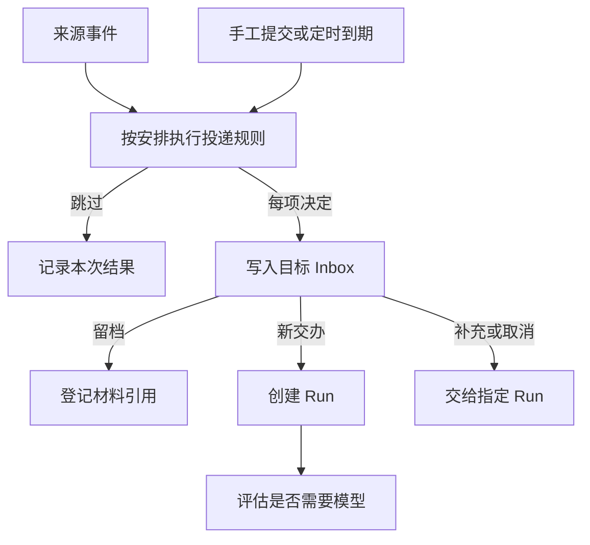
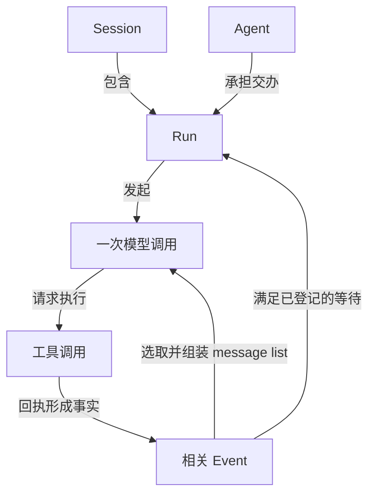
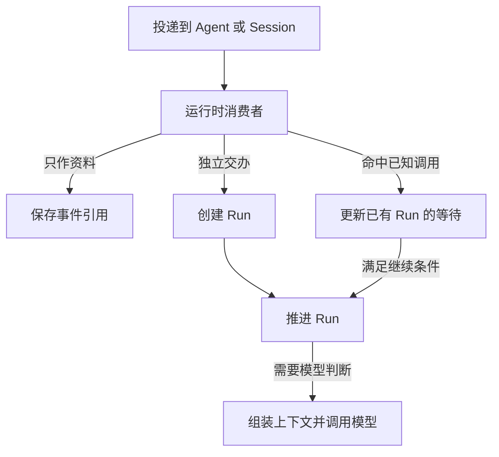

# loom-harness 设计总览

本页汇总截至 2026-11-23 的 loom-harness 设计。当前工作树只有设计文档。已经对齐的是能力和职责。下文给出的 REST 方法、事件名、订阅映射与 Rust 组件分工用于评审。本期的会话能力包括初始 section 组装和模型调用前的刷新检测。最近提出的按需开启只作用于一次 Run。Agent 可持续配置工具绑定，Session 内手动切换工具集留待以后。

[领域模型](#domain-model) · [REST API](#rest-api) · [官方插件](#official-plugins) · [扩展点](#extension-points) · [官方工具](#official-tools) · [事件目录](#official-events) · [插件订阅表](#plugin-subscriptions) · [Rust 宿主订阅表](#host-subscriptions)

2026-11-24 补充归档了[普通交办与 Goal 主动续跑](../2026-11-24-goal-continuation/design.md)和[输入框推荐插件](design.md#composer-suggestions)。[讨论笔记](../2026-11-24-goal-continuation/notes.md)保留了源码依据。

同日补充了[实例 HOME 与资源配置](design.md#instance-home)。需要部署一个插件或比较同一包的多个实例时，可查[逐插件目录与 YAML 示例](../../../../design-review.md#packages)。

2026-11-24 的[工具来源与 Toolset 归档](../2026-11-24-tool-sources/design.md)补全了工具登记到实际调用的过程。部署者可以将 HOME Lua 工具与 MCP 远端工具编为一个集合。Agent 选用后，模型看见当轮获准的成员。即使远端成员失联，仍可执行本地检查，并从具备权限的诊断入口查询远端成员为何不可用。[工具层的装配与刷新规则](tools.md#mixed-toolset)

同日确认 Session 内 Note 的创建、描述检索和原文读取。工具的大文本结果由宿主自动外置，读者可从 Session 找到原结果 Event，再沿稳定引用读取同一份原文。[Note 归档与验收](tools.md#large-tool-results)

同日确定首版使用 Redis Streams 分发已经提交的 Event。插件沿用宿主统一订阅契约。事务发件箱负责从领域存储可靠发布，各逻辑订阅独立提交消费结果后再确认。[分发与恢复约定](design.md#event-distribution)

**用一条构建报告读这份总览。** 构建系统上报一条 Event。投递安排的 Lua 规则可以给出两项决定：把原报告留给项目 Session，再请值班 Agent 排查。宿主为每项分别入箱。第一项只登记材料，第二项可产生 Run。Run 如需推理，触发插件判断时机，上下文构建插件挑选输入，模型执行器发请求。可从投递安排查到每项送达结果，再沿已创建的 Run 查模型和工具调用。



<a id="domain-model"></a>

## 领域模型

| 层次 | 对象 | 职责与关系 |
| --- | --- | --- |
| 工作主体 | Agent | 保存身份、名称、简介和基础 system prompt，关联可用能力。 |
| Agent 的创建来源 | AgentTemplate | 首版随附 `standard` 与 `creator`，第三方包也可提供模板。创建时指定实际 Agent ID，并保存独立的 `agent.yaml`。模板更新不覆盖已创建的定义。[模板格式](../../../../spec/reference/home.md#agent-templates) |
| 运行 | Session、Run | Session 给连续交办提供会话身份。一次 Run 在一个 Session 中由选定的 Agent 推进一项交办。等待期间可释放 worker，后续由同一 Run 接续，直至履行交办或进入失败、取消终态。 |
| 事实 | Event | 描述用户输入、模型回复、工具结果或配置变化等事实。各使用方按调用标识、等待条件或引用使用它。可用 Dispatch 将同一事实送往多个 Session；额外的对外通用总线订阅 API 仍待定。 |
| 来源与投递安排（对象名候选） | EventSource、Dispatch | 来源是可复用的已配置实例。一份安排定义触发时机与投递规则，供用户和获准的 Agent 共同管理。一次性安排触发一次，持续安排可反复触发。规则每次可以返回零项、一项或多项投递。 |
| 实际投递（对象名候选） | EventDelivery | 记录一条 Event 向指定 Agent 或 Session 的一次投递。可分别查询是否送达、消费者如何处理及其关联的 Session 或 Run。 |
| 订阅与消费 | 插件订阅、消费进度 | 插件实例声明关注的类型与作用范围。每条订阅独立记录处理结果。Agent、Session 是业务收件地址，订阅处理函数是实际消费者。 |
| 安排的执行记录 | 规则求值记录、投递意图 | 同一次触发留下用过的规则版本、输入和结果。零项是跳过，脚本错误单独可查，多项可分别送往不同目标。 |
| 持久收件和等待 | Inbox、Run 的等待记录 | Inbox 保存目标已收的投递。Run 保存正在等的调用、作业或决定，回执按关联接续。 |
| 上下文与工具产物 | 分支切点、压缩结果、Note 与工具原文引用 | 分支以子 Session 表达并引用冻结的历史前缀。工作笔记由模型显式创建，大文本工具原文可自动保存为只读 Note。结果 Event 和 ModelCall 可引用同一版本，分支读取时复核可见范围与来源权限。 |
| 执行明细 | ModelCall、ToolCall | ModelCall 记录一次推理和当轮输入或其引用。每个 ToolCall 有独立标识。Code Mode 的子调用关联外层调用；外部作业回执按调用与作业标识接回。 |
| 能力 | Tool、工具集、Skill | Tool 可调用，工具集可以共同登记说明。Skill 按渐进式披露提供简介和正文，可以经 Tool 接入。MCP 是工具来源，连接由 MCP 插件管理。 |
| 扩展与配置 | Plugin、插件实例、Settings | 插件登记能力或提供处理函数。插件声明配置项，harness 管理生效值并将其提供给调用上下文。实例作用域的细节仍为候选。 |
| 系统指令 | Section | 归贡献方维护，可注册、刷新、撤出。system prompt 插件据此组合 Agent 的基础指令。 |
| 工具选择与按需开启（候选） | Agent 工具绑定、Run 的开启记录 | Agent 绑定 Tool 或 Toolset，默认常开，也可标 `on_demand`。Run 记录本次已获准开启的绑定。下次模型请求据此生成同一版本的目录、原生工具和可见 section。 |
| 插件包与文档（候选） | 插件包版本、manifest、Doc | 文档声明 ID、标题、简介及随包路径。Doc 以包和版本定位，安装时建索引，工具集临时开启与文档读取分别核验。 |
| 模型输入与交付约定 | 附件引用、模型选择与尝试记录、结构化结果约束 | 本期支持图片等附件、模型选择与故障切换、按指定结构交付最终输出，分别归入输入、ModelCall 和交办的结果检查。 |
| 插件自有资源 | MCP Connection 等 | MCP 插件管理连接、将远端操作注册为 Tool。其他插件可以管理自己的业务对象，例如 Task。 |

message list 是每次模型调用从 Event 和选定材料组装出来的输入。LLM loop 是驱动 Run 的行为，`ctx` 是一次插件调用的上下文。`PluginProvider` 是 Rust 宿主的加载与调用接口，本期实现为 `LuaPluginProvider`。这些概念均有用处，持久化和对外提供 REST 资源可分别决定。

Tool 默认只通过 Code Mode 调用。显式例外只进入模型原生工具列表，Code Mode 的执行入口也在原生列表中。Toolset 的组织方式、注册接口、模型交互和 Run 接续见[工具层方案](tools.md)。

例如一次模型调用要求查两份报告。运行中可以有一个外层 Code Mode 调用和两个有独立 ID 的报告调用。子结果返回给程序，程序将汇总返回给模型。相关 Event 可单独查询，默认在下一轮 message list 中呈现外层调用与汇总。长作业可由 Run 登记等待，保存作业句柄与调用 ID 的关系。子 Session 通过冻结的前缀引用已有结果，原 Run 的等待指向已知作业，Dispatch 持续匹配指定来源的未来事件，三者分别推进。



<a id="model-io"></a>

### 首版的模型选择、故障切换、图片输入与结构化交付

这四项已列入首版范围。以下是候选执行契约，当前尚无运行实现。

| 能力 | 调用方怎样使用 | 运行与失败处理 |
| --- | --- | --- |
| 选择模型 | Agent 定义保存默认模型及有序备选。交办可在获准范围内指定模型。 | 模型执行器按输入模态、上下文大小、工具调用和最终输出约束筛选可用路由。ModelCall 留存每次尝试的实际模型、提供方与输入版本。 |
| 故障切换 | 用同一 Run 和同一推理决定继续交办。可切换的错误类型、候选模型和尝试上限取自配置。 | 临时不可用、限流等按策略重试或切到兼容备选；取消、无权访问及非法输入直接报告。每次尝试独立登记，只有被采纳的回复可以派发工具。已派发的工具按原 ToolCall 核实与接续。没有兼容备选或耗尽次数时向 Run 返回明确失败。 |
| 用户图片输入 | 客户端上传图片，取得带媒体类型的附件引用。一条输入 Event 可按序携带文字与多个图片引用，并按原投递机制进入目标。 | 宿主先检查读取权限和内容是否可用，`context.build` 保留有序的多模态内容块，模型适配器将图片编码成该提供方实际接受的图像输入。准备失败可查具体原因，图片要求保留到备选模型。 |
| 结构化结果 | 发起 `start_run` 时由交办方给出最终结果所需的 JSON Schema。Run 固定该版本，在最终结果可交付时提供结构化值。 | 模型适配器按路由能力请求相应输出，宿主在提交最终答复前独立校验。工具请求属于中间步骤。格式错误可在有限次数内要求修正，仍不合法则以 Run 失败和校验原因交回。只在校验成功后准备成功答复，交付器重发同一份已保存结果。 |

端到端验收可用一张测试失败截图。调用方要求返回包含失败用例和错误码的 JSON，并将首选模型置为暂时不可用。检查同一 Run 中能看到主备尝试、备选实际收到图片、成功返回值通过指定 schema，以及重试期间同一工具调用只按原记录处理。另测只有纯文本备选、附件不可读及模型连续返回非法 JSON 时的明确失败。这些是验收场景，尚未执行。

<a id="rest-api"></a>

## REST API

| 资源或能力 | 已讨论的接口 | 设计状态 |
| --- | --- | --- |
| Agent | `GET /api/agents`、`POST /api/agents`、`GET /api/agents/{id}`、`PATCH /api/agents/{id}` | 管理能力已定。列表、详情和更新为建议，Agent 定义可维护长期工具绑定及 `activation`。 |
| Plugin | `GET /api/plugins`、`POST /api/plugins`、`GET /api/plugins/{id}`、`PATCH /api/plugins/{id}` | 管理插件已定。候选操作包括登记包引用、查询和启停。 |
| Settings | `GET`、`PATCH /api/settings/{plugin}`，`GET /api/settings/{plugin}/schema` | 已定资源路径和自动暴露机制，方法与 schema 子路径为草案。 |
| MCP 连接 | `POST /api/mcp/connections` | 支持外部定义连接，资源由 MCP 插件提供，路径为示例。 |
| 插件业务资源 | 任务示例为 `POST /api/task`、`GET /api/task/{id}` | 启用相应插件后挂载其资源。 |
| 动态接口发现 | `GET /api/openapi.json` | 候选，描述该实例已生效的接口。 |
| Session | `POST /api/sessions`、`GET /api/sessions`、`GET /api/sessions/{id}` | 建议的会话管理入口。 |
| 新交办与 Run 查询 | 交办优先用事件投递；`GET /api/sessions/{id}/runs`、`GET /api/runs/{id}` 查结果 | 建议以 `start_run` 意图投给目标 Agent 或 Session，消费成功后可从投递结果取得 `run_id`。独立创建 Run 的资源接口仍待评审。 |
| 给当前 Run 补充输入、请求取消 | 统一使用 `POST /api/events` 和 `POST /api/events/{id}/deliveries` | 投给所属 Session，显式关联原 `run_id`。两项操作只走事件投递；`add_input`、`request_cancel` 是候选动作名。 |
| 工具目录与执行明细 | `GET /api/agents/{id}/tools`、`GET /api/runs/{id}/tool-calls` | 建议的只读接口，分别返回 Agent 绑定及默认可用性、Run 中的外层及子调用。实际出站工具以该 ModelCall 的记录为准。 |
| 大结果原文 | `GET /api/tool-calls/{id}/results/{part}/content` | 候选，只读。外部客户端可从获准的工具调用详情读取内容块。Session 的结果 Event 可定位同一份原文，文本 Note 的模型侧读取见[Note 契约](../../../../spec/reference/contracts.md#notes)。 |
| 工具回执 | 外部来源可上报带调用关联的事件；`POST /api/tool-calls/{id}/results` 为协议适配的候选入口 | 两种接入均按已派发的调用核对来源、关联和重送。核验后由宿主记录权威工具事件，按调用 ID 交回等待方。 |
| 事件管理 | `POST /api/events`、`GET /api/events`、`GET /api/events/{event_id}` | 上报、筛选、按游标续读、查单条。首次上报取得 `event_id`，可暂时没有投递目标。 |
| 显式投递 | `POST /api/events/{event_id}/deliveries`、`GET /api/events/{event_id}/deliveries` | 默认 HTTP 插件把已知 Event 的即时投递提交给投递安排层。指定 Agent 或 Session，可附消费意图，返回 `delivery_id`。按事件查各个目标的送达与处理情况。 |
| 投递安排 | `POST /api/dispatches`、`GET /api/dispatches`、`GET/PATCH /api/dispatches/{id}`、`GET /api/dispatches/{id}/deliveries` | 候选资源，支持创建即时、定时或来源驱动的安排，查询详情与实际投递，修改包括脚本与参数在内的未来生效配置。通过状态字段暂停、恢复或取消。 |
| 规则预览与触发记录 | `POST /api/dispatches/{id}/previews`、`GET /api/dispatches/{id}/evaluations` | 候选。可传候选规则与样例输入试算，正式运行可查跳过、失败或已决定的投递项。 |
| 投递管理 | `GET /api/event-deliveries/{delivery_id}`、`POST /api/event-deliveries/{delivery_id}/attempts` | 查结果或失败原因，对可重试的失败重新尝试同一次投递。 |
| 数据源 | `GET /api/event-source-types`、`GET/POST /api/event-sources`、`GET/PATCH /api/event-sources/{id}` | 候选资源。发现已安装且获准配置的类型及字段，创建、查询、修改或停用来源实例。来源到目标的转发关系在投递安排中配置。 |
| 会话分支 | `GET /api/sessions/{id}/context/items` 提供切点，`POST /api/sessions/{id}/branches` 返回子 Session | 官方 Lua 插件方案。子会话从已提交的位置独立继续。其他选材、编辑和 copy 接口可分别设计。见[会话分支](design.md#session-branch)。 |

| 与新工具配套的 REST 资源（本轮补列的候选） | 方法和路径 | 用途 |
| --- | --- | --- |
| 模型选择与用户输入 | `GET /api/models`、`POST /api/attachments`、`GET /api/attachments/{id}/content` | 列出获准模型与能力；上传或按权限读取用户附件。Agent 上配置模型与备选；输入 Event 引用附件，交办携带结果 schema，Run 详情交付结构化结果或失败原因。 |
| 版本化文档 | `GET /api/docs`、`GET /api/docs/{doc_ref}` | 按主题、来源查可见指南，再读取指向确切版本的正文。 |
| 插件包版本 | `GET/POST /api/plugins/{id}/versions`、`GET /api/plugins/{id}/versions/{version}` | 列出、提交或回读包版本及获准读取的源码。启用指定版本沿用插件管理服务。 |
| 上下文预览 | `POST /api/sessions/{id}/context/previews` | 用样本及有权读取的材料引用，只读运行与 `context.preview` 相同的组装流程。 |
| Run 的工具与模型调用 | `GET /api/runs/{id}/tools`、`GET /api/runs/{id}/model-calls`、`GET /api/model-calls/{id}` | 区分本 Run 当前能用什么、历次调用，以及某轮实际出站的可披露输入或引用。 |

按需开启通过当前 Run 的工具调用 `tool_access.activate` 完成。额外的通用管理 REST 路径仍待评审。

<a id="event-delivery"></a>

### 事件管理与投递（建议接口）

上报时，harness 按来源与来源事件 ID 识别重送，保存事实及其关联对象，返回稳定的 `event_id`。读取接口支持按来源、类型、关联对象和游标筛选。读取历史只返回资料。外部工具服务报告结果时关联原 ToolCall，由宿主核验后记录对应的工具事件。

对当前交办的补充要求和显式取消也走这条投递链。客户端把输入事件投给目标 Session，在投递中带上关联的 `run_id` 和动作。接收方核对该 Run 属于此 Session、调用方获准补充或取消以及当前状态，再幂等受理。补充内容生效后发 `run.input_received`；取消获准后发 `run.cancel_requested`，由 Run 状态机直接处理并尽可能取消已派发的动作，达到取消终态后发 `run.cancelled`。已结束的 Run 返回其实际状态。若要一次 HTTP 请求完成上报与定向投递，候选做法是在上报请求中可选携带投递参数，并一起持久登记事件和投递意图。

显式投递用于“已有一条事件，我要让某个目标使用它”。候选接口支持两种逻辑地址。发给 Agent 表示指定承担工作者，会话可由消费规则选取；发给 Session 表示指定上下文。一个投递只有一个目的地。用于指明响应 Agent 的信息即使与 Session 一起出现，也只产生一条投递。例如对 `POST /api/events/evt_42/deliveries` 发送以下请求。HTTP 的 `Idempotency-Key` 标识此次投递意图，重发同一请求可取回原投递。

```json
{
  "target": { "session_id": "session_review" },
  "action": "attach"
}
```

建议响应 `202 Accepted` 并返回 `delivery_id`。`delivered` 统一表示接收目标的收件记录已经持久保存。消费者另行记录处理结果。上例的 `attach` 表示仅将引用纳入指定分支的候选材料。`start_run` 表示明确授权发起新交办，消费成功后可取回 `run_id`。省略 `action` 时由目标对该类事件的消费规则决定；无匹配规则可保留为已收件、未触发。向已创建的分支投递时，直接使用子 Session 的 ID；切点游标用于创建分支。

<a id="message-ingress"></a>

#### 投递安排层

直接、定时、条件投递属于同一能力。用户可用 REST API 管理，也可授权 Agent 通过官方 Code Mode 工具管理。以下对象、接口和默认行为为候选设计。

- **数据源（EventSource）** 是已配置的事件入口。例如插件注册 Webhook 类型，用户用它配置“构建系统”来源。插件核验并将输入转换成带来源标识的 Event。同一来源可供多份安排引用。
- **投递安排（Dispatch）** 保存触发时机（提交时、指定时刻或周期、某个来源出现新事件）以及投递规则。简单规则可填写可选条件、内容、目标和意图，用户脚本可在每次触发时算出这些决定。按来源触发时可原样转发该 Event；手工或时间触发可使用已有 Event 引用或新消息。
- **实际投递（EventDelivery）** 记录一次来源事件或一个计划时刻命中之后的投递。保存安排、Event 和目标的关联，沿用 Inbox 收件与消费流程。

| 用户想做什么 | 触发时机 | 筛选 | 内容与动作 |
| --- | --- | --- | --- |
| 立即转交报告 | 提交时 | 无 | 将已有 Event 投给评审 Session 留档 |
| 每个工作日生成日报 | 工作日 9 点（含时区） | 无 | 每次创建一条新的“生成日报”消息，投给日报 Agent 交办 |
| 全部构建结果留档 | 构建来源出现新事件 | 无 | 原样转发给归档 Session |
| 失败时请 Agent 排查 | 同一个构建来源出现新事件 | 构建结果为失败 | 原样转发给值班 Agent，意图为新交办 |

每份安排选择一个触发时机。固定规则可直接配置字段比较、目标和意图，省略筛选就转发该来源的全部新事件。来源插件声明事件字段，供表单校验和脚本作者使用。事件驱动的安排默认从启用后收到的事件开始。“每天九点汇总昨晚的失败构建”可以定时交办给 Agent，由 Run 查询已保存的事件。每条延时、按时间窗口聚合和跨事件关联有各自的处理语义，可按需求扩展。

<a id="dispatch-rule"></a>

**自定义投递脚本。** 候选接口为 `decide(ctx) -> DeliveryIntent[]`。用户在安排上提交 Lua 源码和参数即可，建议复用 `LuaPluginProvider` 的执行能力。每次提交、到点或来源事件到达时调用选定版本的规则。上下文包含本次触发标识与时刻、按触发类型提供的 Event 或消息、安排参数和获准使用的只读能力。脚本可选择不投、决定目标与消费意图、转发原 Event 或生成新消息。一条派生消息保留来源关联，原 Event 可继续引用。普通配置与脚本产生相同格式的意图。下例展示构建 Webhook 的一份完整规则，安排参数提供归档 Session ID 和仓库到 Agent ID 的映射。

```lua
function decide(ctx)
  local event = ctx.event
  local build = event.data
  if build.status ~= "failed" then return {} end

  local out = {
    { target = { session_id = ctx.params.archive }, action = "attach", event_id = event.id }
  }
  local owner = ctx.params.repo_agents[build.repo]
  if build.branch == "main" and owner then
    out[#out + 1] = { target = { agent_id = owner }, action = "start_run", event_id = event.id }
  end
  return out
end
```

空列表表示此次成功跳过。脚本错误、超时或返回不合法的意图都记录为本次规则执行失败，生效前检查整批结果。用户和获准的 Agent 可用样例或获准读取的历史 Event 预览候选脚本，查看预计送给谁、携带什么以及消费意图。预览只返回推演结果。规则在有执行预算的 Lua 环境运行，宿主保存选定的规则和参数版本，再以绑定的输入求值；入箱、发布新消息等写操作由宿主根据返回的意图履行。

**跨入口管理。** 用户或 Agent 可以发现可用来源类型、配置或选取来源，创建、查看、修改、暂停、恢复或取消投递安排，并按安排查看每次送达和后续消费结果。HTTP 和工具使用同一应用服务、资源 ID 和校验规则，各按调用者授权限制来源、目标与消费意图。候选的 Code Mode 工具族为 `dispatch.*` 和 `dispatch.sources.*`，每种操作有独立的工具说明。来源提供方可以只向调用者开放选择既有实例的权限。已有 Event 的即时投递保留 `POST /api/events/{event_id}/deliveries`，内部创建并履行一次即时安排。两个入口对同一安排都能读到相同状态；管理操作本身不启动模型。

**执行与回执。** 创建返回稳定的 `dispatch_id`。即时入箱成功还可返回 `delivery_id`；未来某次触发的投递在实际发生后才能查到。修改或停用只影响尚未认领的触发，核对安排版本后处理并发更改。暂停期间的新输入默认跳过，运行中意外重启从持久进度接续。宿主先核验整批意图并持久保存本次决定，再逐项履行，投递前复核安排所获授权。每项有稳定的项标识。安排 ID、触发标识和项标识共同识别重试，即使同一目标有两项不同意图也可分别追踪。入箱重试沿用已存决定；后续编辑只对新的触发生效。来源提供方用稳定的上游事件标识识别重送。一个来源事件同时命中两份安排时复用同一个 Event，各自记录投递；周期触发的新消息每次有独立的 Event ID。目标持久入箱后，消费方决定留档、发起 Run 或接续已有关联。已有 Run 为某个工具登记的到期复查仍由原等待协调器接续。

<a id="event-consumer"></a>

#### 从收件到 Run 接续

外部交办、外部上报和内部运行事实都可被相关消费者按权限订阅。首版的宿主消息总线采用 Redis Streams，后端可替换。领域状态、Event 和事务发件箱在同一事务中保存，宿主可用原 `event_id` 重发。订阅按各自的权限、进度与重试状态处理。查询类 API 只读取数据。定向业务收件仍需按目标创建 EventDelivery，原调用回执按自己的关联归位。面向外部客户的通用订阅服务仍待评估。[事件分发规范](../../../../spec/architecture/runtime.md#event-distribution)

收件处理器根据目标、已授权的投递意图和已有运行关联决定怎样处理。它可以收下资料、建立新交办、将输入交给指定 Run，或按关联把事件交给已有等待。只有需要模型判断时，Run 才进入推理流程。观察同一事实的插件有各自的消费进度。

对于 `{"target":{"agent_id":"reviewer"}}` 收到的一项独立新交办，建议默认给这个 Agent 新建一个 Session 和 Run，消费结果返回二者的 ID。若交办具有已登记的关联关系，则按该关系选定会话；单凭 Agent ID 无法判定哪段旧对话相关。发给已有 Session 的交办按已确定的响应者执行；若没有唯一响应者，需请求指定或由明确路由规则选定。普通资料可在没有活跃 Run 时收下。



worker 被唤醒后读取目标已经持久收下的待处理投递。可以把同一 Run 上相容的连续补充合在一次评估中，按收件顺序固定本批的截止位置，并保存实际采用的 `delivery_id`。两项显式 `start_run` 各有自己的交办。仅作资料的投递、指定 Run 的取消及关联已有调用的决定，分别落实各自动作。宿主在同一次提交中保存各项处理结果、关联的 Run 或等待以及待执行动作，再确认消费。重投和 worker 接手沿原决定继续。检查完收件到释放 worker 之间到达的投递，也须能从持久记录中继续调度。

每次投递同时检查调用者对来源内容和目标动作的权限。相同事件投 A 和 B 分别计状态。若需重试，沿用原 `delivery_id` 和目标动作的幂等标识，恢复后先核对已生效的结果。B 投递失败时原 Event 和 A 的状态仍可读取。

一次即时投递可直接提交。面向未来来源事件的持续投递，通过一份可管理的投递安排表达。插件对内部运行事件的消费仍沿用通用订阅机制，各有自己的处理进度。

#### 等待、推理与交付

Run 登记等待时保存要等的事实、调用或作业标识，以及条件满足后应继续的动作，随即核对已有结果。例如原交办承诺验收报告，工具返回的作业号可用于查询，Run 继续等待报告。登记的检查时间到了，worker 重新读取作业状态。若交办另有“到期即交付当前结果”的约定，才按该期限推进。回执和到期检查同时到达时，同一版本的等待只提交一次后续动作。迟到的真实回执仍记入原调用。

工具派发需要人工批准时，Run 保存待审批的 ToolCall，worker 可释放。批准或拒绝沿现有外部事件入口送达，宿主核验决定者、权限、调用关联和当前等待。获准时继续派发同一 ToolCall，拒绝时按该调用的终态错误交回其直接调用者。重复决定复用原结果，取消或失效后到达的批准只记录处理结果。工具结果按调用关系返回；只有等待满足且业务需要重新评估推理时，等待协调器才发布 `run.wait_satisfied`。

默认触发插件按当前 Run 状态判断是否需要模型。宿主串行登记一次推理决定，固定本轮分支版本、材料截止位置和必需引用。上下文插件据此构建输入，模型执行器取得就绪的输入后才调用 `model.invoke`。截止后收到的普通补充留给下一次评估。若用户已改口或取消，宿主在派发工具或提交答复前核对新指令。参见[推理触发与输入组装](design.md#model-event-policies)和[插件统一订阅与消费](design.md#plugin-events)。

交付以原交办的约定为准。例如“仅失败时通知”在检查通过并保存结果后可直接完成。需要向外发送答复时，宿主先持久保存答复、目标和稳定交付标识，再由交付器按原记录发送。失败时重试同一份答复。若发送后未收到确认，优先按原标识核实或由支持幂等的接收方去重。两项能力都缺失时保留结果未知，按约定处理。承诺送达的 Run 在达到约定的确认条件后才完成。

<a id="self-management"></a>

### Agent 的日常回看与授权自管理

首版普通模板 `standard` 可查看自身配置和当前 Session 历史，查询直接投给当前 Agent 的 Inbox 事件，在当前 Session 内检索、读取或写入 Note。创造者模板 `creator` 另可启用获准的插件编写和自管理工具。模板本身不授予权限。第三方可随包提供模板，或声明按插件实例校验的 Agent 配置，两项能力独立使用。[模板范围与实例配置](design.md#agent-templates) · [可观察的验收结果](../../../../spec/goals/v1.md#agent-template-acceptance)

用户在会话里可以提出两类要求。第一类操作已有资源，例如“暂停我昨天设的定时投递”，Agent 查到相应的安排、暂停并回读状态。第二类改变以后能做的事，例如“给这个 Agent 加一个构建失败摘要工具，现在用上次失败的结果试一下”。Agent 先查当前实例已经提供什么、有哪些扩展点及其契约，优先使用已有配置或插件。确实缺乏能力时，可以按与人工开发相同的契约编写一个 Lua 插件，安装到用户指定且获授权的范围，并用真实调用检查效果。后续会话按作用范围复用该能力，用户也能要求修订或停用它。

建议把这种开放性作为每个模块和插件的设计约定。凡是用户可以委托的操作，模块应说明 Agent 如何发现并调用、从哪里看到结果。插件作者还应能按需查阅与当前版本对应的事件字段、工具签名、扩展点输入输出、用法和最小示例。新插件发布的工具通过已有 Code Mode 目录向获授权的 Agent 提供。这样，官方事先只需要定义扩展契约，用户在会话里提出的新行为也有实现和验证路径。

同一个受管理的对象可以有两种调用方。资源所属模块实现具名操作，负责参数与结果、权限、版本、幂等和实际写入。REST 适配给外部应用；需要对模型开放时，模块显式登记相应 Code Mode Tool，直接调用同一个服务。双方可以采用各自合适的接口形式，获得一致的资源 ID、作用范围、变更结果和失败原因。已经存在的 `dispatch.*` 就是投递模块的入口。插件若希望自己的 REST 资源也可被 Agent 管理，可以采用相同方式登记。工具目录只展示本次调用已获授权的操作。

| Agent 想做什么 | 候选入口与职责 |
| --- | --- |
| 了解当前可用的能力 | 先在 `catalog.search/describe` 查有哪些操作以及参数。候选只读工具 `harness.inspect` 读取当前运行实例的事实，例如获准查看的插件版本、已生效的工具和设置、可用模型或扩展点契约。返回作用域、实际生效版本和相关文档引用。只读工具 `harness.docs` 可按主题找用法，再按引用阅读匹配该版本的指南或示例。 |
| 管理会话和交办 | 将已有 Session 创建与查看操作按授权暴露为工具，创建空闲的独立 Session 后返回 ID。要继承材料可走官方 branch 操作，要发起工作沿已有 Dispatch 投递。需要两个独立会话时，管理者可各自交办；本期无专门的父子 Agent 生命周期。 |
| 管理 Agent、模型、插件设置、MCP、数据源和投递规则 | 每个资源的所有者挑选面向 Agent 的操作，例如读取已有配置、调整获准修改的值、预览或暂停一份安排。设置项可写范围与当前 Agent 可用工具分别核验。读取凭据配置返回获准的引用或状态。 |
| 创造者编写并启用获准的插件 | 提交 manifest 和 Lua 源码形成不可变的插件包版本，可直接经工具或 REST 传入。校验后由插件管理服务完成安装、启用及作用域登记。创造者按授权更新自身绑定，在下一次模型调用的实际目录中找到并调用新工具。安装、目录可见和调用成功分别可查。 |

**生效与权限。** 调用作用域由宿主绑定到实际身份与当前 Agent、Session、Run；目标标识作为请求参数单独校验。已出站的模型请求沿用原工具清单。新工具在插件启用、Agent 绑定生效并获准调用后，随下一次模型调用刷新。按需绑定还需在本 Run 开启，见[工具绑定示例](tools.md#on-demand-tools)。变更回执给出资源 ID、版本、影响范围和实际生效状态。一个 Agent 可以在已委托范围内管理设置或安装插件，不能借自己生成的 Lua、修改权限设置或冒充批准人扩大委托范围。可变更的配置项与授权上限由宿主分别管理。候选插件版本装配失败时保留上一个可用版本并返回原因；云端能按作用域确认激活后再报告已生效。

**用法验收。** 用户让 Agent “把构建报告另开一个会话整理”。Agent 创建或选定目标，用既有 Dispatch 交办，用户从 REST 查到同一个 Session 和投递。如果用户改为“接入已部署的构建 MCP 并验证可用”，优先复用已有 MCP 连接能力，给目标 Agent 绑定获准的工具，再从真实运行目录找到并调用一个只读操作。需要新增处理逻辑时才编写 Lua 插件。通过 Agent 工具与通过 REST 做同一项变更，应能读到同一版本和状态；未委托的作用域在两条入口都拒绝。

**本期范围。** 用户附件与结构化结果、模型选择与故障切换进入本期。候选验收是用户发来图片、Agent 从所选模型取得符合指定结构的最终结果；遇可切换的模型故障时，在配置范围内选择可处理该输入及输出要求的备选，核对未决工具并记录实际模型。文件环境回滚与子 Agent 委派本期暂缓。

<a id="official-plugins"></a>

## 官方插件

| 成熟度 | 插件或实现 |
| --- | --- |
| 设计已明确职责 | System Prompt 插件管理 section 生命周期，组装与同步系统指令。 |
| 投递安排（实现分工候选） | Dispatch 提供安排管理、固定规则与用户自定义脚本的求值接口及 Agent 工具。HTTP 插件适配外部请求，定时插件提供时钟触发。来源插件可登记可选的数据源类型，Webhook 作为未来接入示例。 |
| 已提出的官方交付方向 | 本次实现官方上下文压缩插件。官方 `branch` 插件已有[设计方案](design.md#session-branch)。 |
| 接入方式已明确 | MCP 用 Lua 插件接入。MCP 的随包交付范围待定。Skill 接入插件可通过 section 上报简介，也可自行提供正文读取能力。官方 Skill 正文读取工具本期暂缓。 |
| 默认能力确定，独立打包待定 | 默认模型调用、默认上下文构建和工具管理。模型调用路径承担选模与故障切换，构建与适配器传递图片，Run 在最终结果交付前校验结构。工具体系整体由官方 Lua 插件实现仍为候选。 |
| 大文本结果与 Note（分包待定） | 宿主在云端保存只读原文。上下文组装可选全文或预览，模型可凭 Note 引用回读。Note 工具也支持主动新建工作笔记和按描述检索。[Note 操作与保存](tools.md#large-tool-results) |
| 本期默认调用方式已定 | Code Mode 负责组合本轮可用工具。官方随包插件及其与 Rust 执行宿主的分工为建议。 |
| 模型消费者的两项默认策略 | 推理触发和模型输入组装均由插件机制承载。输入组装复用 Context Builder；两个扩展点可以独立更换，插件包数量待定。 |
| 日常回看、授权自管理与文档（本期交付，分包待定） | 普通模板提供自身、当前 Session、Agent Inbox 与 Note 的日常工具。创造者另可查运行状态与版本文档，通过相应资源服务管理获准的插件及设置并预览上下文。 |
| 用于解释机制的例子 | 任务插件展示动态路由，用量统计插件展示结果观察。 |

<a id="extension-points"></a>

## 扩展点

| 扩展位置 | 契约 |
| --- | --- |
| 插件载体与插件间服务 | Rust 的 `PluginProvider` 负责加载、调用和撤销注册，本期使用 `LuaPluginProvider`。插件可声明依赖、登记具名服务，其他插件通过声明的契约调用。 |
| 通用插件事件消费 | 所有插件可在启用时声明订阅。宿主按作用域投递、逐订阅记录进度；同一阶段的正式结果只接受选定实现提交。 |
| 推理触发，候选名 `model.should_invoke` | 在已有 Run 内评估新交办、补充或已满足的业务等待，建议等待或发起一次推理。宿主保存决定、输入边界和所需材料引用。 |
| 上下文组装，候选名 `context.build` | 选择、编辑、排序输入材料，生成本轮 message list，可用于压缩和读取分支。 |
| 模型调用前、执行、调用后 | `model.before_invoke` 可调整请求，`model.invoke` 选一个实现，`model.after_invoke` 观察结果或错误。标识符均为候选。 |
| Tool 和工具集接入 | 登记工具说明、参数与调用实现，可适配多个外部来源，并可贡献共同的 section。工具派发前检查 `tool.before_dispatch` 为候选。 |
| 工具执行与结果 | 每个工具绑定一个处理函数。直接调用、Code Mode 子调用复用分派检查。处理函数可返回结果、错误或异步受理信息，完成 Event 可供观察。 |
| Section 管理 | system prompt 插件向其他插件开放注册、刷新和撤出接口。Session 发起时组合初始版本，每次模型请求发送前处理相关变更。 |
| 文档注册（候选） | 官方和第三方插件在 manifest 中声明随包指南和示例。安装新版本时建索引，按版本提供文档引用。文档正文按需读取。 |
| Settings 注册 | 声明字段与校验约束，宿主提供 REST 配置服务与运行时配置。 |
| REST 服务注册与面向 Agent 的管理操作 | 模块注册资源路由，可显式注册指向同一服务的 Code Mode 工具。两种调用入口依实际身份执行相同的资源授权检查。[自管理方案](#self-management) |
| 投递规则求值（候选） | 安排绑定一份固定规则或用户脚本。每次触发通过同一契约产出零到多项投递意图，宿主负责履行。 |
| 事件接入与投递（候选） | 来源插件登记来源类型、配置与事件字段，并发布带来源的事实。触发扩展声明参数和稳定的发生标识。Dispatch 在命中后把投递交给宿主。 |

插件也可以声明依赖、使用其他插件提供的服务。Event 用于通知变化和接回运行结果，公共订阅及通用规则引擎的范围待定。插件间传递参数、只读 `ctx` 与固定调用版本的具体契约见[设计草稿](design.md)。

运行扩展点用于在指定步骤处理请求。注册接口用于声明持续生效的工具、section、配置或路由。已发生事实可通过 Event 通知。多个上下文变换按顺序参与，每次模型调用或工具调用只选择一个执行者，结果观察者可以有多个。Rust 宿主通过 `PluginProvider` 加载插件，本期实现为 `LuaPluginProvider`。模型生成的 Code Mode 程序只能使用本轮获准的工具；模型程序语言仍待评审。

<a id="official-tools"></a>

## 官方工具

| 能力 | 暴露对象 | 当前口径 |
| --- | --- | --- |
| `code_exec` | 模型原生 tools | 本期需要官方 Code Mode 执行入口，名称为候选。本轮有默认工具时提供，脚本内部不能再调用它自己。 |
| `catalog.search`、`catalog.describe` | Code Mode 脚本环境 | 候选目录接口，分别查获准的工具和参数说明。 |
| `dispatch.submit/list/get/update`、`dispatch.deliveries`（候选操作） | Code Mode 工具目录 | 创建、列举、查看或更新安排，按安排查投递。更新支持暂停、恢复和取消，每项操作按调用者授权。 |
| `dispatch.preview`、`dispatch.evaluations`（候选操作） | Code Mode 工具目录 | 用样例检查当前或待更新脚本的结果，查询一次正式触发的规则版本、跳过、错误或投递决定。 |
| `dispatch.sources.types/list/get/create/update`（候选操作） | Code Mode 工具目录 | 发现来源类型及字段，选择或管理来源实例，仅显示调用者获准的操作。 |
| 运行检查，示例名 `harness.inspect` | Code Mode 工具目录 | 创造者可查当前实例和 Agent 的实际生效版本、扩展点契约及适用事件字段，取得匹配的文档引用。 |
| 版本文档，示例名 `harness.docs` | Code Mode 工具目录 | 按主题返回可见文档的标题、简介和引用，按引用读取对应版本的正文或 Lua 示例。核心指南随 harness 版本发布，插件在 manifest 中声明随包文档。 |
| `sessions.create`、`sessions.branch`、`events.search`（候选） | Code Mode 工具目录 | 创建空会话，从指定切点建分支，或按获准的会话和事件类型查历史及结果引用。外置文本沿原结果 Event 的引用交给 `read_note` 读取，交办沿用 `dispatch.submit`。 |
| 日常回看，示例名 `agents.get`、`sessions.history`、`events.search` | Code Mode 工具目录 | 查询自身定义、当前 Session 的有序历史和直接投给自身的 Inbox 事件。读取不消费待处理投递，宿主依据调用身份检查材料权限。 |
| 修改自身、读写设置，示例名 `agents.update`、`settings.get/update` | Code Mode 工具目录 | 创造者修改自己的指令和获准工具绑定，读写受委托的插件设置。绑定受宿主授予的能力上限约束。 |
| 插件管理，示例名 `plugins.get/install/set_enabled` | Code Mode 工具目录，工具集示例 `plugins.authoring` | 按 ID 和版本读回可读的 Lua 源码及 manifest，提交一版新包，按目标启用指定版本或停用。安装校验、实际生效状态、影响范围和诊断随回执返回。 |
| 上下文预览，示例名 `context.preview` | Code Mode 工具目录 | 对指定样本、选材边界和插件版本走只读的上下文组装，显示将进入模型的工具结果或消息。传入调用方有权使用的记录与原文引用。预览期间的推理、工具重执行和事件投递次数均为零。需要新外部结果或写入的步骤返回无法预演的原因。输出标明预览，已发送请求以原 ModelCall 记录为准。 |
| `tool_access.activate`（候选） | Code Mode 工具目录 | 由工具管理插件提供，只接受 Agent 已获准的可选绑定，作用于当前 Run。Agent 工具绑定可配置 `activation: on_demand`。见[按需开启](tools.md#on-demand-tools)。 |
| `write_note`、`search_notes`、`read_note` | 授权的工具目录 | 新建 Session 工作笔记、按 `description` 字面检索、凭引用读取正文。默认读全文，显式起止行按正文从 1 起算、包含两端。[工具契约与示例](tools.md#large-tool-results) |
| `tools.call`、`tools.parallel`、`wait_for` | Code Mode 脚本环境 | 候选调用和等待接口。前两者组合调用；最后一个将异步等待交回 Run。 |

目前官方明确需要提供的模型原生入口是 Code Mode。插件显式标记的直接工具由该插件按 Agent 授权追加。MCP 动态导入的工具归对应来源。此前的 `ask_user`、查构建、读平台报告、文件读取和后台测试都是场景示例。首版通用内置业务工具清单仍待选择。

<a id="official-events"></a>

## 官方事件类型与用途（建议目录）

下面给每个已讨论环节选一组可评审的名称。发布者一栏表示谁对该事实负责，底层持久发布统一由宿主完成。插件与工程订阅者一栏只列该设计的直接消费者，观察插件可以另外按权限登记。一个事件不要求同时有两类订阅者。标为可选的分支、Skill 和视图事件随相应能力启用。插件自定义业务事件保留各自的命名空间，例如构建系统的 `job.finished` 可经授权接入。

| 事件 | 发布者 | 事实或用途 | 插件直接订阅 | Rust 直接订阅 |
| --- | --- | --- | --- | --- |
| `delivery.received` | 定向投递服务 | 目标 Agent 或 Session 已持久收件，收件处理器可读取待处理的投递。 | — | 收件处理器 |
| `session.created` | 会话服务 | 会话身份已建立，可初始化该会话的指令片段。 | System Prompt | — |
| `run.started` | Run 状态机 | 交办已建立，引用首次输入，供触发插件评估是否需要第一轮推理。 | 推理触发 | — |
| `run.input_received` | Run 状态机 | 在途 Run 已接收补充要求，保留已受理的输入引用及版本。相容的补充可以合并评估。 | 推理触发 | — |
| `run.wait_satisfied` | 等待协调器 | 需要重新评估推理的业务等待已经满足，引用该次等待及相关材料。同一版本的等待只推进一次。 | 推理触发 | — |
| `run.cancel_requested` | 收件处理器受理获准的取消动作后 | 明确请求取消指定 Run。运行时核对状态并停止后续派发。 | — | Run 状态机 |
| `model.inference_requested` | Run 状态机采纳触发建议后 | 已登记一次推理决定，带决策 ID、分支版本、材料截止位置和必要引用。 | 上下文构建 | — |
| `context.compaction_ready`（候选） | 上下文压缩插件通过宿主持久发布 | 某段已选历史的压缩结果已可读。携带覆盖前缀的版本和有序替换条目或引用。 | 上下文构建，登记可复用结果或恢复正在等待的构建 | — |
| `model.input_prepared` | 宿主验收上下文构建结果后 | 本轮 message list 已就绪，携带不可变输入引用。 | — | 模型执行器 |
| `model.input_failed` | 宿主验收上下文构建结果时 | 本轮输入构建失败或关键材料失效。记录阶段原因，决定补读、重新评估或结束。 | — | Run 状态机 |
| `model.completed` | 模型执行器 | 主 Run 的本轮推理完成，输出可能是工具请求或最终回答。最终回答依 Run 的输出契约校验。 | — | Run 状态机 |
| `model.failed` | 模型执行器 | 主 Run 的推理尝试失败，记录模型、尝试编号与原因。按同一决定重试、切换合格模型、核实不确定状态或终止。 | — | Run 状态机 |
| `tool.call_requested` | 宿主工具调用服务 | 外层或子调用已登记。携带调用 ID、直接调用者、可选父调用 ID 和实际绑定。 | — | 工具分派器 |
| `tool.accepted`、`tool.progressed` | 宿主工具调用服务 | 前者登记异步作业句柄，后者更新进度。要求等待报告时，两者都保持原等待。 | — | 工具回执分派器 |
| `tool.completed`、`tool.failed` | 宿主工具调用服务 | 调用已取得结果或明确失败。按直接调用者定向返回，含 Code Mode 的外层与子调用。 | — | 工具回执分派器 |
| `run.reply_ready` | Run 状态机 | 需要交付的答复（含已校验的结构化值）、目标和交付标识已经持久保存，可按交办约定发送。 | — | 答复交付器 |
| `run.completed`、`run.failed`、`run.cancelled` | Run 状态机 | 原交办已履约、失败或已取消。无需外发的工作可以直接完成，承诺外发的工作须达到约定的交付条件。 | — | 运行状态视图（可选） |
| `section.registered`、`section.refreshed`、`section.withdrawn` | 宿主记录贡献方的 section 变更后 | 登记新段、更新指定版本或撤出旧段。来源实例与 section ID 共同定位内容。 | System Prompt | — |
| `settings.changed` | Settings 服务 | 某插件实例的配置新版本已提交。事件只含实例与版本信息。 | MCP 接入（按需） | — |
| `tool.source_changed` | MCP 或其他工具来源插件 | 某来源可用的工具定义有变化，请工具管理重新读取该来源。 | 工具管理 | — |
| `tool.catalog_changed` | 工具管理提交目录变更后 | 生效目录已有新版本。缓存可按影响范围失效。Run 临时开启可复用带 Run 标识的通知，下一次模型调用还要核对该 Run 的绑定版本。 | — | 模型请求准备器（有缓存时） |
| `skill.catalog_changed` | 支持目录变更通知的 Skill 来源 | 技能简介或成员有变化。Skill 适配据此更新所拥有的 section；独立事件为可选。 | Skill 适配（可选） | — |
| `plugin.enabled`、`plugin.disabled` | 插件宿主完成装配或撤销后 | 已生效的插件集合改变。路由、订阅和注册清理由宿主在状态变更时落实。 | — | 服务发现视图（可选） |
| `branch.created`、`branch.updated` | 提供分支能力的插件或外部适配器 | 分支产生或编辑已提交，提供版本引用。启用分支能力时可开放。 | 上下文压缩（可选） | — |

已选来源的业务事件按来源与类型动态路由。用户输入、外部工具回执或构建报告可进入总线，具体业务名由来源契约声明。直接提交和到期回调进入同一个 Dispatch 求值入口，规则结果是可查询的执行记录。入箱才产生 `delivery.received`。工具开启、文档读取、索引更新各有直接调用或提交时机。收件后的 `attach`、`start_run`、`add_input`、`request_cancel` 表示消费意图。表中模型完成和失败的 Run 订阅限于本轮主推理，压缩使用的辅助模型调用按原构建关联接回。

候选公共字段为 `event_id`、`type`、`source`、契约版本、发生时间、关联对象和数据或引用。按场景携带 Run、调用或决策 ID。来源上报业务事实的权限与提交推理决定、工具终态等内部事实的权限分别校验。公开读取范围和保留期限仍待定。

<a id="plugin-subscriptions"></a>

## 官方插件的订阅与原因

| 插件职责 | 状态 | 建议直接订阅 | 原因或实际调用入口 |
| --- | --- | --- | --- |
| 推理触发 | 默认策略 | `run.started`、`run.input_received`、`run.wait_satisfied` | 评估已有 Run 的首次输入、生效补充或已满足的业务等待，返回推进建议。宿主按同一次就绪状态至多提交一个推理决定。 |
| 上下文构建 | 默认策略 | `model.inference_requested`、`context.compaction_ready`（启用压缩时） | 推理决定启动输入构建。压缩结果可登记供后续使用，也可恢复正在等待的同一次构建。构建器按所选分支组装材料并交付输入或错误。 |
| System Prompt | 职责已定 | `session.created`、`section.registered`、`section.refreshed`、`section.withdrawn` | 初始化会话，维护 section 投影。模型请求发送前还要按所需版本核对同步进度。 |
| 工具管理 | 默认能力，分包待定 | `tool.source_changed` | 按来源更新工具与工具集目录，只在生效版本变化时通知使用方。内置工具和静态 Lua 工具也可在启用时直接注册。临时开启工具按原调用直接处理。 |
| 投递安排 | 实现分工候选 | 启用中的来源型安排所选来源及事件类型 | 收到持久化 Event 后按安排调用规则，保存本次结果及进度，通过宿主执行各项投递。即时请求由调用入口触发，定时安排由到期回调触发。 |
| 默认 HTTP 接入、定时触发 | 官方提供方式候选 | 无固定总线订阅 | 外部 POST 提交或时钟到期后直接把请求交给 Dispatch。接入某个 Webhook 时，该来源插件发布自己识别的业务事实。 |
| 大文本结果与 Note | 官方能力，分包待定 | 无固定总线订阅 | 工具结果入库时可关联只读 Note，`context.build` 选择预览或正文。显式的 Note 工具调用经授权派发。 |
| 自管理、文档与预览 | 资源模块或官方插件，分包待定 | 无固定总线订阅 | 管理工具与预览由工具调用定向进入；文档索引随包安装或升级登记，持有查看权的 Agent 在工具集开启前即可阅读。 |
| Code Mode | 默认能力，分包待定 | 无固定总线订阅 | 作为 code_exec 的执行者被工具分派器调用。运行中的程序按子调用 ID 收返回值，外层完成后走普通工具终态事件。 |
| 默认模型调用 | 默认能力，分包待定 | 无固定总线订阅 | 模型执行器按本轮绑定调用 model.invoke，并负责记录结果。提供方只执行获选的请求。 |
| MCP 接入（按需） | Lua 接入方式已定，默认安装待定 | `settings.changed` | 只关心自己的配置实例，必要时重连或重新发现工具。远端工具由工具分派器直接调用。 |
| Skill 适配（可选） | 支持渐进式披露，打包待定 | `skill.catalog_changed` | 变化时重新上报简介；静态目录可以直接注册。有正文读取需求的插件可登记自己的工具。 |
| 上下文压缩 | 本次实现的官方插件 | `branch.created`、`branch.updated`（可选预计算） | 在 `context.build` 选材后检查实际预算，必要时摘要已结束的历史，并保留当前交办和未决工具状态。见[压缩流程](design.md#context-compaction)。 |
| `branch` | 官方 Lua 插件设计 | 由显式创建分支请求进入 | 固定来源切点、派生独立 Session，通过宿主发布 `session.created` 和 `branch.created`。原工具结果仍由其原调用接回。 |

统计插件监听 `model.completed` 的示例展示了观察能力。任务插件演示动态 REST，两者均未列入首版官方交付。插件注册后即可通过统一订阅入口获得自己的匹配事件，直接被选为工具执行者、模型提供方或有序上下文变换也可以工作。

<a id="host-subscriptions"></a>

## Rust 工程的订阅位置与原因

本表给出逻辑组件和处理位置。实际 crate、源码文件和部署进程将在实现阶段确定。定向调用指宿主按已登记的调用关系或唯一绑定交还结果。

| 工程位置 | 建议直接订阅 | 为什么在这里处理 |
| --- | --- | --- |
| 事件接入与投递服务 | 无固定总线订阅 | 接收来源上报的事实、投递安排层已触发的投递和宿主内部的请求。保存事实，按权限和幂等标识向目标 inbox 投递，供收件处理器继续。普通查询只读。 |
| 投递安排的触发执行与恢复 | 定向进入，无额外固定总线订阅 | 来源匹配、手工提交或时钟到期后绑定一次触发及规则版本，保存求值结果，再按项核验和履行。失败项按原决定重试，服务恢复后从已保存的进度继续。 |
| 发件箱发布器与消息总线适配器 | 已提交的发件箱记录 | Rust 宿主用稳定 `event_id` 发布到默认 Redis Streams，失败时续发。插件通过宿主获得事件。 |
| 插件订阅分发器 | 注册表内已获准且匹配的事件（通用分发） | 各逻辑订阅独立消费。该订阅的消费状态、引起的 Run 决定和下一动作一起提交后才 ACK。重投只补确认已完成的消费，其他订阅仍可独立追赶。匹配本身不会生成业务收件。 |
| 收件处理器 | `delivery.received` | 从目标的持久收件记录取待办，核对权限和关联。按意图归档资料、创建 Run、受理补充或取消。外部审批决定核验后按关联定向交给原等待。提交各投递的结果与待执行动作后确认消费。 |
| Run 状态机 | `run.cancel_requested`、`model.input_failed`、`model.completed`、`model.failed` | 按 Run 版本串行接受当前尝试的结果与推进建议。派发工具、提交答复前核对生效的新指令。已履约且无需通知时直接完成，有待外发的答复先登记交付。失败沿原决定处理，受理取消后停止新派发。 |
| 等待协调器 | 无固定总线订阅 | 登记和变更等待时核对已有事实，按调用或作业标识接回结果。普通检查时间到只重查。业务等待满足且需要重新评估推理时才发布 `run.wait_satisfied`。经核验的审批结果定向交回原 ToolCall 的派发流程。 |
| 模型执行器 | `model.input_prepared` | 拿到输入引用，确认决定仍有效，完成 section 和请求准备后调用唯一 provider，返回 model.completed 或 model.failed。 |
| 工具分派器 | `tool.call_requested` | 校验身份、code/direct 入口、参数和派发条件。需要审批时保存原 ToolCall，获准后继续派发该调用，拒绝则按终态错误交回。一个调用绑定一个执行者。 |
| 工具回执分派器 | `tool.accepted`、`tool.progressed`、`tool.completed`、`tool.failed` | 用调用与父调用标识区分程序子结果、顶层结果及异步作业。子结果先交还程序，顶层结果才交给 Run 的等待协调器。 |
| 答复交付器 | `run.reply_ready` | 按稳定交付标识发送已保存的答复，将确认或失败交回原 Run。结果未知时依接收端的查询或幂等能力恢复，保留无法核实的状态。 |
| 运行状态视图（可选） | `run.completed`、`run.failed`、`run.cancelled` | 按 Run 终态刷新外部可查的运行视图或通知。也可直接查询权威状态。 |
| 模型请求准备器（有缓存时） | `tool.catalog_changed` | 失效旧的工具目录。发送前仍按本轮绑定、授权和版本生成实际 tools。 |
| 插件宿主与文档索引 | 无固定总线订阅 | 安装或升级时校验包、登记版本和文档索引，启用时装配路由、订阅及工具，停用时撤回相关运行注册。文档索引按可读版本提供内容。 |
| 服务发现视图（可选） | `plugin.enabled`、`plugin.disabled` | 刷新已启用插件与动态 API 的展示。实际路由冲突检查、装配和撤销由插件宿主先完成。 |

**一次交办的核对方式。** 创建 Run 后由推理触发插件接手；上下文构建只消费已登记的推理决定；Rust 模型执行器只消费输入就绪。若模型请求通过 Code Mode 查两份报告，调用分派服务先登记外层工具，再登记两个子工具。先完成的子调用只归还程序。外层汇总完成并满足本轮等待后，才由触发插件评估下一次推理。终态错误同样可以满足等待。重送按逻辑决定、调用和尝试关联去重，已失效的尝试可保留记录。真实外部操作结果不确定时按原句柄核实。

**首版范围待评审。** 上表给出宿主与插件处理这些阶段的候选分工。工具结果先按直接调用者归位，等待协调器据后续动作选择是否发布 `run.wait_satisfied`。外部输入和内部阶段事实可由总线分发，模型请求和工具动作各由本次绑定的执行者完成。
