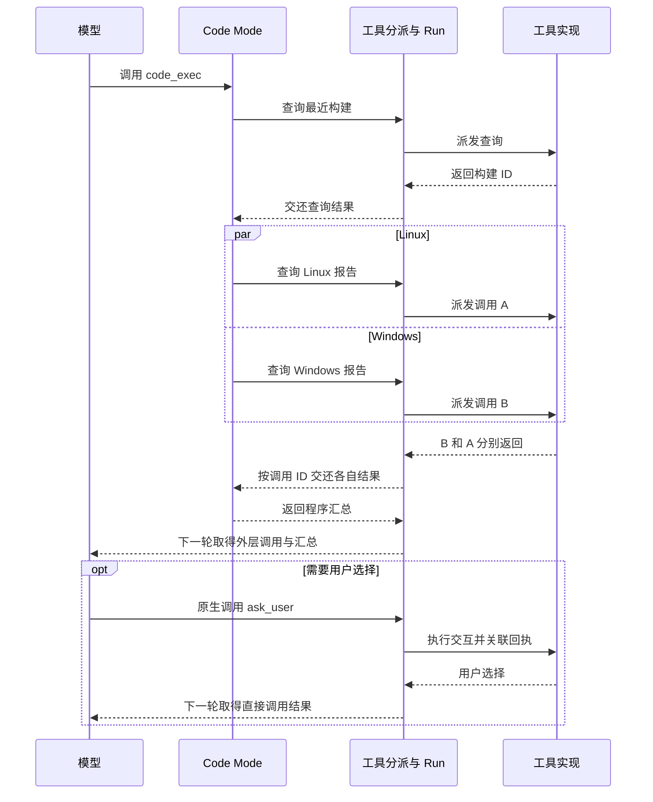

# loom-harness 工具层设计

**本期已定的规则**是业务工具默认进入 Code Mode。显式标记为不走 Code Mode 的工具只出现在模型的原生工具列表中。这条规则适用于内置工具、Lua 插件工具和 MCP 接入工具。以下对象的职责、接口名、Lua 示例、插件分工与验收案例是本轮评审方案。

## 1. 工具集、工具和一次调用

| 名称 | 建议定义 | 例子 |
| --- | --- | --- |
| Toolset（工具集） | 有稳定 ID、简介和成员引用的集合。供 Agent 选用，供模型发现，也可贡献共用的 system prompt section。工具集本身不执行动作 | “版本验收”包含查构建、查报告、询问维护人 |
| Tool（工具） | 可单独调用的操作契约。定义 ID、用途、输入参数、结果说明和调用入口。注册时绑定一个实现，宿主记下所属插件实例与版本 | `release.report` 接受构建 ID 和平台，返回结构化报告 |
| Code Mode | 模型提交一段短程序来调用本轮可用工具的方式。一段程序可以只调用一个工具，也能顺序、分支、并行调用多个工具 | `code_exec` 接收程序，返回程序选出的结果 |
| ToolCall（工具调用） | 一次具体执行。带独立调用 ID、Run、被调用的工具与版本、状态、结果或引用。由程序发起时额外关联外层调用 ID | `C1` 查询 Linux，`C2` 查询 Windows，两者属于同一次 `code_exec` 调用 `E1` |

一个插件可声明多个工具或工具集。建议 Toolset 只引用 Tool，让一个工具可以出现在多个集合中。Agent 可选择整个集合或单个工具。解析时按唯一 Tool ID 去重，每个工具只绑定一个执行者。两个 MCP 连接各自导出名为 `search` 的工具时，用稳定的连接实例命名空间区分；同一实例内的 ID 冲突使该次注册失败。展示名修改不影响 Agent 保存的引用。

## 2. 插件注册与本轮工具清单

对注册者，建议只有一个有关调用方式的可选字段 `exposure`，值为 `code` 或 `direct`，省略表示 `code`。入口由 Tool 声明，Toolset 只组织成员。MCP 插件可在本地连接配置中给特定导入工具设置显式例外。工具的远端描述只用于说明能力。

下面是 `release` 插件作者注册两个工具的 Lua 示意。同一实例已登记用于查询最近构建的 `release.latest`。注册表以插件实例为命名空间，注册成功后得到完整的工具 ID。业务参数来自模型，调用身份与配置由宿主注入。

```lua
plugin:register_tool({
  name = "report",
  description = "读取指定构建在某个平台的测试报告",
  input_schema = schemas.report_input,
  output_schema = schemas.report,
}, get_report)

plugin:register_tool({
  name = "ask_user",
  description = "请用户选择需要复核的平台",
  input_schema = schemas.platform_question,
  exposure = "direct",
}, ask_user)

plugin:register_toolset({
  name = "acceptance",
  description = "查构建、读测试报告、与用户确认验收范围",
  members = { "release.latest", "release.report", "release.ask_user" },
})
```

每次准备模型请求时，从登记目录取 Agent 选中的工具，再应用当前身份的授权、可用的插件绑定以及本 Run 已开启的可选项，形成本轮目录。按同一份目录生成以下两个输出。上一轮的结果可以继续作为历史材料，其工具入口按本轮目录重新计算。Run 按需开启是下文单独评审的候选方案。

建议选择整个工具集表示跟随它的成员变化，新成员在下一轮通过授权检查后出现；希望固定范围的 Agent 可以只选择具体 Tool ID。模型适配器负责将内部 ID 映射到供应商支持的函数名，并保存该轮反向映射。不同工具映射到同一原生名字时应在生成请求前消除冲突。

| 本轮项目 | 模型请求的顶层 `tools` | Code Mode 可查签名、可调用 |
| --- | --- | --- |
| 默认工具，如 `release.report` | 省略单独的函数声明 | 是 |
| 显式 `direct`，如 `release.ask_user` | 展示函数名和完整输入 schema | 否 |
| 宿主的 `code_exec` | 本轮有 Code Mode 工具时提供；按需方案中的开启工具也走这个入口 | 否，脚本不能递归执行入口 |
| 未选中或无权使用的工具 | 否 | 否 |

若本轮只有直接工具，可只发送这些工具。如果存在默认工具但 Code Mode 运行时未就绪，应显示该能力不可用；不能把所有默认工具临时改为直接调用。对于同一请求，模型请求、程序查目录和运行记录引用同一个目录版本。插件下线、权限撤销等实时变化在每次派发时再次检查；失败时返回明确原因，下一轮刷新目录。宿主不把旧 ID 转发到碰巧重名的新实现。

## 3. 模型怎样发现和使用工具

建议 `code_exec` 的说明列出可见工具集 ID 和一句话用途，独立工具也有入口。工具集很多时，说明中只保留查目录的方法。脚本环境提供 `catalog.search(query)` 返回可调用的工具 ID 和简介，`catalog.describe(id)` 返回完整输入与输出说明。目录与原生 schema 都由同一份注册信息生成。模型已知签名时可以直接调用；首次发现陌生工具时，可以先将签名返回给模型，由下一轮模型生成符合签名的程序。

system prompt 的 section 适合放工作约定或 Skill 简介，例如“版本验收先检查两个平台”。参数、类型和返回结构由目录提供。section、目录和原生工具列表按同一轮可用能力裁剪。工具集里的直接调用成员从原生列表发现，脚本的搜索、签名和调用接口只接受 Code Mode 成员。Skill 的正文也可沿用普通工具读取，由程序显式返回正文给模型。

<a id="on-demand-tools"></a>

### Agent 可按需开启哪些工具（首版候选）

外部通过 `PATCH /api/agents/{id}` 配置 Agent 的工具绑定。已有 Tool 和 Toolset 引用可附带 `activation`，取值 `always`（省略时的默认值）或 `on_demand`。例如在 Agent 定义中保存：

```json
{
  "tools": [
    { "tool": "harness.inspect" },
    { "tool": "tool_results.read" },
    { "toolset": "plugins.authoring", "activation": "on_demand" }
  ]
}
```

配置选中哪些能力、哪些须临时开启。工具定义的 `exposure` 继续决定调用入口。插件实例的运行参数仍通过 `/api/settings/{plugin}` 配置。两条绑定重复引用同一工具时，只要其中一条已开启，该工具按 ID 去重后即可用；工具集共用的 section 只随对应工具集启用。授予的权限和资源范围仍由宿主独立校验。

通常的 Code Mode 工具可以保持默认绑定。模型需要时查签名、直接调用。工具集如果带有较长的使用约定、直接调用成员，或只在编写插件时才用，Agent 可以只把它配置为可按需开启。开启前目录按显式筛选返回获准绑定的稳定引用、简介和状态；例如 `catalog.search("插件开发", {include = "available"})`。普通搜索继续只返回本轮可调用的 Code Mode 工具。元数据可指明某个直接工具的存在，其完整原生声明与执行入口遵循原来的互斥规则。

有合格的可选绑定时，工具管理插件提供可直接经 Code Mode 调用的 `tool_access.activate`，即使此时没有其他活动工具也提供 `code_exec`。模型用目录返回的引用请求开启，例如 `tools.call("tool_access.activate", {toolset = "plugins.authoring"})`。Run 由调用身份确定。宿主把获准的开启结果持久记入该 Run，重复请求返回已有结果；变更可发 Event 通知，工具回执交给原 Run 接续。下一次模型调用统一更新目录、原生声明及 section，当次已发出的请求和执行中的脚本仍沿用原目录版本。Run 换 worker 后继续生效，结束后自然失效。

启用范围受 Agent 已配置的绑定、插件实际状态与调用权限共同约束。安装插件或开启其开发工具集不会扩大这三项范围。开发中的工具要在本 Run 实测，可以发布到该 Agent 已获授权的测试工具集和资源范围。插件停用或授权撤回后，宿主在派发时立即拒绝失效绑定。可选工具集只影响本 Run 的可见工具和 section；插件的后台订阅和全局路由仍沿用插件自己的生命周期。

下面是**模型临时写的程序**示例，与插件作者的注册代码运行在不同环境。这里用 Lua 说明接口。建议首版用它验证交互，具体脚本语言待评审。宿主提供有并发上限的 `tools.parallel`，每项得到独立结果，返回位置对应输入位置。

```lua
local build = tools.call("release.latest", {})
if build.status ~= "ok" then return build end

local platforms = { "linux", "windows" }
local requests = {}
for i, platform in ipairs(platforms) do
  requests[i] = {
    tool = "release.report",
    args = { build_id = build.value.id, platform = platform },
  }
end

local reports = tools.parallel(requests)
local summary = {}
for i, report in ipairs(reports) do
  if report.status == "ok" then
    summary[i] = { platform = platforms[i], failed = report.value.failed_tests,
                   source = report.value.report_ref }
  else
    summary[i] = { platform = platforms[i], status = report.status,
                   call_id = report.call_id, detail = report.error }
  end
end
return summary
```

例如 Linux 有 2 项失败，Windows 报告读取超时。模型会收到两条不同的结论和相应引用，可以只重查 Windows，也可以直接调用顶层的 `release.ask_user` 请用户选择。模型只想阅读单份报告时，程序可以只有一行 `return tools.call("release.report", args)`。

## 4. 谁负责注册、授权与执行

| 组件 | 提供的接口与职责 |
| --- | --- |
| 工具管理（建议官方随包） | 提供 `register_tool`、`register_toolset`，维护命名空间、schema、成员和实现绑定，解析 Agent 本轮可用工具。插件停用时按所有者撤下注册项和 section |
| Code Mode（建议官方随包） | 提供模型入口、脚本目录和调用接口，将脚本返回值编码成外层工具结果。按本轮目录生成绑定。可使用宿主提供的隔离执行能力 |
| Rust 宿主与 Run | 提供身份、资源隔离、调用标识、授权校验、持久记录和回执关联。原生调用与程序子调用进入统一分派。宿主校验调用来自哪个入口，持久记录派发意图，再进入绑定的实现 |
| 工具实现插件 | 声明 schema，读取已校验的业务参数，在自己的 `ctx` 中取得配置和授权能力。可以立即返回结果、返回异步受理凭据或报告错误。MCP 插件在这一层转换协议 |

Lua 插件可管理自身的工具、settings、REST 路由和 section。模型脚本只取得本轮工具接口、目录、局部值和受限的执行资源；插件管理接口、原始凭据和直接访问宿主文件或网络的能力留在受信任侧。网络操作由获准工具执行。宿主对模型程序限制执行时间、内存、子调用数量、并发和输出大小。超限返回结构化错误并保留已派发调用的真实状态。

工具处理函数的候选签名为 `handler(ctx, args)`。`ctx` 由宿主提供本次调用/父调用 ID、Session、Run、插件自身的有效配置与受限宿主接口。模型只传 `args`。派发顺序为解析本轮绑定、校验入口和当前授权、校验参数、执行已登记的派发检查，然后调用唯一执行者。两条入口沿用这一顺序。审批要求独立于 `exposure`；一个需要审批的写操作也可以通过 Code Mode 发起。

**工具派发前等待审批（候选）。** 需要批准时，宿主先持久保存原 ToolCall 的待派发意图，关联审批标识、提请批准的参数和工具绑定版本，同时登记等待和应送出的审批请求。工具实现此时尚未执行。原 Run 可以释放 worker。审批方通过统一事件入口提交决定，宿主核验审批人的权限、请求标识、有效期和原调用状态。通过后在原 `call_id` 下复核当前授权和原绑定，把该次决定及待派发动作一并提交。参数发生变化或换了实现时须对变更后的操作重新提请审批。拒绝或过期可作为该调用明确的未执行结果，按已有工具回执交还直接调用者。取消后的迟到批准、重复决定均不能再创建派发动作。审批通过且动作已确定时，可直接恢复派发。

## 5. 同步、并行与异步结果



一次调用在脚本侧的观察可以是 `ok(value)`、`error(code, detail)` 或 `pending(call_id)`。所有结果都带本次调用 ID。等待超时与外部作业已经失败须分别表达。二进制、图片或大型报告可以返回受权限约束的产物引用，外层可选取模型支持的内容块输出。

* **同步或短并行。** 分派器为每个子调用登记父调用，哪个先完成就先交回它自己的结果。某一项出错时保留已完成的兄弟项。子调用 Event 可供外部观察，默认由外层程序交付一次模型可见的结果。
* **异步长任务。** 例如 `release.start_tests` 提交半小时的测试。宿主把外部作业标识与原 ToolCall 关联。工具契约若只承诺提交，受理回执即可结束该调用，后来的报告更新作业记录；若承诺返回测试报告，受理只表示进度，最终报告才结束该调用。Run 另按用户交办判断能否交付。只要任务号时可交付受理单；需要验收结论时可等待相应调用终态或已登记的作业完成事件。约定的检查时间到了，可以按原句柄查询或发送提醒。只有真实回执或查询得到的确定状态才能作为作业终态。
* **交回长等待。** 对尚待审批或正在运行的子调用，Code Mode 程序可取得 `pending(call_id)`。首版建议只支持显式交回，例如 `return wait_for({call_id})`。宿主保存需要等的调用与已有结果引用，释放脚本和 worker。条件满足后，宿主按约定组装外层结果，后续分析交给下一次需要的模型调用。若调用的是只负责提交的工具，等待测试报告应关联外部作业；等待已经完成的提交调用只能得到受理单。跨 worker 的接续点是已登记的调用和等待条件，不能依赖脚本栈、局部变量或重放前面的写操作。
* **输出与历史。** 原生调用默认投影为模型协议中的原生调用与结果。Code Mode 默认投影为外层调用与汇总或错误，子调用记录可循 ID 查看。挂起的外层调用按模型协议一次配对最终结果，恢复时才投影；原 Run 已经交付的后台回执按后续事件处理。外部投影仍可选择材料，适配模型协议时保持可见调用与结果配对。

等待登记与已有终态的检查须在同一次一致性操作中完成，覆盖“回执比等待登记先到”的情况。接收重复回执按来源实例、稳定调用/作业标识与事件标识去重，更新状态和调度下一步一起提交。宿主在派发前记下调用意图，对支持幂等的外部服务传递稳定键。若服务可能已执行而回执丢失，先按句柄或幂等键查询；无法查证时保留“结果待核实”，由策略或人决定。整段含副作用脚本不得因 worker 重启而自动重放。取消 Run 后继续保留已经派发的调用和迟到的结果，其回执不会自动重新开启该 Run。

对外可先提供两个只读视图供开发者排查：Agent 的生效工具目录（按工具展示来源、工具集、调用入口），Run 的工具调用记录（按外层和子调用查看状态及已获准访问的结果）。候选路径为 `GET /api/agents/{id}/tools` 和 `GET /api/runs/{id}/tool-calls`。Agent 视图表示当前可用范围，回看具体模型调用时以那一轮实际使用的目录版本为准。MCP 连接沿用 MCP 插件的 REST 资源，插件的配置仍经 `/api/settings/{plugin}` 管理。

<a id="large-tool-results"></a>

### 大工具结果如何保存和查看（候选）

同一 ToolCall 的结果有两种读法。直接调用者按工具契约取得返回值，模型取得适合本轮输入的表示。例如 Code Mode 子调用返回一万条结构化记录，程序可以先筛出第 9999 条，再把这一条返回给模型。脚本的内存或单次读取超限时，按声明的接口分段读取或返回明确错误。模型的预览只在直接工具结果或 Code Mode 外层结果进入 message list 时产生。

**存一份原文。** 小结果可内联在调用记录里。大结果由 Rust 宿主按内容块流式写入持久存储，保留原文或约定编码的结构化值。单机部署可用服务数据卷，多 worker 需能读取同一份持久文件或对象。宿主把稳定引用关联到已接纳的 ToolCall 结果及其内容块，记录类型、字节数和完整性。ToolCall、结果 Event、分支材料与模型输入可以引用同一份内容。已有可持久读取且已固定版本的产物可直接引用。若上游只返回日志尾部，明确记录仅保存了尾部。

**先让内容可读，再公布引用。** 完整写入后，一次提交调用终态、引用及待发布的结果事件。重复回执复用原记录。暂存成功但登记中断时可在恢复后补登记，未被引用的暂存文件可回收。工具已执行而结果保存失败时，分别记录执行状态与原文保存状态，优先按已有回执或外部句柄恢复。宿主对读取者重新校验访问权限，保留期内的有效引用应能跨 worker 读取。撤权、过期或原文缺失时，读取返回明确状态。

**决定本轮展示多少。** 宿主按字节数决定小值内联或写文件；结果展示插件在 `context.build` 中按本轮额度选择全文或短预览，同时为同一批其他工具结果留出空间。两处阈值独立。预览保留原调用对应的成功或错误状态、内容类型、大小、范围和引用，并登记这次 ModelCall 实际采用的表示。结果很大时，默认可取有界的首尾文本，工具已有的结构化概要也可使用。错误详情同样可外置，错误码和原因保留在模型可见部分。

**模型与人读同一个结果。** 建议插件通过现有 Code Mode 目录注册 `tool_results.read`，文本可指定起始行与行数，响应限制字节数并提供续读游标，长单行也能分段。可在同一读取接口加关键词定位。二进制保留媒体类型，支持受控下载或按字节范围读取。插件启用时为获准的模型调用提供对应读取路径。若当前 Agent 无可用读取工具，应在输入中说明可见范围和限制。外部客户端从已有 Run 的工具调用详情取得预览和授权内容链接，建议使用 `GET /api/tool-calls/{id}/results/{part}/content`。两种入口都按原调用权限读取，按页读取只产生有界片段。

例如日志调用返回 10 MiB 文本，模型收到原工具结果中的状态、首尾预览和引用 `r42`。模型可在 Code Mode 中调用 `tools.call("tool_results.read", {ref = "r42", start_line = 500, line_count = 30})` 取得第 500～529 行。人可以从该调用详情打开或下载原文。分支中保存引用只影响选材，读取内容时仍核对该分支当前可用权限。Claude Code 对超限且成功、不含图片的 MCP 结果采用保存文件并在会话中返回路径的做法。[Claude Code MCP 文档](https://code.claude.com/docs/en/mcp#mcp-output-limits-and-warnings)

## 6. 用哪些场景验收

| 操作 | 可检查的结果 |
| --- | --- |
| 注册两个默认和一个直接调用的工具，把所属工具集授给 Agent | 模型原生列表只有 `code_exec` 和直接工具；脚本能调用前两项；两个方向的越界调用均在执行前被拒绝 |
| Agent 只配置一个按需工具集，含 Code Mode 工具、一个直接工具和一段 section | 初始请求可发现并申请开启，开启前无法调用成员。下次请求出现 section 和原生直接工具，默认成员可经 Code Mode 调用。换 worker 能继续；同一 Agent 的其他 Run 仍从各自的绑定状态开始 |
| 两个连接导入同名工具，Agent 只选其中一个 | 目录、section 和实际分派只使用获准的实例，猜另一个实例的 ID 无法调用 |
| 一段程序顺序查构建，再并查两个平台，其中一个出错 | 工具记录含三个业务子调用，模型拿到一次外层结果，能区分失败用例与读取失败 |
| 调用前撤权，或新增 MCP 工具恰好与旧工具重名 | 旧绑定的请求得到明确错误，实际执行者无法被静默替换；后续模型请求使用刷新后的目录 |
| 待批写操作在 worker 重启后收到两次批准，或批准到达前参数被更换、权限被撤回 | 同一有效决定只登记一次原操作的派发意图。旧批准不能用来执行变更后的参数或已撤权的操作；外部执行结果不确定时按原调用核实 |
| 测试受理后 worker 重启，完成回执先于等待登记或重复到达 | 已登记的调用可查，测试只提交一次或明确报告不确定；满足等待的 Run 只接续一次 |
| 同一后台工具分别用于“只提交”和“等结果” | 前者可在取得受理单后交付，后者在取得终态后交付。两者都可以追到外部作业 |
| Code Mode 子调用从一万条记录筛出一条，另一次直接调用返回 10 MiB 日志 | 前者只将所选记录交给模型。后者换 worker 后仍可按原引用读取指定行，人也可下载同一份原文；外部工具只执行原来那一次。 |

首版评审建议把字段名、脚本语言和官方插件是否分包作为实现选择。首先验证路由互斥、两条入口一致授权、部分失败可见和异步可恢复。只有确实需要在两次模型判断间继续原脚本的局部变量时，再讨论持久脚本或额外的 `wait` 工具。

## 参考的 Codex 实现

Codex 把工具暴露方式与执行契约放在工具定义上，并区分模型与代码单元发起的调用。它的执行协议还区分观察一个运行中的单元和保持会话租约。loom-harness 的默认互斥路由、插件组织与持久等待是本项目的设计选择。[工具暴露规则](https://github.com/openai/codex/blob/main/codex-rs/tools/src/tool_executor.rs) · [调用与结果记录](https://github.com/openai/codex/blob/main/codex-rs/rollout-trace/src/model/runtime.rs) · [执行协议](https://github.com/openai/codex/blob/main/codex-rs/code-mode-protocol/src/grpc/codex.code_mode.v1.proto)
