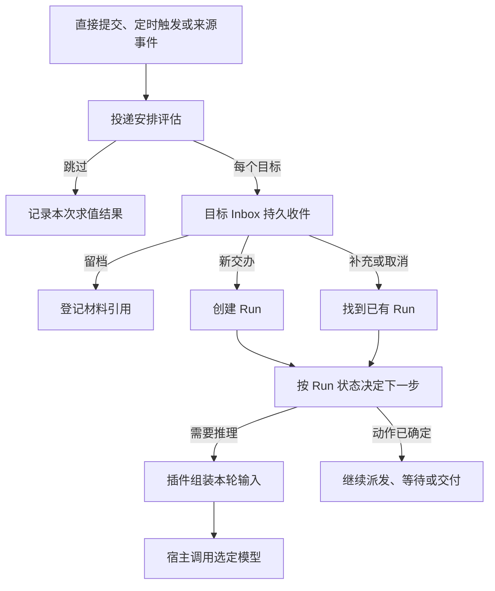
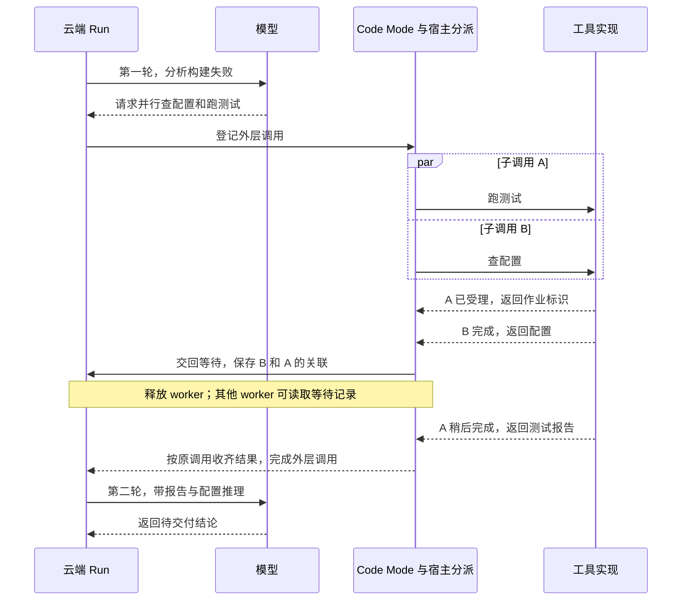

# 云端执行架构

本页描述首版运行目标和职责边界。本期采用 Redis Streams 作为默认事件总线，宿主通过适配器分发已提交的事实。状态库的部署选型、Rust crate 划分和插件分包可在实现时细化。

## 一个逻辑 API 入口与可调执行池

客户端通过同一个逻辑 API 地址交办和查询。默认部署只启动一个 `loom-harness` 进程，在进程内提供 API、运行发件箱发布循环，并以 **1 个 worker** 执行工作。需要增加执行容量时，可用同一程序独立启动执行进程。API 副本数和执行池大小可以分别调整，客户端继续使用原地址。

| 职责 | 工作方式 |
| --- | --- |
| API 入口 | 受理交办、补充和取消，按相应事务持久登记业务状态、Event 和待发布记录后即可返回受理结果。查询从已提交的状态读取。 |
| 事件发布器 | 从事务发件箱向 Redis Streams 发布已提交的事实，故障恢复后补发。发布器可以是 Loom 进程内的后台循环。 |
| 执行池 | worker 是提供执行能力的 Loom 进程。同一逻辑订阅下的多个 worker 作为同一消费组的成员领取事件，按原 Run 的状态执行已就绪的一步。其他独立订阅各有消费进度。 |
| 共享状态与文件 | 所有执行进程能读写同一份权威状态，能取得原调用固定的插件与脚本修订，并能通过授权读取同一份 Note 或其他产物。跨机器部署需要支持多进程共享访问和事务提交的状态库，以及共同可访问的持久文件。[HOME 持久化约定](../reference/home.md#persistence) |

worker 可在并发额度内同时处理多个 Run。等待 CI 最终报告或用户批准时，宿主持久登记所等对象并释放执行名额；回执到达后可由任一 worker 接续。在模型请求等待网络响应期间，进程可处理其他已就绪工作。不同 Run 可并行推进；同一 Run 按版本和原等待提交下一步，重投只形成一次有效决定，独立 ToolCall 仍可并行。

用同一批交办和固定的下游响应时延对照 1、2、4 个 worker，观察每秒成功提交的就绪 Run 步骤数，以及从宿主接纳使等待就绪的回执到对应下一步开始执行的 p95 时延。结果用于判断执行排队、状态库写入或下游配额中的哪一项限制吞吐。[执行池与性能验收](../goals/v1.md#worker-pool-acceptance)

## 从收到消息到发起推理

用户可以向一个 Session 留一份报告，也可以要求某个 Agent 根据这份报告完成工作。两种情况下都可共享同一个 Event。直接、定时和条件投递先进入统一的投递安排层。用户配置或 Lua 规则决定何时投递、目标、材料与消费意图。收件处理器按目标处理每项投递，遇到新交办时将选定的 Agent、Session 和交付约定关联到一个 Run。对已有 Run 的补充和取消走同一事件入口，按 Session 和 Run 核对后接续。

推理触发和上下文构建是两个可独立更换的插件职责。前者根据已受理的交办、补充要求和已就绪结果判断是否需要模型。后者按该次决定的材料范围组装 message list。宿主保存本轮输入或引用，核对选用的 section 和工具版本，然后由模型执行器调用本轮选定的实现。新建 Session 时组装初始 system prompt，此后每次模型调用前同步相关 section 的注册、更新与撤出。

上下文扩展可选择、编辑和排序材料。压缩产物记录其覆盖的历史范围，供后续组装引用。分支从约定的历史位置生成独立 Session，使用该切点的材料继续。原 Run 的工具回执、等待和交付责任仍由原 Run 接手。

## 事件如何发布、消费和恢复

宿主状态库保存可查询的 Event、Run、ToolCall 及其关联，单机可用 `LOOM_HOME/state/loom.db`。Redis Streams 负责把已登记的事实分发给订阅方。一个 Loom 服务进程就可以完成发布和消费。Lua 插件沿用同一套订阅声明与回调，宿主负责权限、分组、重试和确认。向 Agent 或 Session 投递材料仍须登记相应的 EventDelivery 和 Inbox 收件。[插件订阅契约](../../goal-shaping/archive/loom-agent/2026-11-23-initial/design.md#plugin-events)

| 时点 | 宿主的提交和恢复规则 |
| --- | --- |
| 业务事实成立 | 在状态库的同一事务中写入业务变更、带稳定 `event_id` 的 Event，以及该事件的待发布记录（事务发件箱）。例如，CI 回执关联到原 ToolCall 后，事件可以只引用已保存的报告。 |
| 发布到总线 | 发布器读取已提交的待发布记录，用 `XADD` 写入携带原 `event_id` 的 Stream 条目。Redis 确认成功后才标记该项已发布。服务启动时恢复扫描，Redis 暂不可用时保留待发布项。若已写入 Stream 但未记下成功，按原 `event_id` 补发，允许形成多条传输记录。 |
| 分发给订阅 | 每个独立的逻辑订阅拥有自己的消费进度。Redis 适配器用独立消费组实现这一点，通过 `XREADGROUP` 取新条目，重启时也接回组内已投递而未确认的条目。宿主按已启用的订阅、事件类型及当前权限读取事实，再交给对应处理函数。 |
| 接纳处理结果 | 宿主以“逻辑消费者标识 + `event_id`”唯一登记一次处理；插件订阅的标识包含实例和订阅 ID。消费完成记录与该处理产生的状态更新、待执行动作及后继事件的发件箱记录在同一事务内提交。需要推进 Run 时，同时核对原等待或决定及 Run 当前版本。其他订阅独立处理同一事实。 |
| 确认或重试 | 状态库提交成功后，适配器才对该组的条目执行 `XACK`。若此时进程退出，再次读到同一事件时，已完成的订阅只确认本次传输条目；尚未完成的订阅继续处理。外部模型或工具调用按已登记的动作及原调用恢复。 |

总线按至少一次送达设计，同一事实在重发后仍使用原 `event_id`。替换消息总线时，新适配器须能按稳定事件标识发布、为独立订阅保留进度、恢复未确认的消费，并在业务提交后确认。Stream 条目 ID 和 `XACK` 属于 Redis 适配器的实现细节。插件继续使用同一订阅 ID、过滤条件和回调。以“提交后尚未发布就重启”和“消费后尚未确认就重投”检验这套契约。[专项验收](../goals/v1.md#event-distribution-acceptance) · [Redis Streams 消费组](https://redis.io/docs/latest/develop/data-types/streams/#consumer-groups)

## 并行、长等待和恢复

下面的例子要求交付测试结论：第一轮模型通过 Code Mode 并行查配置和跑测试。测试工具承诺返回报告，因此“已受理”只是进度。哪个结果先到，由调用 ID 决定存放位置。

宿主按调用关系将子结果先交给其直接调用方。外层调用完成后，等待协调器判断当前交办是否可以继续。一份终态错误也能满足等待，此时结果应保留哪一项失败及其原因。只承诺提交作业的工具可以在收到句柄时结束 ToolCall；若用户要最终报告，Run 继续按外部作业标识等待。

Run 要保存已处理的输入、下一步获准执行的动作和等待的对象。恢复时先读取当前状态并核对已到事实，覆盖回执先于等待登记到达的情况。最终答复与交付标识一起保存，重试沿用该份答复。约定“仅失败时通知”的后台检查可以在成功结果保存后结束。

首个受理回执丢失时，接手的 worker 从原 ToolCall 读取派发记录，按[工具声明的恢复能力](../reference/contracts.md#外部工具的恢复能力)核实外部结果。取回作业号后保存到原调用，需要最终报告的 Run 继续等该作业。若只能确认请求可能已送达，宿主将该调用保留为“结果待核实”。普通交办和 Goal 续跑都遵守这一状态，不能把同一操作当作新调用再次提交，也不能重放包含该操作的整段 Code Mode 脚本。

查询与迟到回执可能先后确认同一事实。宿主按原调用或作业标识合并结果。对于等待最终报告的 Run，受理只更新作业进度。回执或权威查询带回报告、可读取的报告引用或明确的终态错误时，宿主在同一次状态更新中满足等待并登记下一步。重复报告只能推进同一次等待一次。

## 一轮推理结束后如何推进

宿主先核对本轮结束原因和 Run 已受理的补充、取消。模型请求工具时，继续走工具派发与回执流程。只有模型正常给出最终答复、本轮没有工具请求，宿主才把这条消息作为待交付答复。输出截断或调用失败沿模型调用的恢复或失败路径处理。

| 交付前的状态 | 原 Run 的下一步 |
| --- | --- |
| 交办约定的必要结果尚未到齐 | 按已登记的调用、作业或批准请求等待，释放 worker。结果到达后检查是否就绪。普通交办和 Goal 模式共用这条路径。 |
| 普通交办的必要结果已经就绪 | 采用本轮最终答复。调用方约定了结果结构时执行校验，随后按约定保存或发送。普通问答可直接交付。 |
| 已启用 Goal，模型结束本轮时仍有可推进的工作 | 保留阶段结果。插件请求继续推理，宿主在同一 Run 登记下一步，沿已有推理触发与上下文组装流程继续。 |
| 已启用 Goal，模型已依据产物或测试等证据显式标记目标完成，必要结果也已就绪 | 宿主按普通交办的校验与交付约定处理最终答复。 |

调用方在发起交办时显式选择官方 Goal 插件。目标、完成条件与进度随 Run 保存。宿主按 Run 当前状态提交续跑决定，换 worker 或重收同一结果时复用已登记的决定。取消生效或已配置的预算耗尽时，宿主停止主动续跑，记录实际原因。已派发调用的回执仍归原 Run。

### Goal 续跑时模型收到什么

1. **登记决定。** 宿主采纳插件的续跑请求时，在原 Run 上持久登记一次推理决定，以内部推理请求 Event 记录原 Run、决定标识和触发原因 Goal 续跑。该事件直接驱动本轮输入组装，无需向 Session 的 Inbox 再投递一条 EventDelivery。重收同一事件沿用同一逻辑 ModelCall。
2. **组装本轮输入。** 构建器取出本次决定生效的目标、完成条件和相关证据。仅当触发原因是 Goal 主动续跑时，才在所选历史之后追加一条角色为 `user`、来源为 `goal` 的内部说明。例如目标是迁完 20 个模块并跑通全量测试，说明可以写为“继续当前目标。先核对上轮记录的 14 个模块，再处理剩余工作。”
3. **留存实际输入。** 宿主随 ModelCall 保存实际发送的输入或可还原该输入的版本化引用，包括说明正文及来源。说明文本无需单独发布 Event。重试同一输入时复用原说明。Session 的收件记录和聊天中的用户发言仍取自真实投递，同一 Session 中其他 Run 的请求也不会带入这条说明。

### 活跃 Goal 与上下文压缩

每次为活跃 Goal 发起主模型推理，输入构建器都按这次决定的材料截止位置，从原 Run 取出有效目标全文、完成条件和已生效的用户约束。无论推理由 Goal 主动续跑还是由工具回执唤起，这些内容都是必需输入。压缩可以替换已结束步骤的历史。未决调用保留原 ToolCall 引用、当前状态和已取得的作业标识。作业号尚未取得时，仍可循原调用核实。本轮判断需要的报告保留原文或可回读的证据引用。

例如，Run 等待全量测试 T42 时，较早的迁移记录可以压缩。T42 返回失败报告后，宿主按原作业标识满足等待。若需要模型分析，宿主以工具回执为由登记一次推理，模型同时读到迁移目标、测试通过的条件和失败报告。此轮的新增材料是报告，Goal 续跑说明只在主动续跑轮次出现。重复回执复用同一决定。

压缩插件调用模型生成摘要时，结果只交回仍有效的输入构建，沿用其决定标识和触发原因。压缩期间已受理的用户补充或取消保存在原 Run。采用摘要前，宿主核对原决定是否有效。派发工具或交付答复前，宿主再次核对生效的约束。压缩失败但原文仍可放入窗口时，可回退使用原文。如果错误不可恢复或重试耗尽，且仍无法构建有效输入，宿主记录原因并停止该 Goal 的自动续跑。

## 模型与交付

| 阶段 | 首版预期行为 |
| --- | --- |
| 用户输入 | 保留文本和用户图片的顺序与可读引用。上下文构建和提供方适配共同保证请求中的图片能被模型实际读取。 |
| 模型选择与故障切换 | 根据配置和本轮输入、工具及输出要求选择模型。可切换故障发生时选择兼容的备选，在原 Run 记录尝试和实际模型。后续工具动作以宿主已接纳的回复为依据。 |
| 校验与交付 | 调用方可约定最终结果结构。宿主在提交成功答复前校验，保存结果或可诊断的失败。中间工具请求和部分模型输出继续沿原运行处理。 |

选模的配置优先级、故障分类、尝试上限和格式修正策略仍为候选技术契约。首版能力的可观察验收条件见[目标与验收](../goals/v1.md)。

## 输入框推荐的只读采样

上层应用通过[推荐接口](../reference/contracts.md#输入框推荐)按需发起请求。Lua 插件决定是否推荐并提供预测提示，Rust 宿主负责在指定会话快照上执行一次只读采样。Goal 主动续跑、工具回执或压缩完成均不会自行触发推荐。

1. **固定取材范围。** 宿主把请求绑定到调用者、Session、已交付的回复和预期会话版本。沿用上下文构建器的历史切点和选材逻辑，按调用者当前可见范围组装。工具结果、引用和已有摘要同样受此范围约束，无法确认摘要中材料均可见时将其排除。预测提示只用于本次采样，不写入用户聊天。
2. **限制可执行的动作。** 宿主给本次插件调用的 `ctx` 仅开放读取获准快照和调用获准模型的能力。采样复用模型路由和用量记录，使用独立的推荐额度与超时。请求没有可执行工具，结果只允许是一条文本或空值。即使模型输出工具请求，宿主也丢弃该输出并结束采样，原生工具、Code Mode 和 MCP 均不会收到派发。整个请求无需创建子 Session 或 Run，也不会唤醒已有 Run、更新 Goal 或写入 Inbox。
3. **返回前复核。** 同一调用者对同一 Session、回复、版本和生效插件配置的并发请求可以合并，前提是获准读取的材料范围相同。即使复用结果，宿主也要复核会话版本、当前权限及插件配置。新消息已受理、访问权限或配置已变更、插件已停用时，旧候选作废。采样失败、超时或额度耗尽只影响这次推荐，原回复和交付结果仍然有效。

## Rust 宿主与 Lua 插件

宿主装配 Agent 时读取已应用的定义。从模板创建时，按各消费插件实例声明的 `agent_config_schema` 校验属于该实例的配置，随新 Agent 的修订保存。运行时只把该 Agent 修订中属于本次插件实例的值交给它的 `ctx.agent_config`。实例 Settings 保持自己的作用域与生效修订。Run 保留受理时的 Agent 修订及绑定依据，ModelCall 留存当轮实际输入与工具目录，ToolCall 固定本次工具的执行者、修订和配置。替换 worker 后沿原调用恢复，派发前仍检查当前授权。插件随包工具和从 HOME 装载的独立工具走相同的执行路径。[模板与配置归属](../reference/home.md#agent-templates) · [模板验收](../goals/v1.md#agent-template-acceptance)

历史查询工具由宿主从调用上下文绑定当前 Session 与 Agent。`sessions.history()` 沿用上下文条目的读取权限，只读当前 Session 的历史。`events.search` 的 `current_agent_inbox` 范围只匹配直接定向投给当前 Agent 的收件记录。仅投给其某个 Session 的事件不匹配。工具参数不能替换当前身份或扩大查询范围。

| 所有者 | 负责的操作 |
| --- | --- |
| Rust 宿主 | 管理 Run 状态及重入、授权、持久记录、定向投递和回执关联。模型执行器与工具分派器按本次绑定调用实现。 |
| 插件加载器 | 通过 `PluginProvider` 加载和调用扩展。本期使用 `LuaPluginProvider` 在 Rust worker 内运行 Lua，转换宿主类型与 Lua 值。 |
| 扩展与默认实现 | 插件可消费事件、参与上下文组装和模型调用、提供工具或工具来源、维护 section，并声明 Settings 与对外 REST 路由。宿主提供默认执行路径。 |
| 一次插件调用 | 宿主把调用相关身份、作用域、已生效的插件配置及获准使用的接口交给 `ctx`。模型或外部调用方提供业务参数。 |
| 工具调用 | Code Mode 是默认入口，显式直接工具只从模型原生入口调用。两条路径共享宿主授权、调用标识、执行者绑定和回执处理。MCP 通过 Lua 插件接入同一工具体系。 |

创造者使用匹配版本的开发指南，在授权范围内管理自身和插件，并可预览上下文、实际调用新工具。Run 内按需开启、文档注册的具体接口、工具命名和订阅映射仍可在实现时细化。[Agent 操作契约](../reference/contracts.md#agent-操作-harness)
