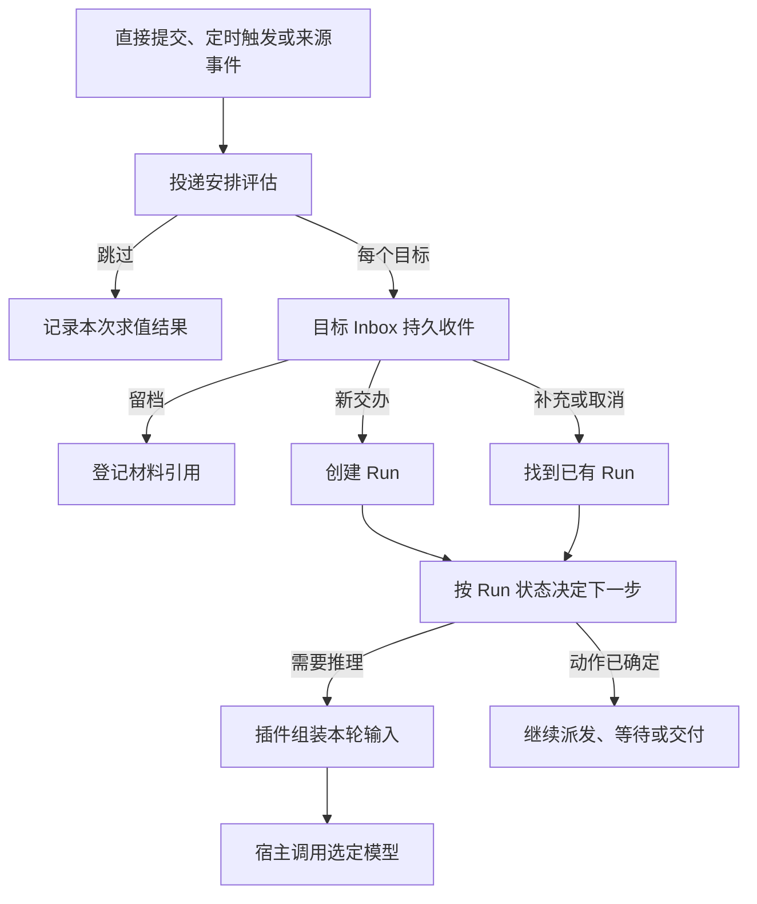
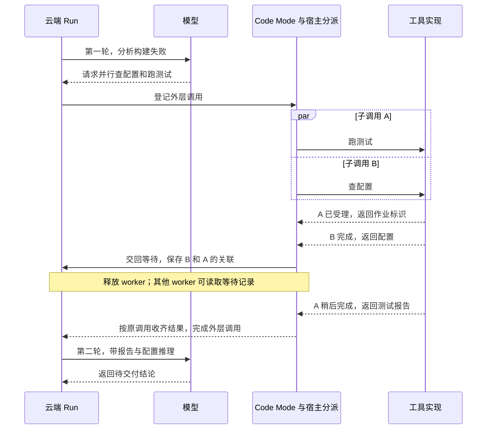

# 云端执行架构

本页描述首版运行目标和用于实现它的职责边界。图中采用逻辑组件，事件传输、持久化后端、Rust crate 划分和插件分包方式仍待实现阶段确定。

## 从收到消息到发起推理

用户可以向一个 Session 留一份报告，也可以要求某个 Agent 根据这份报告完成工作。两种情况下都可共享同一个 Event。直接、定时和条件投递先进入统一的投递安排层。用户配置或 Lua 规则决定何时投递、目标、材料与消费意图。收件处理器按目标处理每项投递，遇到新交办时将选定的 Agent、Session 和交付约定关联到一个 Run。对已有 Run 的补充和取消走同一事件入口，按 Session 和 Run 核对后接续。

推理触发和上下文构建是两个可独立更换的插件职责。前者根据已受理的交办、补充要求和已就绪结果判断是否需要模型。后者按该次决定的材料范围组装 message list。宿主保存本轮输入或引用，核对选用的 section 和工具版本，然后由模型执行器调用本轮选定的实现。新建 Session 时组装初始 system prompt，此后每次模型调用前同步相关 section 的注册、更新与撤出。

上下文扩展可选择、编辑和排序材料。压缩产物记录其覆盖的历史范围，供后续组装引用。分支从约定的历史位置生成独立 Session，使用该切点的材料继续。原 Run 的工具回执、等待和交付责任仍由原 Run 接手。

## 并行、长等待和恢复

下面的例子要求交付测试结论：第一轮模型通过 Code Mode 并行查配置和跑测试。测试工具承诺返回报告，因此“已受理”只是进度。哪个结果先到，由调用 ID 决定存放位置。

宿主按调用关系将子结果先交给其直接调用方。外层调用完成后，等待协调器判断当前交办是否可以继续。一份终态错误也能满足等待，此时结果应保留哪一项失败及其原因。只承诺提交作业的工具可以在收到句柄时结束 ToolCall；若用户要最终报告，Run 继续按外部作业标识等待。

Run 要保存已处理的输入、下一步获准执行的动作和等待的对象。恢复时先读取当前状态并核对已到事实，覆盖回执先于等待登记到达的情况。重复回执只能推进同一次等待一次。已派发动作的外部结果若无法确认，应保留“结果待核实”，可用原句柄查询。最终答复与交付标识一起保存，重试沿用该份答复。约定“仅失败时通知”的后台检查可以在成功结果保存后结束。

## 一轮推理结束后如何推进

宿主先核对本轮结束原因和 Run 已受理的补充、取消。模型请求工具时，继续走工具派发与回执流程。只有模型正常给出最终答复、本轮没有工具请求，宿主才把这条消息作为待交付答复。输出截断或调用失败沿模型调用的恢复或失败路径处理。

| 交付前的状态 | 原 Run 的下一步 |
| --- | --- |
| 交办约定的必要结果尚未到齐 | 按已登记的调用、作业或批准请求等待，释放 worker。结果到达后检查是否就绪。普通交办和 Goal 模式共用这条路径。 |
| 普通交办的必要结果已经就绪 | 采用本轮最终答复。调用方约定了结果结构时执行校验，随后按约定保存或发送。普通问答可直接交付。 |
| 已启用 Goal，模型结束本轮时仍有可推进的工作 | 保留阶段结果。插件请求继续推理，宿主在同一 Run 登记下一步，沿已有推理触发与上下文组装流程继续。 |
| 已启用 Goal，模型已依据产物或测试等证据显式标记目标完成，必要结果也已就绪 | 宿主按普通交办的校验与交付约定处理最终答复。 |

调用方在发起交办时显式选择官方 Goal 插件。目标、完成条件与进度随 Run 保存。宿主按 Run 当前状态提交续跑决定，换 worker 或重收同一结果时复用已登记的决定。取消生效或已配置的预算耗尽时，宿主停止主动续跑，记录实际原因。已派发调用的回执仍归原 Run。

### Goal 续跑时模型收到什么

1. **登记决定。** 宿主采纳插件的续跑请求时，在原 Run 上持久登记一次推理决定，以内部推理请求 Event 记录原 Run、决定标识和触发原因 Goal 续跑。该事件直接驱动本轮输入组装，无需向 Session 的 Inbox 再投递一条 EventDelivery。重收同一事件沿用同一逻辑 ModelCall。
2. **组装本轮输入。** 构建器取出本次决定生效的目标、完成条件和相关证据。仅当触发原因是 Goal 主动续跑时，才在所选历史之后追加一条角色为 `user`、来源为 `goal` 的内部说明。例如目标是迁完 20 个模块并跑通全量测试，说明可以写为“继续当前目标。先核对上轮记录的 14 个模块，再处理剩余工作。”
3. **留存实际输入。** 宿主随 ModelCall 保存实际发送的输入或可还原该输入的版本化引用，包括说明正文及来源。说明文本无需单独发布 Event。重试同一输入时复用原说明。Session 的收件记录和聊天中的用户发言仍取自真实投递，同一 Session 中其他 Run 的请求也不会带入这条说明。

### 活跃 Goal 与上下文压缩

每次为活跃 Goal 发起主模型推理，输入构建器都按这次决定的材料截止位置，从原 Run 取出有效目标全文、完成条件和已生效的用户约束。无论推理由 Goal 主动续跑还是由工具回执唤起，这些内容都是必需输入。压缩可以替换已结束步骤的历史。仍在等待的调用保留作业标识和状态，本轮判断需要的报告保留原文或可回读的证据引用。

例如，Run 等待全量测试 T42 时，较早的迁移记录可以压缩。T42 返回失败报告后，宿主按原作业标识满足等待。若需要模型分析，宿主以工具回执为由登记一次推理，模型同时读到迁移目标、测试通过的条件和失败报告。此轮的新增材料是报告，Goal 续跑说明只在主动续跑轮次出现。重复回执复用同一决定。

压缩插件调用模型生成摘要时，结果只交回仍有效的输入构建，沿用其决定标识和触发原因。压缩期间已受理的用户补充或取消保存在原 Run。采用摘要前，宿主核对原决定是否有效。派发工具或交付答复前，宿主再次核对生效的约束。压缩失败但原文仍可放入窗口时，可回退使用原文。如果错误不可恢复或重试耗尽，且仍无法构建有效输入，宿主记录原因并停止该 Goal 的自动续跑。

## 模型与交付

| 阶段 | 首版预期行为 |
| --- | --- |
| 用户输入 | 保留文本和用户图片的顺序与可读引用。上下文构建和提供方适配共同保证请求中的图片能被模型实际读取。 |
| 模型选择与故障切换 | 根据配置和本轮输入、工具及输出要求选择模型。可切换故障发生时选择兼容的备选，在原 Run 记录尝试和实际模型。后续工具动作以宿主已接纳的回复为依据。 |
| 校验与交付 | 调用方可约定最终结果结构。宿主在提交成功答复前校验，保存结果或可诊断的失败。中间工具请求和部分模型输出继续沿原运行处理。 |

选模的配置优先级、故障分类、尝试上限和格式修正策略仍为候选技术契约。首版能力的可观察验收条件见[目标与验收](../goals/v1.md)。

## Rust 宿主与 Lua 插件

| 所有者 | 负责的操作 |
| --- | --- |
| Rust 宿主 | 管理 Run 状态及重入、授权、持久记录、定向投递和回执关联。模型执行器与工具分派器按本次绑定调用实现。 |
| 插件加载器 | 通过 `PluginProvider` 加载和调用扩展。本期使用 `LuaPluginProvider` 在 Rust worker 内运行 Lua，转换宿主类型与 Lua 值。 |
| 扩展与默认实现 | 插件可消费事件、参与上下文组装和模型调用、提供工具或工具来源、维护 section，并声明 Settings 与对外 REST 路由。宿主提供默认执行路径。 |
| 一次插件调用 | 宿主把调用相关身份、作用域、已生效的插件配置及获准使用的接口交给 `ctx`。模型或外部调用方提供业务参数。 |
| 工具调用 | Code Mode 是默认入口，显式直接工具只从模型原生入口调用。两条路径共享宿主授权、调用标识、执行者绑定和回执处理。MCP 通过 Lua 插件接入同一工具体系。 |

按需工具开启、版本化文档注册、插件自管理、预览和具体订阅映射属于候选契约。各项成熟度与接口目录见[技术参考](../reference/contracts.md)。
